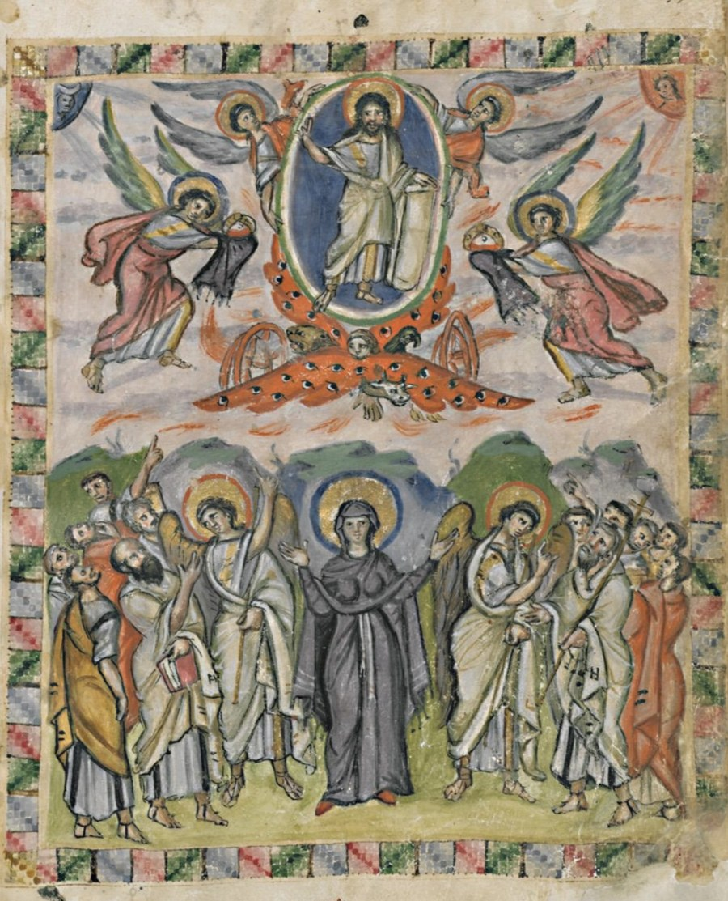

## LESSON 1

### The Core Architecture: Nouns, Pronouns, and Verbless Clauses

  
  
<em>Rabbula Gospels (586 CE), Folio 13v: Christ in majesty with the gathered disciples.</em>

---

#### Section 1: Introduction and Warm-Up

**Quick Summary**

Welcome to Syriac, the dialect of Aramaic that became a major literary language of Middle Eastern Christianity from the 2nd century through the Middle Ages. Before diving into verbs or complex syntax, we must lay the foundation of the language: nouns, pronouns, and how to string them together to make a sentence.

1. **The Alphabet**: The Syriac alphabet (Estrangela script) consists of 22 consonants, written right to left. Like Hebrew and Arabic, vowels were originally unwritten.
2. **The Noun System**: Syriac nouns have gender (masculine/feminine), number (singular/plural), and three "states" (absolute, construct, emphatic).
3. **The Emphatic State**: The default form of a Syriac noun. It ends in an Alaph (ܐ) and historically signaled the definite article ("the"), though in classical Syriac it is the standard dictionary form.

**5-Question Baseline Drill**

*(Since this is Lesson 1, these questions reflect general Semitic language principles to prime your existing knowledge. Answers are in Section 9).*

1. Semitic languages are built on root systems. How many consonants typically make up a root?
2. Looking closely at the script, in which direction is Syriac written?
3. What is a "verbless clause" in Hebrew or Arabic?
4. What consonant do you think represents the 'Alaph' (the first letter)?
5. If the Hebrew word for "king" is *melek* and Arabic is *malik*, what do you hypothesize the Aramaic/Syriac root consonants might be?

---

#### Section 2: Core Architecture — Overview

One of the most striking differences between Indo-European languages (Greek, Latin, English) and Semitic ones (Hebrew, Arabic, Syriac) is syntax and the copula ("to be"). 

In English, we say "God **is** good." In Greek, "ὁ θεὸς ἀγαθός **ἐστιν**." We require a verb to link the subject to its predicate.
In Syriac, as in Hebrew and Arabic, the "is" functions implicitly. You simply place two nouns, or a noun and an adjective, next to one another.

> **ʾAlāhā ṭāb** = God [is] good.

**Cross-Linguistic Comparison: The Definite Article**

Another major shift is how Syriac handles "the". 

*   **Hebrew** uses a prefix: הַמֶּלֶךְ (*ha-meleḵ*, "the king").
*   **Arabic** uses a prefix: الملك (*al-malik*, "the king").
*   **Greek** uses a separate word: ὁ βασιλεύς (*ho basileus*, "the king").
*   **Syriac** originally used a **suffix** (the Emphatic State Alaph: ܐ). Over time, this state became the default form. Thus, *malkā* (ܡܠܟܐ) can mean "a king" or "the king" depending on context, but it is structurally the emphatic, determinate form.

---

#### Section 3: Pronouns and Particles

**1. Independent Personal Pronouns**

Pronouns stand alone as the subject of a sentence. They distinguish gender in the 2nd and 3rd persons (unlike English "you" or "they").

**2. The Prefixed Particles `d-`, `l-`, `b-` and `w-`**

Syriac relies heavily on one-letter particles that attach directly to the front of the next word.

*   **The Relative Particle `d-` (ܕ)**: This acts like the English "of", "which", "who", or "that". It defines relationships and possession.
    *   *Malkūtā d-ʾAlāhā* (The kingdom **of** God)
    *   *Nūhrā d-ṭāb* (The light **which** is good)
*   **The Preposition `l-` (ܠ)**: This means "to" or "for", but it is also used heavily as a Direct Object marker (similar to the Hebrew `et` אֵת, though functioning prepositionally).
    *   *l-malkā* (to the king)
    *   *l-Yūḥannan* (to Yukhannan)
*   **The Preposition `b-` (ܒ)**: "in", "on", "at", "with", "by".
    *   *b-ʾarʿā* (in the land, on the earth)
*   **The Conjunction `w-` (ܘ)**: "and".
    *   *malkā w-malkūtā* (the king and the kingdom)

---

#### Section 4: Independent Pronouns Paradigm

Here are the independent personal pronouns in Syriac. Observe the similarities to other Semitic languages.

| Person | Estrangela | Transliteration | Translation | Arabic Cognate | Hebrew Cognate |
| :--- | :--- | :--- | :--- | :--- | :--- |
| **1 c.sg.** | ܐܢܐ | ʾenā | I | ʾanā (أنا) | ʾănī (אֲנִי) |
| **2 m.sg.** | ܐܢܬ | ʾant | You (m) | ʾanta (أنتَ) | ʾattāh (אַתָּה) |
| **2 f.sg.** | ܐܢܬܝ | ʾant(y) | You (f) | ʾanti (أنتِ) | ʾatt (אַתְּ) |
| **3 m.sg.** | ܗܘ | hū | He / It | huwa (هو) | hūʾ (הוּא) |
| **3 f.sg.** | ܗܝ | hī | She / It | hiya (هي) | hīʾ (הִיא) |
| **1 c.pl.** | ܚܢܢ | ḥnan | We | naḥnu (نحن) | ʾănaḥnū (אֲנַחְנוּ) |
| **2 m.pl.** | ܐܢܬܘܢ | ʾantūn | You (m.pl) | ʾantum (أنتم) | ʾattem (אַתֶּם) |
| **2 f.pl.** | ܐܢܬܝܢ | ʾantēn | You (f.pl) | ʾantunna (أنتنّ)| ʾatten (אַתֶּן) |
| **3 m.pl.** | ܗܢܘܢ | hennōn | They (m) | hum (هم) | hēm (הֵם) |
| **3 f.pl.** | ܗܢܝܢ | hennēn | They (f) | hunna (هنّ) | hēn (הֵן) |

*Note: In ʾant, ʾant(y), ʾantūn, and ʾantēn, the 'n' is historically written but silent in pronunciation (assimilated: "at", "at", "atūn", "atēn"). The final Yodh of ܐܢܬܝ is also written but silent. Throughout this course a letter that is written but not pronounced is put in parentheses in the transliteration: ʾant(y), malk(y), ktab(w).*

---

#### Section 5: Noun States, Plurals and Adjectives

For masculine singular nouns, the **absolute** state ("a king") and the **construct** state ("king of...") are identical in form: ܡܠܟ (*melek*). In the **emphatic** state (the standard dictionary form), an Alaph (*-ā*) is added to the stem (*malk-*): ܡܠܟܐ (*malkā*). For feminine abstract nouns ending in *-ūtā*, the absolute state ends in *-ū* (*malkū*) and the construct state ends in *-ūt* (*malkūt*).

| Gender | Absolute State | Construct State | Emphatic State (Default) | Transliteration |
| :--- | :--- | :--- | :--- | :--- |
| **Masc.** | ܡܠܟ (*melek*) | ܡܠܟ (*melek*) | ܡܠܟܐ | malk**ā** (King) |
| **Fem.** | ܡܠܟܘ (*malkū*) | ܡܠܟܘܬ (*malkūt*) | ܡܠܟܘܬܐ | malkūt**ā** (Kingdom) |

*Rule of Thumb: If a noun ends in -ā (Alaph), it is overwhelmingly likely to be a masculine or feminine emphatic singular (or a feminine singular absolute adjective/noun such as mellā 'word', rabbā 'great [f.abs.]').*

**Plurals and the Plural Dots (*syāmē*)**

The emphatic plural of most masculine nouns ends in *-ē*, and that of feminine nouns in *-ātā*. Because the masculine plural ending is written with the same Alaph as the singular, the two would look identical; Syriac therefore marks every plural with two dots, the *syāmē*, placed above one of the letters (on a Rish they replace its own dot).

| | Singular | Plural (emphatic) | Plural (absolute) |
| :--- | :--- | :--- | :--- |
| **Masc.** | ܡܠܟܐ *malkā* (king) | ܡ̈ܠܟܐ *malkē* (kings) | ܡ̈ܠܟܝܢ *malkīn* |
| **Fem.** | ܡܠܟܬܐ *malktā* (queen) | ܡ̈ܠܟܬܐ *malkātā* (queens) | ܡ̈ܠܟܢ *malkān* |

A few common nouns exist only in the plural: ܚ̈ܝܐ *ḥayyē* "life", ܡ̈ܝܐ *mayyā* "water".

**Adjectives: Attributive and Predicate**

An adjective follows its noun and agrees with it in gender and number. Its *state* depends on its job in the sentence:

- **Attributive** ("the good king"): the adjective takes the same state as the noun, normally the emphatic: *malkā ṭābā* (the good king), *meltā ṭābtā* (the good word).
- **Predicate** ("the king is good"): the adjective stands in the **absolute** state: *malkā ṭāb hū* (the king is good), *meltā ṭābā hī* (the word is good).

| Adjective | m.sg. absolute (predicate) | m.sg. emphatic (attributive) | f.sg. absolute (predicate) | f.sg. emphatic (attributive) |
| :--- | :--- | :--- | :--- | :--- |
| good | ܛܒ *ṭāb* | ܛܒܐ *ṭābā* | ܛܒܐ *ṭābā* | ܛܒܬܐ *ṭābtā* |
| evil | ܒܝܫ *bīš* | ܒܝܫܐ *bīšā* | ܒܝܫܐ *bīšā* | ܒܝܫܬܐ *bīštā* |
| great | ܪܒ *rab* | ܪܒܐ *rabbā* | ܪܒܐ *rabbā* | ܪܒܬܐ *rabbtā* |

Notice that the feminine absolute and the masculine emphatic are spelled and pronounced alike (*ṭābā*); the noun tells you which one you are reading. An emphatic adjective can also stand alone as a noun: *bīšā* "the evil one", *rabbā* "the great one, chief".

---

#### Section 6: Theological Vocabulary

The following core nouns feature prominently in classical Syriac literature and the Peshitta (the Syriac Bible).

| Estrangela | Translit | Gender | Meaning | Etymology / Notes |
| :--- | :--- | :--- | :--- | :--- |
| ܐܠܗܐ | ʾAlāhā | m. | God | Cognate w/ Arabic *Allāh*, Heb *ʾĔlōhīm* |
| ܒܪܢܫܐ | barnāšā | m. | Human, son of man | Compounded from *bar* (son) + *nāšā* (man). Standard term for human. |
| ܡܠܟܐ | malkā | m. | King | Semitic root *m-l-k* |
| ܡܠܟܘܬܐ | malkūtā | f. | Kingdom | Abstract noun ending *-ūtā* |
| ܡܠܬܐ | meltā | f. | Word, Logos | The Syriac translation of Greek *Logos* (John 1:1) |
| ܢܘܗܪܐ | nūhrā | m. | Light | Root *n-h-r*. Cf. Arabic *nūr* |
| ܐܪܥܐ | ʾarʿā | f. | Earth, land | Cognate with Hebrew *ʾereṣ*, Arabic *ʾarḍ* |
| ܛܒܐ | ṭābā | adj. | Good | Absolute (predicate) form ܛܒ *ṭāb*. Heb *ṭōb* |
| ܒܝܫܐ | bīšā | adj. | Evil, bad | Absolute (predicate) form ܒܝܫ *bīš*. As a noun: "the evil one". |
| ܝܘܚܢܢ | Yūḥannan | m. | John | Proper Name. |
| ܪܒܐ | rabbā | adj. | Great, large | Absolute (predicate) form ܪܒ *rab*. Root *r-b-b*. Cf. "Rabbi" (my great one). |
| ܚ̈ܝܐ | ḥayyē | m.pl.| Life | Root *ḥ-y-y*. Plural form (like Heb *ḥayyīm*) |

---

#### Section 7: The Story — Part 1

**The Setting**

*Narrative note: This introductory passage is written entirely in verbless sentences, establishing the setting and main characters using classical equational syntax, pronouns, and the relational `d-` particle.*

**Sentence 1**

ܡܠܟܐ ܗܘ 
malkā hū.
malkā (a-king) hū (he-[is]).
→ He is a king.

**Sentence 2**

ܘܡܠܟܘܬܐ ܕܡܠܟܐ ܪܒܐ ܗܝ
w-malkūtā d-malkā rabbā hī.
w- (and-) malkūtā (the-kingdom) d- (of) malkā (the-king) rabbā (great) hī (she-[is]).
→ And the kingdom of the king is great.
*(Note: 'malkūtā' is feminine, so the feminine absolute predicate adjective 'rabbā' and the pronoun 'hī' are used).*

**Sentence 3**

ܒܪܢܫܐ ܒܝܫ ܗܘ
barnāšā bīš hū.
barnāšā (the-man) bīš (evil) hū (he-[is]).
→ The man is evil.

**Sentence 4**

ܝܘܚܢܢ ܛܒ ܗܘ
Yūḥannan ṭāb hū.
Yūḥannan (John) ṭāb (good) hū (he-[is]).
→ Yukhannan is good.

**Sentence 5**

ܐܠܗܐ ܠܝܘܚܢܢ ܢܘܗܪܐ ܗܘ
ʾAlāhā l-Yūḥannan nūhrā hū.
ʾAlāhā (God) l- (to/for) Yūḥannan (John) nūhrā (light) hū (he-[is]).
→ God is light to Yukhannan.

**Sentence 6**

ܡܠܬܐ ܕܐܠܗܐ ܒܐܪܥܐ ܗܝ
meltā d-ʾAlāhā b-ʾarʿā hī.
meltā (the-word) d- (of) ʾAlāhā (God) b- (in) ʾarʿā (the-earth) hī (she-[is]).
→ The word of God is in the land.

**Sentence 7**

ܡܠܟܐ ܒܐܪܥܐ ܘܝܘܚܢܢ ܠܡܠܟܐ ܢܘܗܪܐ ܗܘ
malkā b-ʾarʿā, w-Yūḥannan l-malkā nūhrā hū.
malkā (the-king) b- (in) ʾarʿā (the-earth), w- (and) Yūḥannan (John) l- (to) malkā (the-king) nūhrā (light) hū (he-[is]).
→ The king is in the land, and Yukhannan is a light to the king.

---

#### Section 8: Exercises

**Exercise 1: Pronoun Identification**

Identify the person, gender, and number of the following pronouns, and give the English translation.

1. ܚܢܢ (ḥnan)
2. ܗܝ (hī)
3. ܐܢܬܘܢ (ʾantūn)
4. ܗܢܘܢ (hennōn)
5. ܗܘ (hū)

**Exercise 2: Morphology (Nouns)**

Identify whether the following words are taking the Emphatic State suffix (-ā). 

1. ܢܘܗܪܐ (nūhrā)
2. ܡܠܟ (melek)
3. ܛܒܐ (ṭābā)

**Exercise 3: Translation Drill (Syriac → English)**

Translate the following basic verbless clauses into English.

1. ʾAlāhā ṭāb hū.
2. Nūhrā b-malkūtā hū.
3. Yūḥannan barnāšā hū.
4. Meltā d-malkā bīšā hī.
5. ʾEnā Yūḥannan.

**Exercise 4: Production Drill (English → Syriac)**

Render the following English sentences into Syriac transliteration using verbless clauses. (Remember to include the correct 3rd person pronoun at the end to act as "is").

1. God is a great light.
2. The earth is the kingdom of God. (Earth is feminine *hī*).
3. The king is an evil man.
4. I am the king. (No "is" pronoun needed, just "I king").

**Exercise 5: Reading Comprehension**

Re-read the story in Section 7 and answer the following:

1. What adjective is used to describe the king's kingdom?
2. To whom is Yukhannan a "light"?
3. Where is the word of God?

---

#### Section 9: Answer Key

**Section 1 Warm-Up**

1. Three consonants (the triliteral root).
2. Right to left.
3. A sentence lacking a verb (like "to be"), where subject and predicate are placed adjacently (e.g., "The man [is] good").
4. Usually a glottal stop or silent carrier for a vowel.
5. m-l-k.

**Exercise 1: Pronoun Identification**

1. 1 c.pl. (We)
2. 3 f.sg. (She)
3. 2 m.pl. (You all)
4. 3 m.pl. (They, m)
5. 3 m.sg. (He)

**Exercise 2: Morphology**

1. Yes (Ends in Alaph/`ā`).
2. No (Absolute/construct state *melek*).
3. Yes (Ends in Alaph/`ā`).

**Exercise 3: Translation**

1. God is good.
2. The light is in the kingdom.
3. Yukhannan is a man.
4. The word of the king is evil. (Because *meltā* is feminine, *hī* is used).
5. I am Yukhannan.

**Exercise 4: Production**

1. ʾAlāhā nūhrā rabbā hū.
2. ʾArʿā malkūtā d-ʾAlāhā hī.
3. Malkā barnāšā bīšā hū.
4. ʾEnā malkā.

**Exercise 5: Comprehension**

1. Great (*rabbā*).
2. To the king (*l-malkā*).
3. In the land (*b-ʾarʿā*).

---

#### Section 10: Grammatical Summary

**THE VERBLESS CLAUSE — FORMATION RULES**

| Component 1 | Component 2 | Copula (Pronoun) | Translation |
| :--- | :--- | :--- | :--- |
| Subject Noun | Predicate Noun / Adjective (absolute) | Pronoun matching Subject | |
| ʾAlāhā (God) | ṭāb (good) | hū (he) | God is good. |
| Meltā (Word) | rabbā (great) | hī (she) | The word is great. |

**PRONOUN REFERENCE TABLE**

| Person | Singular | Plural |
| :--- | :--- | :--- |
| 1st Common | ʾenā (I) | ḥnan (We) |
| 2nd Masc | ʾant (You) | ʾantūn (You all) |
| 2nd Fem | ʾant(y) (You) | ʾantēn (You all) |
| 3rd Masc | hū (He) | hennōn (They) |
| 3rd Fem | hī (She) | hennēn (They) |

#### Section 11: Additional Vocabulary

The following 30 common nouns supplement this lesson's core vocabulary.

| Syriac (Estrangela) | Transliteration | Part of Speech | Meaning | Notes |
| :--- | :--- | :--- | :--- | :--- |
| ܩܪܝܬܐ | qrītā | f. noun | village | emphatic state |
| ܠܫܢܐ | leššānā | m. noun | tongue, language | |
| ܓܪܡܐ | garmā | m. noun | bone | |
| ܟܐܦܐ | kēpā | f. noun | stone, rock | |
| ܡ̈ܝܐ | mayyā | m. noun (pl.) | water | plural in form |
| ܢܘܢܐ | nūnā | m. noun | fish | |
| ܡܕܝܢܬܐ | mdīttā | f. noun | city | |
| ܫܡܫܐ | šemšā | m. noun | sun | |
| ܬܪܥܐ | tarʿā | m. noun | door, gate | |
| ܡܫܚܐ | mešḥā | m. noun | oil | |
| ܚܝܠܐ | ḥaylā | m. noun | power, army | |
| ܐܕܢܐ | ʾednā | f. noun | ear | |
| ܩܝܣܐ | qaysā | m. noun | wood, tree | |
| ܢܗܪܐ | nahrā | m. noun | river | |
| ܣܒܪܐ | sabrā | m. noun | hope | |
| ܕܚܠܬܐ | deḥltā | f. noun | fear, religion | abstract noun |
| ܣܗܪܐ | sahrā | m. noun | moon | |
| ܪܓܠܐ | reglā | f. noun | foot | |
| ܫܠܡܐ | šlāmā | m. noun | peace | common greeting |
| ܐܬܪܐ | ʾatrā | m. noun | place, country | |
| ܣܗܕܐ | sāhdā | m. noun | witness, martyr | |
| ܒܣܪܐ | besrā | m. noun | flesh | |
| ܛܝܒܘܬܐ | ṭaybūtā | f. noun | grace | |
| ܬܘܪܐ | tawrā | m. noun | bull, ox | |
| ܩܝܡܐ | qyāmā | m. noun | covenant | |
| ܐܘܪܚܐ | ʾūrḥā | f. noun | way, road | |
| ܗܝܟܠܐ | hayklā | m. noun | temple, palace | |
| ܥܝܢܐ | ʿaynā | f. noun | eye | |
| ܦܘܡܐ | pūmā | m. noun | mouth | |
| ܕܝܢܐ | dīnā | m. noun | judgment | |
