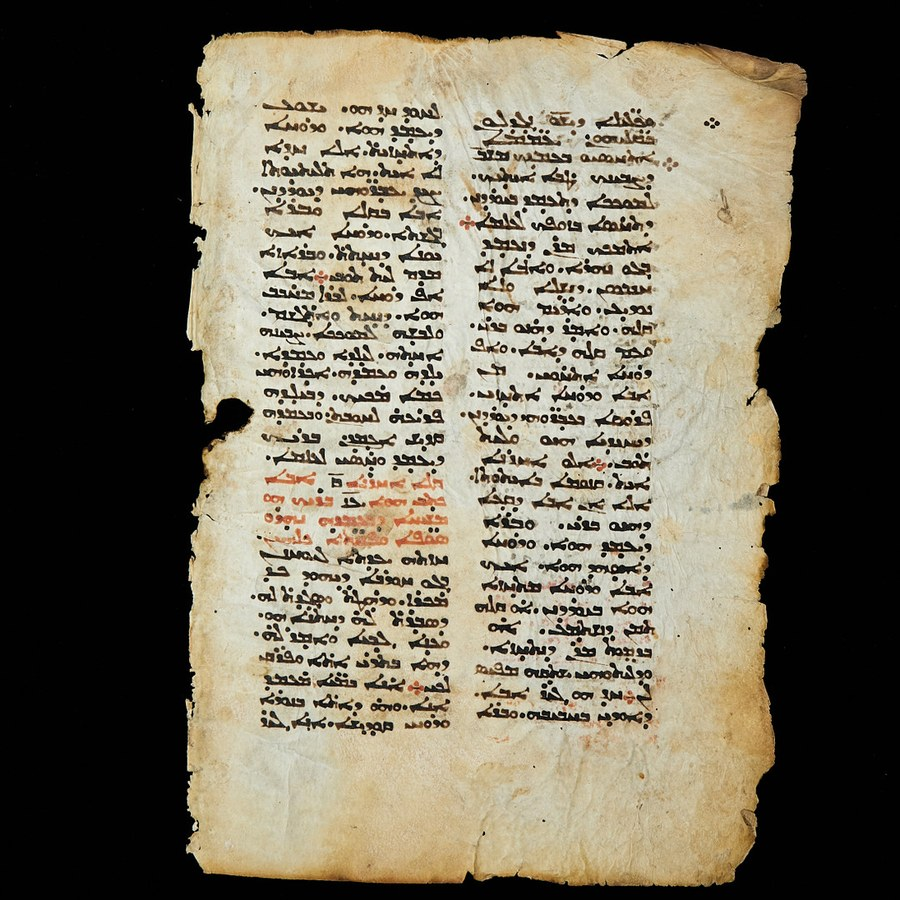

## LESSON 2

### The Narrative Present: Participles and Enclitics

  
  
<em>11th-century Syriac liturgical manuscript text page.</em>

---

#### Section 1: Review of Lesson 1

**Quick Summary**

In Lesson 1, we established the basic building blocks of Syriac syntax. We learned that Syriac sentences do not strictly require a "to be" verb; rather, placing a subject and predicate side-by-side with a matching independent pronoun acts as an equational sentence (e.g., *Malkā ṭāb hū* — "The king [is] good"). We also looked at the absolute, construct, and emphatic states of nouns, with the emphatic ending in `ā` (Alaph) acting as the default dictionary form.

**5-Question Warm-Up Drill**

*(Answers in Section 9)*

1. Translate: *ʾAlāhā rab hū*.
2. What is the Syriac construct state for "word of" (from *meltā*)?
3. How do you say "We" in Syriac?
4. What particle is used to express "of", "who", or "that"?
5. In *Malkūtā d-ʾAlāhā hī*, why is the pronoun *hī* (she) used instead of *hū* (he)?

---

#### Section 2: The Participle as Present Tense — Overview

In Indo-European languages like English and Greek, the "present tense" is a fully conjugated finite verb (e.g., "I walk", περιπατῶ). Participles are verbal adjectives (e.g., "the *walking* man").

In Aramaic and Syriac, the **active participle** stepped in to take over the function of the present tense almost entirely. A Syriac speaker didn't say "I write" as a finite verb; they literally said "Writing [am] I."

**Cross-Linguistic Comparison**

*   **Hebrew**: Biblical Hebrew primarily used the Imperfect for ongoing action, but by the Mishnaic period (interfacing with Aramaic), Hebrew also adopted the participle for the present tense (e.g., *ʾănī kōtēb* = I am writing).
*   **Arabic**: Standard Arabic relies on the imperfect prefix conjugation (يَكْتُبُ *yaktubu*, "he writes"). The active participle (كَاتِب *kātib*) means "writer" or "one who has written," but does not serve as a primary present tense verb.
*   **Greek**: Syriac's reliance on the participle to form continuous action heavily influenced how Syriac translators rendered Greek continuous tenses (often translating a Greek present indicative with a Syriac participle + pronoun).

---

#### Section 3: The Peal Active Participle & Enclitics

**The Peal Stem**

Semitic verbs exist in different "stems" (or binyanim) that modify their meaning. The basic, un-augmented ground-stem is called the **Peal**. Almost all basic actions occur in the Peal.

**Forming the Participle**

For a strong tri-consonantal root (C-C-C) like *k-t-b* (write), the active participle is formed by inserting a long *ā* after the first consonant, and an *e* after the second.

*   *kāteb* (writing, m.sg.)
*   *kātbā* (writing, f.sg.)

**Enclitic Pronouns**

To turn "writing" into "I am writing," Syriac places a personal pronoun after the participle. In pronunciation, the pronoun loses its stress and fuses with the participle as an **enclitic**; in writing, the pronoun may either stand separately (analytic spelling: ܟܬܒ ܐܢܐ *kāteb ʾenā*, pronounced *kāteb-nā*) or be written attached as a single fused word (synthetic spelling: ܟܬܒܬ *kātbat*, ܟܬܒܝܢܢ *kātbīnan*, ܟܬܒܝܬܘܢ *kātbītūn*).

*   *ʾenā* (I) $\rightarrow$ enclitic *-nā*: ܟܬܒ ܐܢܐ (*kāteb-nā*, "I am writing")
*   *ʾant* (you, m.sg.) $\rightarrow$ analytic ܟܬܒ ܐܢܬ (*kāteb ʾant*) or fused ܟܬܒܬ (*kātbat*, "you are writing")
*   *ḥnan* (we) $\rightarrow$ analytic ܟܬܒܝܢ ܚܢܢ (*kātbīn ḥnan*) or fused ܟܬܒܝܢܢ (*kātbīnan*, "we are writing")

---

#### Section 4: Participle and Enclitic Paradigms

**1. The Participle + Enclitic Present Tense Paradigm**

| Person | Independent | Analytic Spelling | Fused Enclitic Form | Translation |
| :--- | :--- | :--- | :--- | :--- |
| **1 c.sg.** | ʾenā | ܟܬܒ ܐܢܐ (*kāteb-nā* / f. ܟܬܒܐ ܐܢܐ *kātbā-nā*) | ܟܬܒܢܐ (*kātebnā* / f. *kātbānā*) | I am writing |
| **2 m.sg.** | ʾant | ܟܬܒ ܐܢܬ (*kāteb ʾant*) | ܟܬܒܬ (*kātbat*) | You (m) are writing |
| **2 f.sg.** | ʾant(y) | ܟܬܒܐ ܐܢܬܝ (*kātbā ʾant(y)*) | ܟܬܒܬܝ (*kātbat(y)*) | You (f) are writing |
| **3 m.sg.** | hū | ܟܬܒ (*kāteb*) / ܟܬܒ ܗܘ (*kāteb-hū*) | *kāteb* | He is writing / writes |
| **3 f.sg.** | hī | ܟܬܒܐ (*kātbā*) / ܟܬܒܐ ܗܝ (*kātbā-hī*) | *kātbā* | She is writing / writes |
| **1 c.pl.** | ḥnan | ܟܬܒܝܢ ܚܢܢ (*kātbīn ḥnan*) | ܟܬܒܝܢܢ (*kātbīnan* / f. *kātbānan*) | We are writing |
| **2 m.pl.** | ʾantūn | ܟܬܒܝܢ ܐܢܬܘܢ (*kātbīn ʾantūn*) | ܟܬܒܝܬܘܢ (*kātbītūn*) | You (m.pl) are writing |
| **2 f.pl.** | ʾantēn | ܟܬܒ̈ܢ ܐܢܬܝܢ (*kātbān ʾantēn*) | ܟܬܒ̈ܬܝܢ (*kātbātēn*) | You (f.pl) are writing |
| **3 m.pl.** | hennōn | ܟܬܒܝܢ (*kātbīn*) | *kātbīn* | They (m) are writing |
| **3 f.pl.** | hennēn | ܟܬܒ̈ܢ (*kātbān*) | *kātbān* | They (f) are writing |

*Notes: In the 3rd person singular, the participle usually stands alone without an enclitic. In the 3rd person plural, the plural ending (-īn / -ān) is sufficient; no enclitic is added. The feminine plural participle, like other feminine plural forms, is normally written with the plural dots (syāmē): ܟܬܒ̈ܢ.*

**2. The Peal Active Participle Declension (Root `k-t-b`)**

| Gender/Num | Estrangela | Transliteration |
| :--- | :--- | :--- |
| **Masc. Sg.** | ܟܬܒ | kāteb |
| **Fem. Sg.** | ܟܬܒܐ | kātbā |
| **Masc. Pl.** | ܟܬܒܝܢ | kātbīn |
| **Fem. Pl.** | ܟܬܒ̈ܢ | kātbān |

---

#### Section 5: Sentence Syntax

When the active participle drives the sentence, the word order is very fluid, but Verb-Subject-Object (VSO) or Subject-Verb-Object (SVO) are both common.

*   **SVO**: *Yūḥannan kāteb meltā.* (Yukhannan writes a word).
*   **VSO**: *Kāteb Yūḥannan meltā.* (Writes Yukhannan a word).
*   **Enclitic**: *Kāteb-nā meltā.* (I am writing a word).

---

#### Section 6: Vocabulary (Strong Verbs, Nouns & Adverbs)

**Verbs**

| Root | Peal Participle (m.sg.) | Meaning |
| :--- | :--- | :--- |
| ܟ.ܬ.ܒ | kāteb | to write |
| ܐ.ܙ.ܠ | ʾāzel | to go |
| ܐ.ܡ.ܪ | ʾāmer | to speak, say |
| ܫ.ܡ.ܥ | šāmaʿ* | to hear |
| ܚ.ܙ.ܝ | ܚܙܐ (ḥāzē) | to see |
| ܥ.ܒ.ܕ | ʿābed | to do, make |
| ܢ.ܛ.ܪ | nāṭer | to keep, guard |
| ܪ.ܕ.ܦ | rādep | to pursue |
| ܫ.ܒ.ܩ | šābeq | to leave |
| ܢ.ܦ.ܩ | nāpeq | to go out |

**Adverbs, Prepositions and Other Words**

| Word | Transliteration | Meaning |
| :--- | :--- | :--- |
| ܗܫܐ | hāšā | now |
| ܕܝܢ | dēn | but, then, however |
| ܬܡܢ | tammān | there |
| ܠܥܠ | lʿel | above |
| ܗܪܟܐ | harkā | here |
| ܥܡ | ʿam | with |
| ܥܠ | ʿal | upon, against |
| ܡܢ | men | from |
| ܐܝܬ | ʾīt | there is / are |
| ܬܠܡܝܕܐ | talmīdā | disciple (pl. ܬܠܡܝ̈ܕܐ *talmīdē*) |

*\*Note: Roots ending in gutturals (like ʿAyn) change the `e` to an `a` (šāmaʿ instead of šāmeʿ). For III-Yodh roots like ḥ-z-y ("see"), the m.pl. participle is ḥāzēn (ܚܙܝܢ), contracting to ḥāzēnan ("we see") or ḥāzētūn ("you [m.pl.] see").*

---

#### Section 7: The Story — Part 2

**Preparation**

*Narrative note: The present tense (participle + enclitics) is used here to create an immediate, action-oriented dialogue as Yukhannan prepares his disciples.*

**Sentence 1**

ܝܘܚܢܢ ܐܡܪ ܠܬܠܡܝ̈ܕܐ ܕܐܝܬ ܠܗ
Yūḥannan ʾāmer l-talmīdē d-ʾīt leh.
Yūḥannan (John) ʾāmer (is-speaking) l- (to) talmīdē (the-disciples) d- (that) ʾīt (there-are) leh (to-him).
→ Yukhannan is speaking to the disciples that are his (lit. "that there are to him", previewing Lesson 4's possession idiom).

**Sentence 2**

ܐܙܠ ܐܢܐ ܡܢ ܗܪܟܐ
ʾāzel-nā men harkā.
ʾāzel (going) -nā (am-I) men (from) harkā (here).
→ "I am going from here."

**Sentence 3**

ܐܙܠ ܐܢܐ ܠܡܠܟܘܬܐ ܕܒܝܫܐ ܐܡܪ ܗܘ
ʾāzel-nā l-malkūtā d-bīšā, ʾāmer-hū.
ʾāzel (going) -nā (am-I) l- (to) malkūtā (the-kingdom) d- (of) bīšā (the-evil-[one]), ʾāmer (says) -hū (he).
→ "I am going to the kingdom of the evil one," he says.

**Sentence 4**

ܬܠܡܝ̈ܕܐ ܫܡܥܝܢ ܡܠܬܐ ܕܝܘܚܢܢ
talmīdē šāmʿīn meltā d-Yūḥannan.
talmīdē (the-disciples) šāmʿīn (are-hearing) meltā (the-word) d- (of) Yūḥannan (John).
→ The disciples hear the word of Yukhannan.

**Sentence 5**

ܗܢܘܢ ܐܡܪܝܢ ܚܙܝܢ ܚܢܢ ܡܠܟܐ ܒܝܫܐ ܬܡܢ
hennōn ʾāmrīn: ḥāzēn ḥnan malkā bīšā tammān.
hennōn (they) ʾāmrīn (are-saying): ḥāzēn (seeing) ḥnan (are-we) malkā (a-king) bīšā (evil) tammān (there).
→ They say: "We see an evil king there."

**Sentence 6**

ܝܘܚܢܢ ܥܒܕ ܢܘܗܪܐ ܒܐܪܥܐ
Yūḥannan ʿābed nūhrā b-ʾarʿā.
Yūḥannan (John) ʿābed (is-making/doing) nūhrā (light) b- (in) ʾarʿā (the-earth).
→ Yukhannan makes light in the earth.

**Sentence 7**

ܟܬܒ ܐܢܐ ܡܠܬܐ ܕܐܠܗܐ ܐܡܪ ܗܫܐ
kāteb-nā meltā d-ʾAlāhā, ʾāmer hāšā.
kāteb (writing) -nā (am-I) meltā (the-word) d- (of) ʾAlāhā (God), ʾāmer (says-[he]) hāšā (now).
→ "I am writing the word of God," he says now.

---

#### Section 8: Exercises

**Exercise 1: Participle Identification**

Identify the gender and number of the following participles.

1. ܟܬܒܝܢ (kātbīn)
2. ܫܡܥܐ (šāmʿā)
3. ܢܦܩ̈ܢ (nāpqān)
4. ܪܕܦ (rādep)

**Exercise 2: Conjugation Drill**

Combine the root *ʿ-b-d* (to do, make) with the correct pronoun/enclitic to form the present tense for:

1. I am making (m.sg)
2. We are making (m.pl)
3. You (f.sg) are making
4. They (m.pl) are making

**Exercise 3: Translation Drill (Syriac → English)**

Translate the following present tense clauses.

1. ʾĀzel-nā l-malkūtā.
2. Šāmʿīn ʾantūn (or *šāmʿītūn*) meltā d-ʾAlāhā.
3. Barnāšā bīšā rādep l-Yūḥannan.
4. Ḥāzēn ḥnan (or *ḥāzēnan*) nūhrā rabbā tammān.

**Exercise 4: Production Drill (English → Syriac)**

Render the following active present sentences into Syriac transliteration.

1. I (m) am hearing the word.
2. She is writing a good word.
3. They (m) are going from here.
4. You (m.pl) are seeing the king.

**Exercise 5: Reading Comprehension**

Re-read Section 7 and answer:

1. From where does Yukhannan say he is going?
2. What do the disciples say they see there?
3. What is Yukhannan "writing" right now?

---

#### Section 9: Answer Key

**Section 1 Warm-Up**

1. God is great.
2. *Mellat* (ܡܠܬ; the absolute state is *mellā* ܡܠܐ).
3. *ḥnan*
4. *d-*
5. Because *malkūtā* (kingdom) is a feminine noun.

**Exercise 1: Participle Identification**

1. Masculine Plural
2. Feminine Singular
3. Feminine Plural
4. Masculine Singular

**Exercise 2: Conjugation Drill**

1. *ʿābed-nā* (ܥܒܕ ܐܢܐ, or fused ܥܒܕܢܐ)
2. *ʿābdīn ḥnan* or fused *ʿābdīnan* (ܥܒܕܝܢ ܚܢܢ / ܥܒܕܝܢܢ)
3. *ʿābdā ʾant(y)* or fused *ʿābdat(y)* (ܥܒܕܐ ܐܢܬܝ / ܥܒܕܬܝ)
4. *ʿābdīn* (ܥܒܕܝܢ — no enclitic needed for 3rd person pl)

**Exercise 3: Translation Drill**

1. I am going to the kingdom.
2. You all are hearing the word of God.
3. The evil man is pursuing Yukhannan.
4. We are seeing a great light there.

**Exercise 4: Production Drill**

1. Šāmaʿ-nā meltā.
2. Kātbā meltā ṭābtā.
3. ʾĀzlīn men harkā.
4. Ḥāzēn ʾantūn (or *ḥāzētūn*) l-malkā.

**Exercise 5: Reading Comprehension**

1. "From here" (*men harkā*).
2. An evil king (*malkā bīšā*).
3. The word of God (*meltā d-ʾAlāhā*).

---

#### Section 10: Grammatical Summary

**PARTICIPLE + ENCLITIC COMBINATIONS (Masc. Root k-t-b)**

| English | Participle | Analytic Spelling | Fused Enclitic Form |
| :--- | :--- | :--- | :--- |
| I write (m) | kāteb | ܟܬܒ ܐܢܐ (*kāteb ʾenā*) | ܟܬܒܢܐ (*kātebnā*) |
| You write (m) | kāteb | ܟܬܒ ܐܢܬ (*kāteb ʾant*) | ܟܬܒܬ (*kātbat*) |
| He writes | kāteb | ܟܬܒ (*kāteb*) | *kāteb* / *kāteb-hū* |
| We write (m) | kātbīn | ܟܬܒܝܢ ܚܢܢ (*kātbīn ḥnan*) | ܟܬܒܝܢܢ (*kātbīnan*) |
| You all write (m)| kātbīn | ܟܬܒܝܢ ܐܢܬܘܢ (*kātbīn ʾantūn*) | ܟܬܒܝܬܘܢ (*kātbītūn*) |
| They write (m) | kātbīn | ܟܬܒܝܢ (*kātbīn*) | *kātbīn* |

#### Section 11: Additional Vocabulary

The following 31 words supplement this lesson's vocabulary. Most are nouns built on verbal roots, so that you begin to see how one root yields a family of words.

| Syriac (Estrangela) | Transliteration | Part of Speech | Meaning | Notes |
| :--- | :--- | :--- | :--- | :--- |
| ܫܒܬܐ | šabbtā | f. noun | sabbath, week | pl. šabbē |
| ܠܒܘܫܐ | lbūšā | m. noun | garment, clothing | from root l-b-š (to wear) |
| ܕܘܟܪܢܐ | dūkrānā | m. noun | memory, remembrance | from root d-k-r (to remember) |
| ܦܓܥܐ | pegʿā | m. noun | encounter, meeting | from root p-g-ʿ (to meet) |
| ܨܒܥܐ | ṣebʿā | f. noun | finger | body part |
| ܦܘܠܚܢܐ | pūlḥānā | m. noun | labor, service | from root p-l-ḥ (to serve) |
| ܢܛܘܪܬܐ | nṭūrtā | f. noun | watching, custody | from root n-ṭ-r (to guard) |
| ܒܣܝܡܘܬܐ | bassīmūtā | f. noun | kindness, gentleness | from root b-s-m (to be pleasant) |
| ܠܒܟܬܐ | lebkātā | f. noun | capture, hold | from root l-b-k (to hold) |
| ܡܣܟܢܘܬܐ | meskēnūtā | f. noun | poverty, want | abstract noun |
| ܦܠܓܘܬܐ | palgūtā | f. noun | division, half | from root p-l-g (to divide) |
| ܩܠܦܬܐ | qlāptā | f. noun | shell, bark, scale | |
| ܪܘܓܙܐ | rūgzā | m. noun | rage, wrath | from root r-g-z (to be angry) |
| ܝܕܥܬܐ | ʾīdaʿtā | f. noun | knowledge | from root y-d-ʿ (to know) |
| ܟܦܪܐ | kaprā | m. noun | village, hamlet | place noun |
| ܦܬܚܐ | petḥā | m. noun | opening, commencement | from root p-t-ḥ (to open) |
| ܓܡܝܪܘܬܐ | gmīrūtā | f. noun | completion, perfection | from root g-m-r (to complete) |
| ܥܘܫܢܐ | ʿūšnā | m. noun | strength, might | from root ʿ-š-n (to be strong) |
| ܫܦܥܐ | šepʿā | m. noun | abundance, flow | from root š-p-ʿ (to overflow) |
| ܠܚܡܐ | laḥmā | m. noun | bread, food | staple item |
| ܡܫܘܚܬܐ | mšūḥtā | f. noun | measure, standard | from root m-š-ḥ (to measure) |
| ܫܠܡܘܬܐ | šalmūtā | f. noun | completeness, concord | from root š-l-m (to be whole) |
| ܕܪܓܐ | dargā | m. noun | step, stair, rank | from root d-r-g |
| ܣܝܓܐ | syāgā | m. noun | enclosure, hedge | from root s-y-g (to fence) |
| ܫܘܚܠܦܐ | šūḥlāpā | m. noun | change, alteration | from root š-ḥ-l-p (to change) |
| ܕܒܝܩܘܬܐ | dbīqūtā | f. noun | clinging, adhesion | from root d-b-q (to cling) |
| ܩܕܝܫܘܬܐ | qaddīšūtā | f. noun | holiness, sanctity | from root q-d-š (to be holy) |
| ܪܒܘܬܐ | rabbūtā | f. noun | greatness, majesty | from root r-b-b (to be great) |
| ܥܪܛܠܝܘܬܐ | ʿarṭlāyūtā | f. noun | nakedness, exposure | from root ʿ-r-ṭ-l (to be naked) |
| ܕܘܒܪܐ | dubbārā | m. noun | conduct, way of life | from root d-b-r (to lead) |
| ܪܘܡܐ | rawmā | m. noun | height, elevation | from root r-w-m (to be high) |
