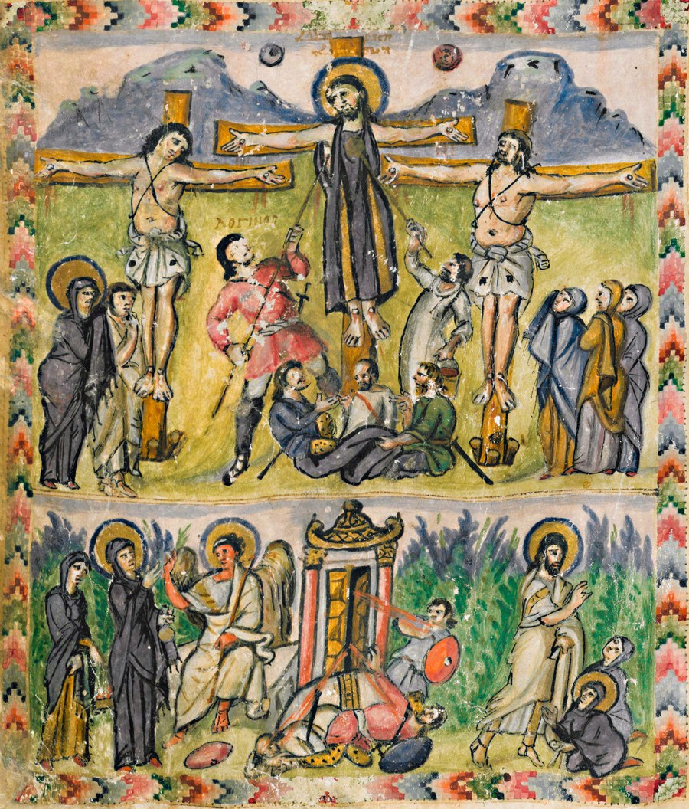

## LESSON 3

### The Narrative Past: The Peal Perfect and Verb Syntax

  
  
<em>Rabbula Gospels: illumination of the gathered apostles.</em>

---

#### Section 1: Review of Lesson 2

**Quick Summary**

In Lesson 2, we moved our verbless clauses into the active present tense using the **Peal Active Participle** (e.g., *kāteb*, "writing"). We learned that by combining the participle with personal/enclitic pronouns (*kāteb-nā*, *kātbat*, *kātbīnan*), Syriac forms the equivalent of the English present continuous ("I am writing").

**5-Question Warm-Up Drill**

*(Answers in Section 9)*

1. What is the m.sg. active participle of the root *ʿ-b-d* (to do/make)?
2. How would you say "We are going" (root: *ʾ-z-l*, pronoun: *ḥnan* / enclitic *-nan*)?
3. Translate: *Šāmʿīn ʾantūn* (or *šāmʿītūn*) *meltā d-ʾAlāhā*.
4. What happens to the enclitic pronoun in the 3rd person plural (*hennōn/hennēn*) present tense?
5. Write "She is writing" using the root *k-t-b* and the 3rd f.sg pronoun.

---

#### Section 2: The Semitic Perfect Tense — Overview

While the participle covers the present, the **Perfect tense** covers the past (completed action). The Perfect is formed by adding *suffixes* to the root to indicate person, gender, and number. It is therefore often called the "Suffix Conjugation."

**Cross-Linguistic Comparison: The Suffix Conjugation**

The Perfect tense behaves almost identically across the major Semitic languages. The core pattern is a C-a-C-a-C vocalization in the 3rd m.sg (or similar variant) followed by distinct suffixes for "I", "you", "we", "they".

*   **Hebrew Qal Perfect**: כָּתַב (*kātab* — he wrote), כָּתַבְתִּי (*kātabtī* — I wrote).
*   **Arabic Form I Perfect**: كَتَبَ (*kataba* — he wrote), كَتَبْتُ (*katabtu* — I wrote).
*   **Syriac Peal Perfect**: ܟܬܒ (*ktab* — he wrote), ܟܬܒܬ (*ketbet* — I wrote).
*   **Greek/Latin**: Greek Aorist (ἔγραψα) or Latin Perfect (scripsi) serve similar functions for completed past narrative actions, but without the triliteral root morphology.

---

#### Section 3: The Peal Perfect & Narrative Syntax

**Forming the Peal Perfect**

For a strong root like *k-t-b* (write), the 3rd person masculine singular is the base form: **ktab** (he wrote). Notice the vocalization shift from the Hebrew/Arabic *a-a* to the Syriac *zero-a* (k-t-a-b) due to vowel reduction.
The suffixes are added directly to the root:

*   Root + *-et* (1st person) $\rightarrow$ *ketb-et* (I wrote).
*   Root + silent *-w* (3rd m.pl.) $\rightarrow$ *ktab(w)* (They wrote): written ܟܬܒܘ, but pronounced exactly like the singular *ktab*.

**Narrative Syntax: V-S-O Word Order**

In past narrative Syriac favours VSO (Verb-Subject-Object) order. Word order is flexible, and a subject or object is often moved to the front for emphasis or contrast, but when reading historical or biblical texts you will find the verb first more often than not.

*   *Ktab Yūḥannan meltā.* (Wrote Yukhannan a word $\rightarrow$ Yukhannan wrote a word).

**The Conjunction `w-` (And)**

Syriac narratives chain countless actions together using the attached conjunction `w-` (and). "And he went... and he saw... and he wrote."

*   *W-npaq Yūḥannan w-ḥzā malkā.* (And Yukhannan went out and saw the king).

---

#### Section 4: Perfect Tense Paradigms

**1. The Peal Perfect Conjugation (Root `k-t-b`)**

| Person | Estrangela | Transliteration | Translation | Arabic Cognate Suffix | Hebrew Cognate Suffix |
| :--- | :--- | :--- | :--- | :--- | :--- |
| **3 m.sg.** | ܟܬܒ | ktab | he wrote | kataba (ـَ) | kātab (ـַ) |
| **3 f.sg.** | ܟܬܒܬ | ketbat | she wrote | katabat (ـَت) | kātbāh (ـָה) |
| **2 m.sg.** | ܟܬܒܬ | ktabt | you (m) wrote | katabta (ـتَ) | kātabtā (ـתָּ) |
| **2 f.sg.** | ܟܬܒܬܝ | ktabt(y) | you (f) wrote | katabti (ـتِ) | kātabt (ـתְּ) |
| **1 c.sg.** | ܟܬܒܬ | ketbet | I wrote | katabtu (ـتُ) | kātabtī (ـתִּי) |
| **3 m.pl.** | ܟܬܒܘ | ktab(w) | they (m) wrote | katabū (ـوا) | kātbū (ـוּ) |
| **3 f.pl.** | ܟܬܒ / ܟܬܒܝ | ktab / ktab(y) | they (f) wrote | katabna (ـنَ) | kātbū (ـוּ) |
| **2 m.pl.** | ܟܬܒܬܘܢ | ktabtūn | you (m.pl) wrote | katabtum (ـتم)| kətabtem (ـתֶּם) |
| **2 f.pl.** | ܟܬܒܬܝܢ | ktabtēn | you (f.pl) wrote | katabtunna (ـتنّ) | kətabten (ـתֶּן) |
| **1 c.pl.** | ܟܬܒܢ | ktabn | we wrote | katabnā (ـنَا) | kātabnū (ـנוּ) |

*Orthography Note: Notice how the single letter Taw (ܬ) represents 3 f.sg. (-at), 2 m.sg. (-t), and 1 c.sg. (-et). Several endings are written but silent: the final Waw of 3 m.pl. (ܟܬܒܘ *ktab(w)*), and the final Yodh of 3 f.pl. (ܟܬܒܝ *ktab(y)*) and 2 f.sg. (ܟܬܒܬܝ *ktabt(y)*). All three third-person forms *he wrote*, *they (m.) wrote* and *they (f.) wrote* therefore sound alike (*ktab*), and only the spelling or the context tells them apart. Fuller, audible plural forms also occur: ܟܬܒܘܢ *ktabūn* (3 m.pl.) and ܟܬܒܝܢ *ktabēn* (3 f.pl.). The Waw is heard in III-Yodh verbs (*ḥzaw* "they saw", Lesson 7) and before object suffixes (Lesson 11). Feminine plural verb forms are usually written with syāmē.*

---

#### Section 5: Narrative Word Order Examples

| Verb | Subject | Object | Translation |
| :--- | :--- | :--- | :--- |
| ܟܬܒ | ܝܘܚܢܢ | ܡܠܬܐ | Yukhannan wrote a word. |
| ktab | Yūḥannan | meltā | |
| ܫܡܥܘ | ܬܠܡܝ̈ܕܐ | ܩܠܐ | The disciples heard a voice. |
| šmaʿ(w) | talmīdē | qālā | |

---

#### Section 6: Vocabulary (Strong Verbs & Transitions)

| Root | Peal Perfect (3 m.s.) | Meaning | Transitions | Meaning |
| :--- | :--- | :--- | :--- | :--- |
| ܫ.ܒ.ܩ | šbaq (ܫܒܩ) | to leave, abandon| ܘ (w-) | and |
| ܢ.ܦ.ܩ | npaq (ܢܦܩ) | to go out, exit | ܟܕ (kad) | when, while |
| ܢ.ܛ.ܪ | nṭar (ܢܛܪ) | to keep, watch | ܓܝܪ (gēr) | for, because (Greek $\gamma\acute{\alpha}\rho$)|
| ܩ.ܪ.ܒ | qreb (ܩܪܒ) | to draw near | ܬܘܒ (tūb) | again, furthermore |
| ܪ.ܕ.ܦ | rdap (ܪܕܦ) | to pursue | ܗܝܕܝܢ (hāydēn) | then, at that time |
| ܦ.ܠ.ܚ | plaḥ (ܦܠܚ) | to serve, work | ܕܝܢ (dēn) | but, however (Greek $\delta\acute{\epsilon}$)|
| ܣ.ܓ.ܕ | sgad (ܣܓܕ) | to worship, bow | ܩܕܡ (qdām) | before, in front of |
| ܩ.ܛ.ܠ | qṭal (ܩܛܠ) | to kill | ܗܠܝܢ (hālēn) | these (c.pl.) |
| ܦ.ܪ.ܩ | praq (ܦܪܩ) | to save, rescue | | |
| ܥ.ܪ.ܩ | ʿraq (ܥܪܩ) | to flee | | |
| ܝ.ܠ.ܕ | ʾīled (ܝܠܕ) | to give birth | | |
| ܥ.ܩ.ܪ | ʿqar (ܥܩܪ) | to root out, dig | | |
| ܣ.ܠ.ܩ | sleq (ܣܠܩ) | to ascend, climb | | |
| ܩ.ܘ.ܡ | qām (ܩܡ) | to rise, stand (hollow verb, preview of L7) | | |

---

#### Section 7: The Story — Part 3

**The Journey**

*Narrative note: The story now utilizes the VSO narrative chain to describe Yukhannan's past actions, transitioning from the immediate present tense of Part 2.*

**Sentence 1**

ܘܟܕ ܐܡܪ ܗܠܝܢ ܢܦܩ ܝܘܚܢܢ
w-kad ʾemar hālēn, npaq Yūḥannan.
w-kad (and-when) ʾemar (he-said) hālēn (these-[things]), npaq (went-out) Yūḥannan (John).
→ And when he said these things, Yukhannan went out.

**Sentence 2**

ܘܐܙܠ ܝܘܚܢܢ ܒܐܪܥܐ ܘܫܒܩ ܬܠܡܝ̈ܕܘܗܝ
w-ʾezal Yūḥannan b-ʾarʿā, w-šbaq talmīdaw(hy).
w- (and-) ʾezal (went) Yūḥannan (John) b- (in) ʾarʿā (the-land), w- (and-) šbaq (he-left) talmīdaw(hy) (his-disciples).
→ And Yukhannan went through the land, and he left his disciples.
*(Note: talmīdaw(hy) is "his disciples": the plural noun with the 3 m.sg. suffix. Suffixes are the subject of Lesson 4.)*

**Sentence 3**

ܐܚܕ ܝܘܚܢܢ ܢܘܗܪܐ ܒܐܝܕܗ
ʾeḥad Yūḥannan nūhrā b-ʾīdeh.
ʾeḥad (he-held) Yūḥannan (John) nūhrā (a-light) b- (in) ʾīdeh (his-hand).
→ Yukhannan held a light in his hand.

**Sentence 4**

ܘܩܪܒ ܝܘܚܢܢ ܠܡܠܟܘܬܐ ܕܡܠܟܐ ܒܝܫܐ
w-qreb Yūḥannan l-malkūtā d-malkā bīšā.
w- (and-) qreb (drew-near) Yūḥannan (John) l- (to) malkūtā (the-kingdom) d- (of) malkā (the-king) bīšā (evil).
→ And Yukhannan drew near to the kingdom of the evil king.

**Sentence 5**

ܘܪܒܐ ܕܡܠܟܐ ܪܕܦ ܠܝܘܚܢܢ
w-rabbā d-malkā rdap l-Yūḥannan.
w- (and-) rabbā (the-great-one) d- (of) malkā (the-king) rdap (pursued) l- (to) Yūḥannan (John).
→ And the king's chief officer (lit. "the great one of the king") pursued Yukhannan.

**Sentence 6**

ܘܥܪܩ ܝܘܚܢܢ ܘܩܡ ܩܕܡ ܬܪܥܐ ܕܡܠܟܘܬܐ
w-ʿraq Yūḥannan w-qām qdām tarʿā d-malkūtā.
w- (and-) ʿraq (fled) Yūḥannan (John) w- (and-) qām (stood) qdām (before) tarʿā (gate) d- (of) malkūtā (the-kingdom).
→ And Yukhannan fled and stood before the gate of the kingdom.

---

#### Section 8: Exercises

**Exercise 1: Perfect Identification**

Identify the person, gender, and number of the following verbs in the Perfect tense.

1. ܟܬܒܘ (ktab(w))
2. ܫܒܩܬ (šbaqt - assuming 2nd m.sg)
3. ܢܛܪܬ (neṭrat - assuming 3rd f.sg)
4. ܥܪܩܢ (ʿraqn)

**Exercise 2: Conjugation Drill**

Conjugate the root *p-l-ḥ* (to serve) in the following forms of the Peal Perfect:

1. He served
2. They (m) served
3. I served
4. You all (m) served

**Exercise 3: Translation Drill (Syriac → English)**

Translate the following past narrative clauses. 

1. W-šbaq Yūḥannan l-malkā.
2. Rdap(w) talmīdē l-bīšā.
3. Npaq malkā dēn men tarʿā.
4. Ktabn meltā d-ʾAlāhā.

**Exercise 4: Production Drill (English → Syriac)**

Render the following past narrative sentences into Syriac transliteration. Use VSO order!

1. The evil man fled from the light. (Use `men` for "from").
2. And Yukhannan kept the word of God.
3. When the disciples drew near, they worshipped (*sgad(w)*).
4. The great king saved the earth.

**Exercise 5: Reading Comprehension**

Re-read Section 7 and answer:

1. Who did Yukhannan leave behind when he went out?
2. What did the "great one" of the king do?
3. Where did Yukhannan stand at the end of the passage?

---

#### Section 9: Answer Key

**Section 1 Warm-Up**

1. *ʿābed*
2. *ʾāzlīn ḥnan* (or fused *ʾāzlīnan*)
3. You all (pl) are hearing the word of God.
4. It is not used. The plural participle ending (*-īn* / *-ān*) already marks the plural unambiguously.
5. *Kātbā-hī* (or just *Kātbā*).

**Exercise 1: Perfect Identification**

1. 3.m.pl (They wrote)
2. 2.m.sg (You left)
3. 3.f.sg (She kept)
4. 1.c.pl (We fled)

**Exercise 2: Conjugation Drill**

1. plaḥ
2. plaḥ(w)
3. pelḥet
4. plaḥtūn

**Exercise 3: Translation Drill**

1. And Yukhannan left/abandoned the king.
2. The disciples pursued the evil man.
3. But the king went out from the gate.
4. We wrote the word of God.

**Exercise 4: Production Drill**

1. ʿraq barnāšā bīšā men nūhrā.
2. W-nṭar Yūḥannan meltā d-ʾAlāhā.
3. Kad qreb(w) talmīdē, sgad(w).
4. Praq malkā rabbā l-ʾarʿā.

**Exercise 5: Reading Comprehension**

1. His disciples (*talmīdaw(hy)*).
2. He pursued (*rdap*) Yukhannan.
3. Before the gate of the kingdom (*qdām tarʿā d-malkūtā*).

---

#### Section 10: Grammatical Summary

**THE PEAL PERFECT (Root š-b-q)**

| Person | Syriac | Translit |
| :--- | :--- | :--- |
| **3 m.sg.** | ܫܒܩ | šbaq (he left) |
| **3 f.sg.** | ܫܒܩܬ | šebqat (she left)|
| **2 m.sg.** | ܫܒܩܬ | šbaqt (you left) |
| **1 c.sg.** | ܫܒܩܬ | šebqet (I left) |
| **3 m.pl.** | ܫܒܩܘ | šbaq(w) (they left)|
| **1 c.pl.** | ܫܒܩܢ | šbaqn (we left) |

**VSO RULE**

| 1. Verb | 2. Subject | 3. Object / Preposition |
| :--- | :--- | :--- |
| Npaq (Went out) | malkā (The King) | men (from) ʾarʿā (the earth) |

#### Section 11: Additional Vocabulary

The following 28 words supplement this lesson's vocabulary. Most are nouns built on the roots of this lesson's verbs.

| Syriac (Estrangela) | Transliteration | Part of Speech | Meaning | Notes |
| :--- | :--- | :--- | :--- | :--- |
| ܫܪܐ | šrā | verb (Peal) | to loosen, release; to dwell | III-Yodh root š-r-y |
| ܫܒܝܬܐ | šbītā | f. noun | captivity, captives | from root š-b-y (to capture) |
| ܩܛܠܐ | qeṭlā | m. noun | slaughter, killing | from root q-ṭ-l (to kill) |
| ܓܢܒܘܬܐ | gannābūtā | f. noun | theft, stealing | from root g-n-b (to steal) |
| ܫܘܒܩܢܐ | šūbqānā | m. noun | forgiveness, remission | from root š-b-q (to leave) |
| ܡܦܩܢܐ | mappqānā | m. noun | going out, exit | from root n-p-q (to go out) |
| ܕܡܥܬܐ | demʿtā | f. noun | tear, weeping | from root d-m-ʿ (to weep) |
| ܚܡܝܡܘܬܐ | ḥammīmūtā | f. noun | heat, warmth | from root ḥ-m-m (to be hot) |
| ܡܚܘܬܐ | mḥūtā | f. noun | striking, blow | from root m-ḥ-y (to strike) |
| ܥܪܘܩܐ | ʿārōqā | m. noun | fugitive | from root ʿ-r-q (to flee) |
| ܩܘܪܒܐ | qūrbā | m. noun | drawing near, approach | from root q-r-b (to draw near) |
| ܪܕܘܦܝܐ | rdūpyā | m. noun | pursuit, persecution | from root r-d-p (to pursue) |
| ܡܣܩܢܐ | masqānā | m. noun | stairs, ladder, ascent | from root s-l-q (to ascend) |
| ܦܠܚܘܬܐ | plḥūtā | f. noun | service, labor | from root p-l-ḥ (to serve) |
| ܕܘܪܟܐ | dūrkā | m. noun | treading | from root d-r-k (to tread) |
| ܥܡܘܕܐ | ʿammūdā | m. noun | pillar, column | from root ʿ-m-d |
| ܫܠܝܛܐ | šallīṭā | m. noun | authority, ruler | from root š-l-ṭ (to rule) |
| ܪܓܡܐ | regmā | m. noun | stoning, lapidation | from root r-g-m (to stone) |
| ܡܛܪܬܐ | maṭartā | f. noun | guard, watch | from root n-ṭ-r (to watch) |
| ܢܛܘܪܘܬܐ | nāṭōrūtā | f. noun | watching, guarding | from root n-ṭ-r (to watch) |
| ܟܝܢܐ | kyānā | m. noun | nature, being | from root k-w-n (to be) |
| ܣܒܥܘܬܐ | sbʿūtā | f. noun | satisfaction, plenty | from root s-b-ʿ (to be satisfied) |
| ܓܪܒܐ | garbā | m. noun | scab, leprosy | from root g-r-b |
| ܫܒܝܐ | šabyā | m. noun | captive, prisoner | from root š-b-y (to capture) |
| ܡܡܠܠܐ | mamllā | m. noun | speech, discourse | from root m-l-l (to speak) |
| ܓܠܝܘܬܐ | gelyūtā | f. noun | revelation, manifestation | from root g-l-y (to reveal) |
| ܥܕܡܐ | ʿdammā | preposition | until, as far as | used in past narrative |
| ܡܕܒܪܢܐ | mdabbrānā | m. noun | leader, guide | from root d-b-r (to lead) |
