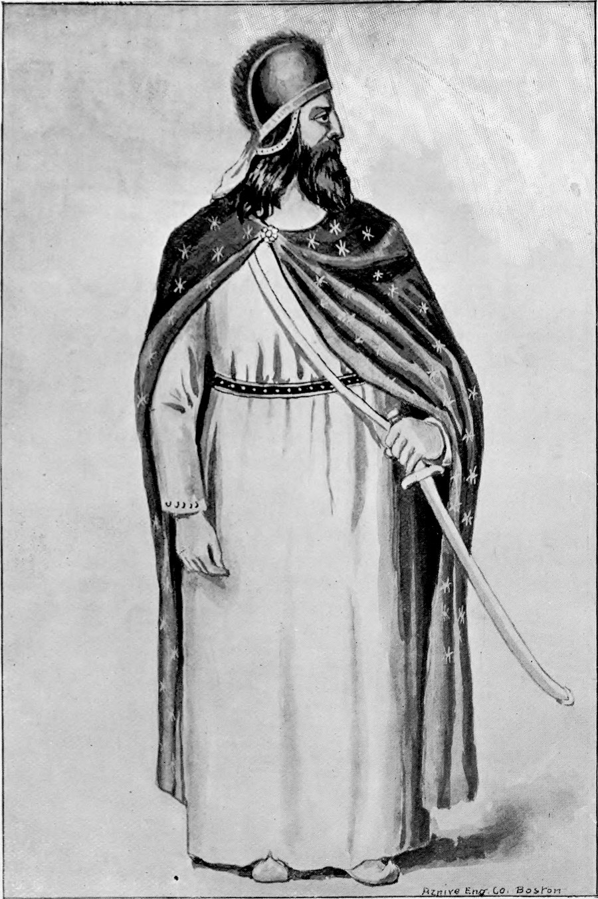

## LESSON 4

### Personalizing the Text: Suffixes and Possession

  
  
<em>King Abgar V of Edessa receiving the messenger.</em>

---

#### Section 1: Review of Lesson 3

**Quick Summary**

In Lesson 3, we examined the Peal Perfect tense (the suffix conjugation), learning how Syriac describes completed, past actions. The sentence structure shifted from fluidly subject-led (in the present participle) to stringently Verb-Subject-Object (VSO) led narrative chains using the conjunction `w-` (and).

**5-Question Warm-Up Drill**

*(Answers in Section 9)*

1. What does the suffix `-ū` indicate on a Perfect verb (e.g., *ktabū*)?
2. Translate the basic VSO sentence: *Šbaq malkā l-ʾarʿā*.
3. What happens to the pronunciation of *k-t-b* (ka-tab) in the Syriac 3rd m.sg Perfect?
4. How do you distinguish between "I went" and "You (m) went" if both are written ܟܬܒܬ (*ktabt/ketbet*) without vowels?
5. Translate: *w-qreb Yūḥannan*.

---

#### Section 2: Possession and Pronominal Suffixes — Overview

In English, we indicate possession using separate pronouns placed before a noun: "my house", "your king". In Greek, it's often an independent genitive pronoun: ὁ οἶκός μου (*ho oikos mou*). 

However, in Semitic languages, possession is expressed by attaching a **pronominal suffix** directly to the end of the noun.

**Cross-Linguistic Comparison: The Possessive Suffix**

*   **Hebrew**: סוּס (*sūs*, horse) $\rightarrow$ סוּסִי (*sūsī*, my horse). אָב (*ʾāb*, father) $\rightarrow$ אָבִינוּ (*ʾābīnū*, our father).
*   **Arabic**: كتاب (*kitāb*, book) $\rightarrow$ كتابي (*kitābī*, my book). 
*   **Syriac**: ܟܬܒ (*ktāb*, book) $\rightarrow$ ܟܬܒܝ (*ktāby*, my book). ܐܒ (*ʾab*, father) $\rightarrow$ ܐܒܘܢ (*ʾabūn*, our father).

These suffixes are derived from the same ancient roots as the independent pronouns (*ʾenā*, *ʾant*, *hū*) but are highly compressed.

---

#### Section 3: Pronominal Suffixes on Nouns & Prepositions

**1. Suffixes on Singular Nouns**

To add a suffix, Syriac drops the Emphatic state ending (*-ā*) and attaches the suffix to the bound/construct stem of the noun. (You don't say "the my-king" `*malkā-y`; you say "king-my", `malk-y`).

*   *Malk-* (king) + *-eh* (his) = *malkeh* (his king).
*   *ʾAb-* (father) + *-y* (my) = *ʾaby* (my father).

**2. Suffixes on Prepositions**

The exact same suffixes attach to the inseparable prepositions `b-` (in) and `l-` (to/for).

*   *b-* + *-eh* = *beh* (in him / in it).
*   *l-* + *-k* = *lāḵ* (to you, m.sg).

**3. The Idiom for "To Have"**

Syriac (like Hebrew and Arabic) lacks a dedicated verb meaning "to possess" (like English "to have" or Latin "habere"). Instead, Semitic languages use a prepositional phrase: "there is to me" or just "to me".

*   *ʾīt lī* (there-is to-me) $\rightarrow$ **ʾīt lī** = I have.
*   *layt leh* (there-is-not to-him) = He does not have.
*   *ʾīt lī šrārā* = I have truth. (Lit: There is to me truth).

---

#### Section 4: The Suffix Paradigm for Singular Nouns

This paradigm uses the masculine noun *malk-* (king, root m-l-k) and the feminine noun *malkūt-* (kingdom). Notice the suffix column; you must memorize these endings.

| Person | Suffix | Masculine Noun (*malk-*) | Translit | Fem Noun (*malkūt-*) | Translit |
| :--- | :--- | :--- | :--- | :--- | :--- |
| **1 c.sg. (my)** | ـܝ (-y) | ܡܠܟܝ | malk-y | ܡܠܟܘܬܝ | malkūt-y |
| **2 m.sg. (your)** | ـܟ (-k) | ܡܠܟܟ | malk-āḵ | ܡܠܟܘܬܟ | malkūt-āḵ |
| **2 f.sg. (your)** | ـܟܝ (-ky) | ܡܠܟܟܝ | malk-ēky| ܡܠܟܘܬܟܝ | malkūt-ēky |
| **3 m.sg. (his)** | ـܗ (-eh) | ܡܠܟܗ | malk-eh | ܡܠܟܘܬܗ | malkūt-eh |
| **3 f.sg. (her)** | ـܗ (-āh) | ܡܠܟܗ | malk-āh | ܡܠܟܘܬܗ | malkūt-āh |
| **1 c.pl. (our)** | ـܢ (-n) | ܡܠܟܢ | malk-an | ܡܠܟܘܬܢ | malkūt-an |
| **2 m.pl. (your)** | ـܟܘܢ (-kūn) | ܡܠܟܟܘܢ | malk-kūn | ܡܠܟܘܬܟܘܢ | malkūt-kūn |
| **2 f.pl. (your)** | ـܟܝܢ (-kēn) | ܡܠܟܟܝܢ | malk-kēn | ܡܠܟܘܬܟܝܢ | malkūt-kēn |
| **3 m.pl. (their)** | ـܗܘܢ (-hūn) | ܡܠܟܗܘܢ | malk-hūn | ܡܠܟܘܬܗܘܢ | malkūt-hūn |
| **3 f.pl. (their)** | ـܗܝܢ (-hēn) | ܡܠܟܗܝܢ | malk-hēn | ܡܠܟܘܬܗܝܢ | malkūt-hēn |

*Orthography Note: The 3rd masculine singular (-eh) and 3rd feminine singular (-āh) are both spelled with a final He (ܗ). Only vowel pointing or context distinguishes "his" from "her".*

---

#### Section 5: Prepositional "To Have" Paradigm (l- + Suffix)

How to say "I have", "You have", "He has", etc., by attaching suffixes to the `l-` preposition, often preceded by *ʾīt* (there is).

| Person | Estrangela (l- + suffix)| Transliteration | Meaning |
| :--- | :--- | :--- | :--- |
| **1 c.sg.** | ܠܝ | lī | to me (I have) |
| **2 m.sg.** | ܠܟ | lāḵ | to you (You [m.sg.] have) |
| **2 f.sg.** | ܠܟܝ | lēky | to you (You [f.sg.] have) |
| **3 m.sg.** | ܠܗ | leh | to him (He has) |
| **3 f.sg.** | ܠܗ | lāh | to her (She has) |
| **1 c.pl.** | ܠܢ | lān | to us (We have) |
| **2 m.pl.** | ܠܟܘܢ | lḵūn | to you (You [m.pl.] have)|
| **2 f.pl.** | ܠܟܝܢ | lḵēn | to you (You [f.pl.] have)|
| **3 m.pl.** | ܠܗܘܢ | lhūn | to them (They [m.pl.] have) |
| **3 f.pl.** | ܠܗܝܢ | lhēn | to them (They [f.pl.] have) |

---

#### Section 6: Vocabulary (Family, Body Parts & Belongings)

Family and body parts are the most common nouns to receive pronominal suffixes. *(Note: ʾabā 'father' and ʾaḥā 'brother' insert -ū- before suffixes other than 1 c.sg., e.g. ʾabūḵ 'your father', ʾabūhy 'his father').*

| Construct / Emphatic | Transliteration | Meaning | Example with Suffix (1 c.sg.) |
| :--- | :--- | :--- | :--- |
| ܐܒ / ܐܒܐ | ʾab / ʾabā | Father | ʾab-y (my father) |
| ܐܡ / ܐܡܐ | ʾem / ʾemmā | Mother | ʾem-y (my mother) |
| ܒܪ / ܒܪܐ | bar / brā | Son | bar-y (my son) |
| ܒܪܬ / ܒܪܬܐ | bart / bartā | Daughter | brat-y (my daughter) |
| ܐܚ / ܐܚܐ | ʾaḥ / ʾaḥā | Brother | ʾaḥ-y (my brother) |
| ܐܝܕ / ܐܝܕܐ | ʾīd / ʾīdā | Hand (f) | ʾīd-y (my hand) |
| ܪܝܫ / ܪܝܫܐ | rēš / rēšā | Head (m) | rēš-y (my head) |
| ܩܠ / ܩܠܐ | qāl / qālā | Voice (m) | qāl-y (my voice) |
| ܠܒܘܫ / ܠܒܘܫܐ| lbūš / lbūšā | Garment | lbūš-y (my garment) |
| ܒܝܬ / ܒܝܬܐ | bēt / baytā | House | bayt-y (my house) |
| ܢܛܘܪ / ܢܛܘܪܐ | nāṭōr / nāṭōrā | Guard, watchman (pl. *nāṭōrē*) | nāṭōr-y (my guard) |
| ܡܐ / ܡܢܐ | mā / mānā | What? | (Interrogative pronoun) |
| ܐܝܟܐ | ʾaykā | Where? | (Interrogative adverb; with 3 m.sg. enclitic: ܐܝܟܘ *ʾaykaw* "where is he?") |

---

#### Section 7: The Story — Part 4

**A Dialogue at the Gate**

*Narrative note: Watch how the guards use suffixes with prepositions (`leh`, `lāḵ`) and nouns (`ʾabūḵ`, `ʾemmāḵ`) to interrogate Yukhannan about his origins and possessions.*

**Sentence 1**

ܩܡ ܝܘܚܢܢ ܒܬܪܥܐ ܕܡܠܟܘܬܐ
qām Yūḥannan b-tarʿā d-malkūtā.
qām (stood) Yūḥannan (John) b-tarʿā (in-the-gate) d-malkūtā (of-the-kingdom).
→ Yukhannan stood at the gate of the kingdom.

**Sentence 2**

ܘܐܡܪܝܢ ܢܛܘܪܐ ܕܬܪܥܐ ܠܗ
w-ʾāmrīn nāṭōrē d-tarʿā leh:
w-ʾāmrīn (and-are-saying) nāṭōrē (the-guards) d-tarʿā (of-the-gate) leh (to-him):
→ And the guards of the gate say to him:

**Sentence 3**

ܡܢ ܐܝܢܐ ܐܬܪܐ ܐܢܬ
men ʾaynā ʾatrā ʾant?
men (from) ʾaynā (what) ʾatrā (country/place) ʾant (you-[are])?
→ "From what country are you?"

**Sentence 4**

ܘܐܝܟܐ ܐܒܘܟ ܘܐܡܟ
w-ʾaykā ʾab-ūḵ w-ʾemm-āḵ?
w-ʾaykā (and-where) ʾab-ūḵ (father-your) w-ʾemm-āḵ (and-mother-your)?
→ "And where are your father and your mother?"

**Sentence 5**

ܘܡܐ ܐܝܬ ܠܟ ܒܐܝܕܟ
w-mā ʾīt lāḵ b-ʾīd-āḵ?
w-mā (and-what) ʾīt (there-is) lāḵ (to-you) b-ʾīd-āḵ (in-hand-your)?
→ "And what do you have in your hand?"

**Sentence 6**

ܐܡܪ ܠܗܘܢ ܝܘܚܢܢ
ʾemar lhūn Yūḥannan:
ʾemar (said) lhūn (to-them) Yūḥannan (John):
→ Yukhannan said to them:

**Sentence 7**

ܐܠܗܐ ܗܘ ܐܒܝ ܘܐܪܥܐ ܗܝ ܐܡܝ
ʾAlāhā hū ʾab-y, w-ʾarʿā hī ʾem-y.
ʾAlāhā (God) hū (he-[is]) ʾab-y (father-my), w-ʾarʿā (and-the-earth) hī (she-[is]) ʾem-y (mother-my).
→ "God is my father, and the earth is my mother."

**Sentence 8**

ܘܠܝܬ ܠܝ ܠܒܘܫܐ ܒܝܫܐ
w-layt lī lbūšā bīšā.
w-layt (and-there-is-not) lī (to-me) lbūšā (a-garment) bīšā (evil).
→ "And I do not have an evil garment."

**Sentence 9**

ܢܘܗܪܐ ܕܐܠܗܐ ܐܝܬܘܗܝ ܒܐܝܕܝ
nūhrā d-ʾAlāhā ʾītawhy b-ʾīd-y.
nūhrā (the-light) d-ʾAlāhā (of-God) ʾītawhy (it-is) b-ʾīd-y (in-hand-my).
→ "The light of God is in my hand."

---

#### Section 8: Exercises

**Exercise 1: Suffix Identification**

Identify the person, gender, and number of the possessor for the following suffixed nouns.

1. ܡܠܟܢ (malk-an)
2. ܒܝܬܗ (bayt-eh)
3. ܐܝܕܟܝ (ʾīd-ēky)
4. ܡܠܟܘܬܗܘܢ (malkūt-hūn)

**Exercise 2: Conjugation Drill (Possession)**

Translate the following phrases using `l-` + suffix (using *ʾīt* where appropriate to mean "have"):

1. To you (f.sg).
2. We have (There is to us).
3. He does not have (There is not to him).
4. To them (m.pl).

**Exercise 3: Translation Drill (Syriac → English)**

Translate the following sentences containing suffixed nouns.

1. ʾAb-y ṭābā hū, w-ʾem-y ṭābtā hī.
2. Šbaqū talmīdē l-baythūn.
3. ʾĪt lān nūhrā rabbā.
4. Qālā d-malkā b-ʾarʿan (ʾarʿ-an).

**Exercise 4: Production Drill (English → Syriac)**

Render the following sentences into Syriac transliteration.

1. My brother is writing a word.
2. The king and his son are going to his kingdom.
3. What is in your (m.sg) hand?
4. We do not have (*layt lān*) an evil king.

**Exercise 5: Reading Comprehension**

Re-read Section 7 and answer:

1. Under what three topics do the guards (*nāṭōrē*) interrogate Yukhannan?
2. Who does Yukhannan claim as his parents?
3. What does Yukhannan explicitly state he *does not* have?

---

#### Section 9: Answer Key

**Section 1 Warm-Up**

1. 3rd person masculine plural ("they").
2. The king left the earth.
3. The *a* vowel in the middle of the root disappears (vowel reduction), making it *ktab* (k-t-a-b).
4. Only context or vowel pointing.
5. And Yukhannan drew near.

**Exercise 1: Suffix Identification**

1. 1st common plural (Our king)
2. 3rd masc singular (His house)
3. 2nd fem singular (Your hand)
4. 3rd masc plural (Their kingdom)

**Exercise 2: Conjugation Drill**

1. lēky
2. ʾīt lān
3. layt leh
4. lhūn

**Exercise 3: Translation Drill**

1. My father is good, and my mother is good.
2. The disciples left their house (*bayt-hūn*).
3. We have a great light (There is to us a great light).
4. The voice of the king is in our land (*ʾarʿ-an* = *ʾarʿā* + *-an*).

**Exercise 4: Production Drill**

1. ʾAḥ-y kāteb meltā.
2. Malkā w-bar-eh ʾāzlīn l-malkūt-eh.
3. Mā ʾīt b-ʾīd-āḵ?
4. Layt lān malkā bīšā.

**Exercise 5: Reading Comprehension**

1. Origin (what country), Family (where are father/mother), and Possessions (what is in hand).
2. God (father) and the earth (mother).
3. An evil garment (*lbūšā bīšā*).

---

#### Section 10: Grammatical Summary

**THE PRONOMINAL SUFFIXES (ATTACH TO NOUNS AND PREPOSITIONS)**

| Suffix | Meaning | Example (*bayt-* house)| Example (*l-* to) |
| :--- | :--- | :--- | :--- |
| **-y** | my | bayt-y (my house) | lī (to me) |
| **-k** | your (m.sg.)| baytāḵ (your house) | lāḵ (to you) |
| **-ky** | your (f.sg.)| baytēky (your house) | lēky (to you) |
| **-eh** | his | bayteh (his house) | leh (to him) |
| **-āh** | her | baytāh (her house) | lāh (to her) |
| **-an** | our | baytan (our house) | lān (to us) |
| **-kūn** | your (m.pl.) | baytkūn (your house) | lḵūn (to you all) |
| **-kēn** | your (f.pl.) | baytkēn (your house) | lḵēn (to you all) |
| **-hūn** | their (m.pl.)| baythūn (their house) | lhūn (to them) |
| **-hēn** | their (f.pl.)| baythēn (their house) | lhēn (to them) |

**SAYING "TO HAVE" (Possession Formula)**

| Formula | Syriac | Meaning |
| :--- | :--- | :--- |
| ʾĪT + L- + Suffix | ʾīt lī | I have (There is to me) |
| LAYT + L- + Suffix | layt leh | He does not have |
| ʾĪT + L- + Suffix | ʾīt lhūn malkā | They have a king |

#### Section 11: Additional Vocabulary

The following 18 high-frequency words supplement this lesson's vocabulary for family, the body, and personal qualities.

| Syriac (Estrangela) | Transliteration | Part of Speech | Meaning | Notes |
| :--- | :--- | :--- | :--- | :--- |
| ܣܦܬܐ | septā | f. noun | lip | emphatic state (pl. sepwātā) |
| ܬܠܓܐ | talgā | m. noun | snow | |
| ܐܠܥܐ | ʾelʿā | f. noun | rib, side | |
| ܥܛܡܐ | ʿaṭmā | f. noun | thigh, side | |
| ܕܪܥܐ | darʿā | f. noun | arm | |
| ܫܩܐ | šāqā | f. noun | leg, shin, calf | |
| ܚܬܢܐ | ḥatnā | m. noun | bridegroom | |
| ܟܠܬܐ | kaltā | f. noun | bride | |
| ܕܕܐ | dādā | m. noun | uncle (paternal) | |
| ܥܡܬܐ | ʿammtā | f. noun | aunt (paternal) | |
| ܥܡܝܩܐ | ʿammīqā | m. adj | deep | |
| ܦܠܛܐ | palṭā | m. noun | escape, safety | |
| ܥܬܝܪܐ | ʿattīrā | m. adj | rich, wealthy | |
| ܡܣܟܢܐ | meskēnā | m. adj | poor, humble | |
| ܓܢܒܪܐ | gabbārā | m. adj | mighty, strong | |
| ܩܠܝܠܐ | qallīlā | m. adj | light, swift, few | |
| ܝܚܝܕܝܐ | īḥīdāyā | m. adj | only-begotten, solitary | |
| ܟܐܢܐ | kēnā | m. adj | just, righteous | |
