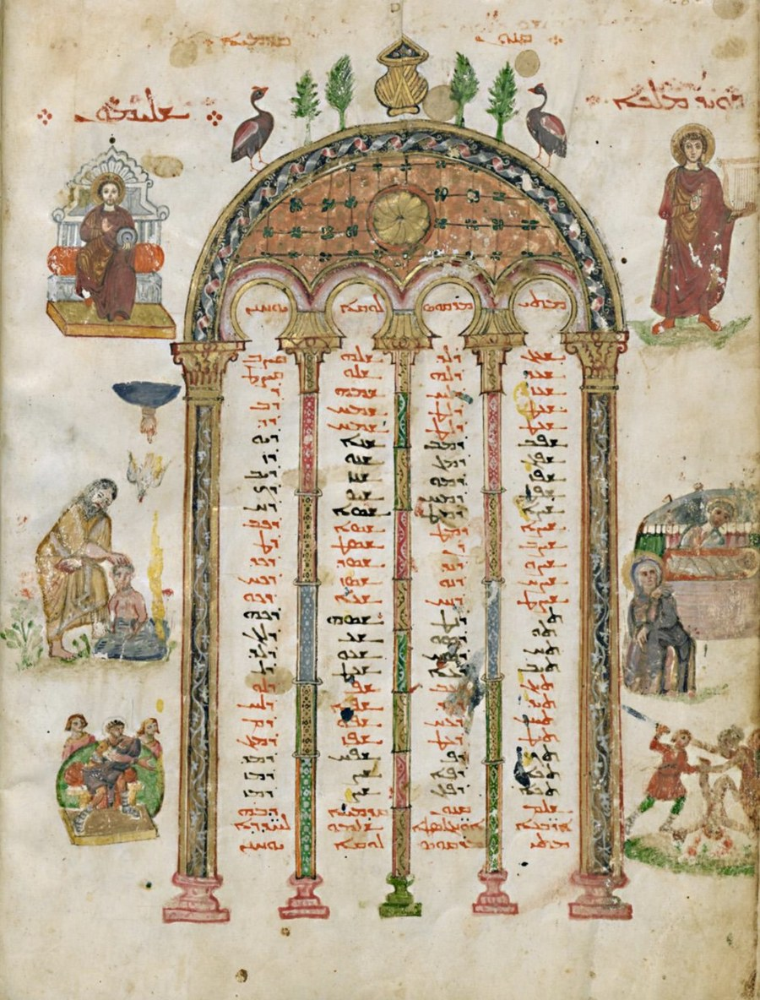

## LESSON 5

### The Aphel Stem: Divine Action & Causative Verbs

  
  
<em>Rabbula Gospels: architectural canon tables with illumination.</em>

ܐܦܥܠ *ʾaphel*

#### Section 1: Review of Lessons 1–4

**Quick Summary**

Before diving into the Aphel stem, let's review the foundational material from the first four lessons:

- Lesson 0: The Estrangela alphabet, letter order, and the non-joining letters.
- Lesson 1: The noun system (gender, number, and the absolute, construct, and emphatic states), independent pronouns, verbless clauses, and the particles *d-* (relative/possessive) and *l-* (to/for, direct object).
- Lesson 2: The Peal stem and its active participle. With enclitic pronouns, the participle forms the narrative present (*kāteb-nā*, "I am writing").
- Lesson 3: The Peal perfect (suffix conjugation) of ܟܬܒ (*k-t-b*, "write"), V-S-O narrative word order, and the conjunction *w-*.
- Lesson 4: Pronominal suffixes on nouns and prepositions, and the idiom *ʾīt l-* for "to have".

**5-Question Warm-Up Drill**

Answer these questions using what you've learned. Answers are in Section 9.

1. ܟܬܒ — Give the 3rd m.sg. Peal perfect and its meaning.
2. What are the three states of the Syriac noun? Give an example of each.
3. Translate: ܗܘ ܪܒܐ ܗܘ (*hū rabbā hū*)
4. What does the Peal active participle of ܐܙܠ (*ʾ-z-l*, "go") look like, m.sg.?
5. Identify the root and stem of the form ܟܬܒܬ (*ketbat*).

#### Section 2: The Derived Stems — Overview

One of the most powerful features of Semitic languages — shared by Syriac, Hebrew, and Arabic — is the system of **derived verbal stems**. A single three-consonant root can generate multiple verbs with systematically related meanings, simply by modifying the vowel pattern and/or adding prefixes or affixes.

This is very different from Greek or Latin, where related meanings usually require entirely different words. In Syriac, once you know a root, you already know the building blocks of an entire semantic family.

**The Three Major Active Stems**

| **Stem Name** | **Formation Pattern** | **Basic Meaning Shift** | **Example** |
|:---|:---|:---|:---|
| **Peal** | Basic vowel pattern | Basic action / state | ܟܬܒ — *ktab*, "he wrote" |
| **Paael** | Middle root letter doubled | Intensive / Factitive | ܩܕܫ — *qaddeš*, "he sanctified" |
| **Aphel** | *ʾa-* prefix added | Causative | ܐܚܝ — *ʾaḥī*, "he caused to live" |

**Cross-Linguistic Comparison**

For those coming from Hebrew or Arabic, these correspondences will look familiar:

| **Syriac** | **Peal** | **Paael** | **Aphel** |
|:---|:---|:---|:---|
| Hebrew | Qal | Piel | Hiphil |
| Arabic | Form I | Form II | Form IV |
| Function | Basic | Intensive / Factitive | Causative |

For learners with a Greek background: Greek uses **voice** (active, middle, passive) and **aspect** to express some of these distinctions, but there is no exact parallel to the Semitic derived stem system. The Greek causative construction (e.g., *ποιεῖν* + infinitive) expresses what the Aphel does morphologically. Latin similarly uses circumlocutions (*facere* + infinitive) or prefix verbs for some causative senses.

#### Section 3: The Aphel Stem

**Core Meaning: Causative**

The Aphel stem expresses **causative** action — "to *cause* X to happen" or "to *make* X do Y." In theological language, this is the stem of divine action: God *ʾaḥī* (gave life), God *ʾaglī* (revealed), God *ʾaqreb* (brought near).

**Formation**

- **Perfect:** *ʾa-* prefix + *CCeC* pattern (same person suffixes as Peal perfect)
- **Participle:** *m-* prefix + *aCCeC* pattern (`maCCeC`, cf. Peal participle)

**Comparison with Other Languages**

- **Hebrew Hiphil:** prefix הִ/הֶ (*hi-*/ *he-*) added to the root. E.g., *ḥāyāh* (live) → *heḥĕyāh* (give life); *qārab* (draw near) → *hiqrīb* (bring near/offer). The structural parallel to Syriac Aphel is very close.
- **Arabic Form IV:** *ʾa-* prefix + *CaCaCa* → *ʾaCCaCa*. E.g., *ḫaraja* (go out) → *ʾaḫraja* (bring out); *qaruba* (draw near) → *ʾaqraba* (bring near). The Syriac Aphel prefix *ʾa-* is cognate with Arabic Form IV.
- **Greek/Latin:** No direct morphological equivalent. Greek uses prefix verbs (e.g., *ζωοποιεῖν*, "to give life") or constructions with *ποιεῖν* + inf. Latin uses *facere* + infinitive or prefix verbs.

**Aphel Examples: Peal → Aphel**

| **Peal (Syr)** | **Root** | **Peal Meaning** | **Aphel (Syr)** | **Aphel Translit** | **Aphel Meaning** |
|:---|:---|:---|:---|:---|:---|
| ܚܝܐ | *ḥ-y-y* | to live (Peal) | ܐܚܝ | *ʾaḥī* | to give life, save |
| ܩܪܒ | *q-r-b* | to draw near (Peal) | ܐܩܪܒ | *ʾaqreb* | to bring near, offer |
| ܢܦܩ | *n-p-q* | to go out (Peal) | ܐܦܩ | *ʾappeq* | to bring out, produce |
| ܢܦܠ | *n-p-l* | to fall (Peal) | ܐܦܠ | *ʾappel* | to cause to fall, throw down |

**The Strong Root *q-r-b* in the Aphel**

The strong root ܩܪܒ (*q-r-b*) means "draw near, approach" in the Peal stem (*qreb*). In the causative Aphel stem (*ʾaqreb*), it means **"to bring near, to offer"** — that is, "to cause someone or something to come near." Because all three of its consonants are strong and remain visible in every form, *q-r-b* serves as our model paradigm for the Aphel in Sections 4–5.

#### Section 4: Aphel Perfect Paradigm

**Root: *q-r-b* | Stem: Aphel | Meaning: "to bring near, offer"**

ܐܦܥܠ **Perfect — Full Conjugation**

| **Person** | **Estrangela** | **Transliteration** | **Translation** |
|:---|:---|:---|:---|
| **3 m.sg.** | ܐܩܪܒ | *ʾaqreb* | he brought near |
| **3 f.sg.** | ܐܩܪܒܬ | *ʾaqrbat* | she brought near |
| **2 m.sg.** | ܐܩܪܒܬ | *ʾaqrebt* | you (m.sg.) brought near |
| **2 f.sg.** | ܐܩܪܒܬܝ | *ʾaqrebt(y)* | you (f.sg.) brought near |
| **1 c.sg.** | ܐܩܪܒܬ | *ʾaqrbet* | I brought near |
| **3 m.pl.** | ܐܩܪܒܘ | *ʾaqrebū* | they (m.) brought near |
| **3 f.pl.** | ܐܩܪܒ / ܐܩܪܒܝ | *ʾaqreb* | they (f.) brought near |
| **2 m.pl.** | ܐܩܪܒܬܘܢ | *ʾaqrebtūn* | you (m.pl.) brought near |
| **2 f.pl.** | ܐܩܪܒܬܝܢ | *ʾaqrebtēn* | you (f.pl.) brought near |
| **1 c.pl.** | ܐܩܪܒܢ | *ʾaqrebn* | we brought near |

**Formation Notes:**

- **Prefix:** *ʾa-* added before the root (3 m.sg.: *ʾaqreb*).
- **Root-internal vowel:** *e* vowel between R2 and R3 in 3 m.sg. (elided before vocalic endings *-at* and *-et*: *ʾaqrbat*, *ʾaqrbet*).
- **Suffixes:** Identical to Peal perfect suffixes (*-at*, *-t*, *-t(y)*, *-et*, *-ū*, zero/silent *-y*, *-tūn*, *-tēn*, *-n*).
- **Weak roots preview:** When R1 is *n* (*n-p-q*), the *n* assimilates to R2 (*ʾappeq*, "he brought out"). When R1 is *y* (*y-d-ʿ*), the prefix + *y* becomes *ʾaw-* (*ʾawdaʿ*, "he made known").

**Comparison: Hebrew Hiphil Perfect**

The Hebrew Hiphil perfect is structurally parallel to the Syriac Aphel perfect, with a causative prefix (הִ- *hi-* / הֶ- *he-*) and essentially the same suffix set:

| **Person** | **Hebrew (Hiphil)** | **Transliteration** | **Translation** |
|:---|:---|:---|:---|
| 3 m.sg. | הִקְרִיב | *hiqrīb* | he brought near (Hiphil of *q-r-b*) |
| 3 f.sg. | הִקְרִיבָה | *hiqrībāh* | she brought near |
| 1 c.sg. | הִקְרַבְתִּי | *hiqrabtī* | I brought near |
| 3 m.pl. | הִקְרִיבוּ | *hiqrībū* | they brought near |

**Comparison: Arabic Form IV Perfect**

Arabic Form IV (*ʾaCCaCa*) is cognate with the Syriac Aphel. The prefix *ʾa-* and the causative meaning are identical; only the internal vowel pattern differs:

| **Person** | **Arabic (Form IV)** | **Transliteration** | **Translation** |
|:---|:---|:---|:---|
| 3 m.sg. | أَرْسَلَ | *ʾarsala* | he sent (Form IV of *r-s-l*) |
| 3 f.sg. | أَرْسَلَتْ | *ʾarsalat* | she sent |
| 1 c.sg. | أَرْسَلْتُ | *ʾarsaltu* | I sent |
| 3 m.pl. | أَرْسَلُوا | *ʾarsalū* | they sent |

#### Section 5: Aphel Participle Paradigm

**Root: *q-r-b* | Stem: Aphel | Meaning: "bringing near / offering"**

The Aphel active participle expresses ongoing or habitual causative action. The participle prefix is **m-** (as in all derived stems), replacing the *ʾ-* of the perfect prefix (`ʾaqreb` → `maqreb`).

| **Form** | **Estrangela** | **Transliteration** | **Translation** |
|:---|:---|:---|:---|
| m.sg. (active) | ܡܩܪܒ | *maqreb* | bringing near (m.sg.) |
| f.sg. (active) | ܡܩܪܒܐ | *maqrbā* | bringing near (f.sg.) |
| m.pl. (active) | ܡܩܪܒܝܢ | *maqrbīn* | bringing near (m.pl.) |
| f.pl. (active) | ܡܩܪܒܢ | *maqrbān* | bringing near (f.pl.) |

**Formation Notes**

- **Prefix:** *m-* added before the stem (same prefix as Paael and other derived-stem participles).
- **Vowel pattern:** *ma-* + R1R2 + *e* + R3 (cf. Peal participle *kāteb* → Aphel *maqreb*).
- **Gender/number suffixes:** Same as all Syriac participles: m.sg. (unmarked), f.sg. (*-ā*), m.pl. (*-īn*), f.pl. (*-ān*).

**Comparison with Hebrew and Arabic**

- **Hebrew Hiphil participle:** prefix מַ/מֵ (*ma-*/ *me-*). E.g., *maqrīb* (bringing near / offering — from *q-r-b* Hiphil). The *m-* participle prefix is pan-Semitic.
- **Arabic Form IV active participle:** pattern *muCCiC*. E.g., *mursil* (sending/sender — from *ʾarsala*). Note the Arabic Form IV participle has the vowel shift *u-i*, while Syriac uses *a-e*.

> **KEY PATTERN: In all Syriac derived stems, the participle prefix is m-. This is one of the most consistent features of Syriac verbal morphology. If you see a verb beginning with m- that is not a Peal form, suspect a derived-stem participle.**

#### Section 6: Theological Vocabulary

**Abstract Nouns and Key Theological Terms**

The following twenty terms form the core theological vocabulary of early Syriac Christianity. Many are abstract nouns ending in *-ūtā* (with a single spirantized *taw*) derived from the same roots as the verbs you are learning.

| **Estrangela** | **Transliteration** | **Meaning** | **Notes** |
|:---|:---|:---|:---|
| ܚܝܐ / ܦܘܪܩܢܐ | *ḥayyē* / *purqānā* | life (pl.) / salvation | Two overlapping terms; *ḥayyē* often = "eternal life"; *purqānā* = "redemption" |
| ܓܠܝܢܐ | *gelyānā* | revelation, disclosure | From *g-l-y*; cf. Gk *apokalypsis*, Lat *revelatio* |
| ܫܘܕܪܐ | *šūddārā* | sending, mission | From *šaddar*; cf. Heb *šālīaḥ* (envoy), Gk *apostolos* |
| ܒܪܝܬܐ | *brītā* | creation, creature | From Peal *brā*; cf. Heb *bārāʾ*, Gen 1:1 |
| ܪܚܡܐ | *raḥmē* | mercy, compassion | Pl. of *raḥmā*; cognate with Heb *raḥămīm*, Arabic *raḥma* |
| ܕܝܢܐ | *dīnā* | judgment | Cf. Heb *dīn* (legal judgment), Arabic *dīn* (religion/judgment) |
| ܫܘܒܚܐ | *šūbḥā* | glory, praise | Cf. Heb *kābōd*; used in doxologies |
| ܛܝܒܘܬܐ | *ṭaybūtā* | grace, goodness | Abstract noun (*-ūtā*) from *ṭāb* (good); cf. Gk *charis*, Latin *gratia* |
| ܗܝܡܢܘܬܐ | *haymānūtā* | faith, trust | Abstract noun (*-ūtā*) from *haymen*; cf. Heb *ʾĕmūnāh* |
| ܟܐܢܘܬܐ | *kēnūtā* | righteousness, justice | Abstract noun (*-ūtā*) from *kēn*; cf. Gk *dikaiosynē*, Heb *ṣĕdāqāh* |
| ܚܛܝܬܐ | *ḥṭītā* | sin, transgression | From *ḥ-ṭ-y*; cf. Gk *hamartia*, Heb *ḥēṭʾ* |
| ܡܥܡܘܕܝܬܐ | *maʿmūdītā* | baptism | Lit. "immersion"; from *ʿ-m-d*; cf. Gk *baptisma* |
| ܨܠܘܬܐ | *ṣlūtā* | prayer | From *ṣ-l-y*; cf. Heb *tĕfillāh* |
| ܝܘܠܦܢܐ | *yūlpānā* | teaching, instruction | Abstract noun from *y-l-p* / *ʾallep* |
| ܢܒܝܘܬܐ | *nbīyūtā* | prophecy | Abstract noun (*-ūtā*) from *nbīyā*; cf. Heb *nĕbūʾāh*, Gk *prophēteia* |
| ܩܝܡܐ | *qyāmā* | covenant, resurrection | Double meaning: covenant (cf. Heb *bĕrīt*) and standing/resurrection |
| ܟܬܒܐ | *ktābā* | scripture, writing, book | From *k-t-b*; cf. Arabic *kitāb*, Hebrew *kĕtābīm* |
| ܒܘܪܟܬܐ | *būrktā* | blessing | From *b-r-k*; cf. Heb *bĕrākāh*, Arabic *baraka* |
| ܪܘܚܐ | *rūḥā* | spirit, wind, breath | Usually f. noun; cf. Heb *rūaḥ*, Arabic *rūḥ*, Gk *pneuma* |
| ܫܪܪܐ | *šrārā* | truth, reality | Cf. Heb *ʾĕmet*, Gk *alētheia*; from *š-r-r* ("to be firm/true") |

**Key Aphel and Related Verbs in Theological Context**

| **Estrangela** | **Translit** | **Stem** | **Meaning** | **Usage Note** |
|:---|:---|:---|:---|:---|
| ܐܚܝ | *ʾaḥī* | Aphel | to save, give life | Causative of *ḥ-y-y* (live); divine act par excellence |
| ܐܓܠܝ | *ʾaglī* | Aphel | to reveal, uncover | From *g-l-y* (also Peal *glā* "reveal"); 3 m.sg. spelled with final *yodh* |
| ܫܕܪ | *šaddar* | Paael | to send | Common verb (root *š-d-r*, preview of Lesson 6 Paael); cf. Heb *šālaḥ* |
| ܒܪܐ | *brā* | Peal | to create | Note: in Syriac this is Peal (not Aphel); cf. Heb *bārāʾ* |
| ܐܟܪܙ | *ʾakrez* | Aphel | to proclaim, preach | Denominative Aphel from *kārōzā* (herald); kerygmatic vocabulary |
| ܐܪܝܡ | *ʾarīm* | Aphel | to exalt, lift up | Causative of *r-w-m* (be high); cf. Heb *hērīm* |
| ܐܫܦܠ | *ʾašpel* | Aphel | to humble, lower | Causative of *š-p-l* (be low); antonym of *ʾarīm* |
| ܦܪܩ | *praq* | Peal | to redeem, deliver, save | Standard Peal verb for "redeem" (source of *purqānā* above) |
| ܩܕܫ | *qaddeš* | Paael | to sanctify, make holy | Preview of Lesson 6 Paael; from *q-d-š* (be holy); cf. Heb *qiddēš* |
| ܐܩܪܒ | *ʾaqreb* | Aphel | to bring near, offer | Causative of *q-r-b* (draw near); cf. Heb *hiqrīb*, Arabic Form IV *ʾaqraba* |

#### Section 7: The Story — Part 5

**Yukhannan Preaches to the Crowds**

**Narrative note:** This passage features heavy use of the Aphel stem to describe God's causative actions in history. Notice the verbless clauses used for theological assertions (sentences 6 and 9) and how indirect objects and pronominal objects are expressed with prepositions + suffixes (`lī`, `lāḵ`, `lān`, `lḵūn`, `lhūn`) that you learned in Lesson 4.

> *Key Aphel forms in this passage: ʾakrez (proclaimed), ʾawdaʿ (made known), ʾaḥī (gave life/saved), ʾaglī (revealed), ʾaqrebtūn (you brought near/offered), ʾappeq (brought out), ʾaḥyat (gave life), ʾaqrbat (brought near).*

**Sentence 1**

ܘܝܘܚܢܢ ܩܡ ܒܡܨܥܬ ܥܡܐ ܘܐܟܪܙ ܠܗܘܢ

*w-Yūḥannan qām b-meṣʿat ʿammā w-ʾakrez lhūn*

w- (and-) Yūḥannan (Yukhannan) qām (stood) b-meṣʿat (in-the-midst-of) ʿammā (the-people) w-ʾakrez (and-proclaimed) lhūn (to-them)

*→ And Yukhannan stood in the midst of the people and proclaimed to them:*

**Sentence 2**

ܡܪܝܐ ܫܕܪ ܠܝ ܘܐܘܕܥ ܠܟܘܢ ܐܘܪܚܐ ܕܚܝܐ

*Māryā šaddar lī w-ʾawdaʿ lḵūn ʾūrḥā d-ḥayyē*

Māryā (the-Lord) šaddar (sent) lī (me) w-ʾawdaʿ (and-made-known) lḵūn (to-you [pl.]) ʾūrḥā (the-way) d-ḥayyē (of-life)

*→ "The Lord sent me and made known to you the way of life."*

**Sentence 3**

ܐܠܗܐ ܕܒܪܐ ܟܠ ܡܕܡ ܐܚܝ ܠܟܘܢ ܒܦܘܪܩܢܗ

*ʾAlāhā d-brā kull meddem ʾaḥī lḵūn b-purqāneh*

ʾAlāhā (God) d-brā (who-created) kull (all) meddem (thing) ʾaḥī (caused-to-live/saved) lḵūn (you [pl.]) b-purqāneh (by-his-redemption)

*→ "God, who created all things, has saved you through his redemption."*

**Sentence 4**

ܗܘ ܐܓܠܝ ܠܢ ܪܐܙܐ ܕܛܝܒܘܬܗ

*Hū ʾaglī lān rāzā d-ṭaybūteh*

Hū (He) ʾaglī (revealed) lān (to-us) rāzā (the-mystery) d-ṭaybūteh (of-his-grace)

*→ "He has revealed to us the mystery of his grace."*

**Sentence 5**

ܘܗܫܐ ܐܩܪܒܬܘܢ ܠܐܠܗܐ ܒܗܝܡܢܘܬܐ

*w-hāšā ʾaqrebtūn l-ʾAlāhā b-haymānūtā*

w- (and-) hāšā (now) ʾaqrebtūn (you [pl.] have-brought-near/drawn-near) l-ʾAlāhā (to-God) b-haymānūtā (by-faith)

*→ "And now you have drawn near to God through faith."*

**Sentence 6**

ܗܢܘ ܫܪܪܐ ܕܡܠܟܘܬܐ ܕܐܠܗܐ

*Hānaw šrārā d-malkūtā d-ʾAlāhā*

Hānaw (This-is) šrārā (the-truth) d-malkūtā (of-the-kingdom) d-ʾAlāhā (of-God)

*→ "This is the truth of the kingdom of God."*

**Sentence 7**

ܘܥܡܐ ܫܡܥ ܡܠܘܗܝ ܘܐܬܕܡܪ ܛܒ

*w-ʿammā šmaʿ mellāw-hy w-ḥdī ṭāb*

w- (and-) ʿammā (the-people) šmaʿ (heard) mellāw-hy (his-words) w-ḥdī (and-rejoiced) ṭāb (greatly)

*→ And the people heard his words and rejoiced greatly.*

**Sentence 8**

ܘܐܡܪ ܓܒܪܐ ܚܕ ܡܢ ܥܡܐ ܡܢ ܐܢܬ ܘܡܢ ܫܕܪ ܠܟ

*w-ʾemar gabrā ḥad men ʿammā: man ʾant w-man šaddar lāḵ?*

w-ʾemar (and-said) gabrā (a-man) ḥad (one) men (from) ʿammā (the-people) man (who) ʾant (are-you) w-man (and-who) šaddar (sent) lāḵ (you)

*→ And a man from the people said: "Who are you, and who sent you?"*

**Sentence 9**

ܥܢܐ ܝܘܚܢܢ ܘܐܡܪ ܐܢܐ ܥܒܕܗ ܕܡܪܝܐ

*ʿnā Yūḥannan w-ʾemar: ʾenā ʿabdeh d-Māryā*

ʿnā (answered) Yūḥannan (Yukhannan) w-ʾemar (and-said) ʾenā (I) ʿabdeh (servant-of) d-Māryā (the-Lord)

*→ Yukhannan answered and said: "I am the servant of the Lord."*

**Sentence 10**

ܗܘ ܐܦܩ ܠܝ ܡܢ ܡܕܒܪܐ ܘܐܟܪܙܬ ܠܥܡܗ

*Hū ʾappeq lī men madbrā w-ʾakrzet l-ʿammeh*

Hū (He) ʾappeq (brought-out) lī (me) men (from) madbrā (the-wilderness) w-ʾakrzet (and-I-proclaimed) l-ʿammeh (to-his-people)

*→ "He brought me out from the wilderness, and I proclaimed to his people."*

**Sentence 11**

ܘܪܘܚܐ ܕܐܠܗܐ ܗܝ ܕܐܚܝܬ ܠܝ ܘܐܩܪܒܬ ܠܝ ܠܡܠܟܘܬܗ

*w-rūḥā d-ʾAlāhā hī d-ʾaḥyat lī w-ʾaqrbat lī l-malkūteh*

w- (and-) rūḥā (the-Spirit) d-ʾAlāhā (of-God) hī (she-is) d-ʾaḥyat (who-gave-life) lī (to-me) w-ʾaqrbat (and-brought-near) lī (me) l-malkūteh (to-his-kingdom)

*→ "And it is the Spirit of God who gave me life and brought me near to his kingdom."*

#### Section 8: Exercises

**Exercise 1: Stem Identification**

Identify each verb form as Peal or Aphel, give its person/number/gender, root, and English meaning.

| **#** | **Estrangela** | **Transliteration** |
|---:|:---|:---|
| 1 | ܐܟܪܙ | *ʾakrez* |
| 2 | ܟܬܒ | *ktab* |
| 3 | ܐܚܝ | *ʾaḥī* |
| 4 | ܐܙܠ | *ʾezal* |
| 5 | ܐܩܪܒ | *ʾaqreb* |
| 6 | ܡܩܪܒ | *maqreb* |
| 7 | ܫܡܥ | *šmaʿ* |
| 8 | ܐܦܩ | *ʾappeq* |
| 9 | ܟܬܒ | *kāteb* |
| 10 | ܐܓܠܝ | *ʾaglī* |

**Exercise 2: Conjugation Drill**

Fully conjugate the following two Aphel verbs in the perfect (all 10 persons) and the participle (all 4 forms). Use the paradigm in Sections 4–5 as a model.

1. *Root š-l-m (be complete) — Aphel: ʾašlem (hand over, deliver)*
2. *Root r-w-m (be high) — Aphel: ʾarīm (exalt)*

**Exercise 3: Translation Drill (Syriac → English)**

Translate the following sentences into English. All contain Aphel forms or theological vocabulary from this lesson.

1. ܐܠܗܐ ܐܚܝ ܠܥܡܗ (*ʾAlāhā ʾaḥī l-ʿammeh*)
2. ܝܘܚܢܢ ܐܟܪܙ ܠܬܠܡܝܕܘܗܝ (*Yūḥannan ʾakrez l-talmīdāw-hy*)
3. ܗܘ ܐܦܩ ܠܗܘܢ ܡܢ ܒܝܬ ܐܣܝܪܐ (*Hū ʾappeq lhūn men bēt ʾasīrē*)
4. ܪܘܚܐ ܐܓܠܝ ܫܪܪܐ (*Rūḥā ʾaglī šrārā*)
5. ܡܪܝܐ ܐܩܪܒ ܠܢ ܠܡܠܟܘܬܗ (*Māryā ʾaqreb lān l-malkūteh*)
6. ܡܟܪܙ ܐܢܐ ܠܟܘܢ ܐܘܪܚܐ (*Makrez ʾenā lḵūn ʾūrḥā*)
7. ܐܢܬ ܐܪܝܡܬ ܠܥܒܕܟ (*ʾAnt ʾarīmt l-ʿabdāḵ*)
8. ܗܢܘ ܝܘܠܦܢܐ ܕܡܠܟܘܬܐ (*Hānaw yūlpānā d-malkūtā*)

**Exercise 4: Production Drill (English → Syriac Aphel)**

Render the following causative sentences into Syriac using the Aphel stem. More than one correct answer may exist.

1. God revealed his glory to the people.
2. She proclaimed the law to the children.
3. The Spirit brought him out of the wilderness.
4. You (m.pl.) have brought near the offering.
5. The prophet gave life to the dead (*mītē*).
6. The Lord exalted the humble (*makkīkē*).

**Exercise 5: Reading Comprehension**

Re-read the story in Section 7, then answer the following comprehension questions in complete Syriac sentences if possible, or in English.

1. What did Yukhannan say the Lord sent him and made known to the people?
2. What three actions does Yukhannan attribute to God in sentences 3–5? (Name the Aphel verbs.)
3. What question does the man from the crowd ask?
4. How does Yukhannan identify himself?
5. Who brought Yukhannan out of the wilderness (sentence 10), and who gave him life and brought him near to the kingdom (sentence 11)?

#### Section 9: Answer Key

**Section 1 Warm-Up**

- **Q1:** Peal perfect 3 m.sg. of *k-t-b*: ܟܬܒ (*ktab*) = "he wrote"
- **Q2:** Absolute: ܡܠܟ (*melek*, "a king"); Construct: ܡܠܟ (*melek* + genitive, "king of...", identical to the absolute in m.sg.); Emphatic: ܡܠܟܐ (*malkā*, "the king"). (Before pronominal suffixes, the bound stem *malk-* is used.)
- **Q3:** "He is great" — verbless clause with pronoun as copula
- **Q4:** ܐܙܠ (*ʾāzel*), "going" — the *CāCeC* pattern
- **Q5:** Root: *k-t-b*; Stem: Peal; Form: perfect 3 f.sg. — "she wrote" (unvocalized ܟܬܒܬ also spells 2 m.sg. *ktabt* and 1 c.sg. *ktabet*)

**Exercise 1: Identification**

| **#** | **Stem** | **Person** | **Root** | **Meaning** |
|---:|:---|:---|:---|:---|
| 1 | Aphel | 3 m.sg. | *k-r-z* | he proclaimed |
| 2 | Peal | 3 m.sg. | *k-t-b* | he wrote |
| 3 | Aphel | 3 m.sg. | *ḥ-y-y* | he gave life / saved |
| 4 | Peal | 3 m.sg. | *ʾ-z-l* | he went |
| 5 | Aphel | 3 m.sg. | *q-r-b* | he brought near |
| 6 | Aphel Ptcp | m.sg. | *q-r-b* | bringing near |
| 7 | Peal | 3 m.sg. | *š-m-ʿ* | he heard |
| 8 | Aphel | 3 m.sg. | *n-p-q* | he brought out |
| 9 | Peal Ptcp | m.sg. | *k-t-b* | writing / writer |
| 10 | Aphel | 3 m.sg. | *g-l-y* | he revealed |

**Exercise 2: Conjugation Drill**

1. **Root *š-l-m* (Aphel: *ʾašlem*)** — *Perfect:* 3 m.sg. ܐܫܠܡ (*ʾašlem*), 3 f.sg. ܐܫܠܡܬ (*ʾašlmat*), 2 m.sg. ܐܫܠܡܬ (*ʾašlemt*), 2 f.sg. ܐܫܠܡܬܝ (*ʾašlemt(y)*), 1 c.sg. ܐܫܠܡܬ (*ʾašlmet*), 3 m.pl. ܐܫܠܡܘ (*ʾašlemū*), 3 f.pl. ܐܫܠܡ / ܐܫܠܡܝ (*ʾašlem*), 2 m.pl. ܐܫܠܡܬܘܢ (*ʾašlemtūn*), 2 f.pl. ܐܫܠܡܬܝܢ (*ʾašlemtēn*), 1 c.pl. ܐܫܠܡܢ (*ʾašlemn*). *Participle:* m.sg. ܡܫܠܡ (*mašlem*), f.sg. ܡܫܠܡܐ (*mašlmā*), m.pl. ܡܫܠܡܝܢ (*mašlmīn*), f.pl. ܡܫܠܡܢ (*mašlmān*).
2. **Root *r-w-m* (Aphel: *ʾarīm*)** — *Perfect:* 3 m.sg. ܐܪܝܡ (*ʾarīm*), 3 f.sg. ܐܪܝܡܬ (*ʾarīmat*), 2 m.sg. ܐܪܝܡܬ (*ʾarīmt*), 2 f.sg. ܐܪܝܡܬܝ (*ʾarīmt(y)*), 1 c.sg. ܐܪܝܡܬ (*ʾarīmet*), 3 m.pl. ܐܪܝܡܘ (*ʾarīmū*), 3 f.pl. ܐܪܝܡ / ܐܪܝܡܝ (*ʾarīm*), 2 m.pl. ܐܪܝܡܬܘܢ (*ʾarīmtūn*), 2 f.pl. ܐܪܝܡܬܝܢ (*ʾarīmtēn*), 1 c.pl. ܐܪܝܡܢ (*ʾarīmn*). *Participle:* m.sg. ܡܪܝܡ (*mrīm*), f.sg. ܡܪܝܡܐ (*mrīmā*), m.pl. ܡܪܝܡܝܢ (*mrīmīn*), f.pl. ܡܪܝܡܢ (*mrīmān*).

**Exercise 3: Translation**

| **#** | **Translation** |
|---:|:---|
| 1 | God saved his people. |
| 2 | Yukhannan proclaimed to his disciples. |
| 3 | He brought them out of prison. |
| 4 | The Spirit revealed the truth. |
| 5 | The Lord brought us near to his kingdom. |
| 6 | I am proclaiming to you the way. |
| 7 | You (m.sg.) have exalted your servant. |
| 8 | This is the teaching of the kingdom. |

**Exercise 4: Production (sample answers)**

1. *ʾAlāhā ʾaglī šūbḥeh l-ʿammā* (ܐܠܗܐ ܐܓܠܝ ܫܘܒܚܗ ܠܥܡܐ)
2. *ʾAkrzat nāmūsā l-yalūdē* (ܐܟܪܙܬ ܢܡܘܣܐ ܠܝܠܘܕܐ)
3. *Rūḥā ʾappeq leh men madbrā* (ܪܘܚܐ ܐܦܩ ܠܗ ܡܢ ܡܕܒܪܐ)
4. *ʾAqrebtūn qūrbānā* (ܐܩܪܒܬܘܢ ܩܘܪܒܢܐ)
5. *Nbīyā ʾaḥī l-mītē* (ܢܒܝܐ ܐܚܝ ܠܡܝܬܐ)
6. *Māryā ʾarīm l-makkīkē* (ܡܪܝܐ ܐܪܝܡ ܠܡܟܝܟܐ)

**Exercise 5: Comprehension**

| **#** | **Answer** |
|---:|:---|
| 1 | The Lord sent him and made known (*ʾawdaʿ*) to them the way of life (*ʾūrḥā d-ḥayyē*). |
| 2 | *ʾaḥī* (saved/gave life), *ʾaglī* (revealed), *ʾaqrebtūn* (you have drawn near / offered). |
| 3 | "Who are you, and who sent you?" (*man ʾant w-man šaddar lāḵ?*) |
| 4 | As the servant (*ʿabdeh*) of the Lord (*d-Māryā*). |
| 5 | The Lord (*Hū*, referring to *Māryā*) brought him out of the wilderness (s. 10), and the Spirit of God (*rūḥā d-ʾAlāhā*) gave him life and brought him near to his kingdom (s. 11). |

#### Section 10: Grammatical Summary

**THE APHEL STEM — FORMATION RULES**

| **Feature** | **Rule** | **Example** |
|:---|:---|:---|
| Perfect prefix | *ʾa-* (Alaph) before root | *ʾa* + R1 + R2 + *e* + R3 |
| Perfect 3 m.sg. | *ʾa* + R1R2*e*R3 (no suffix) | *ʾaqreb*, *ʾakrez*, *ʾaḥī* |
| Suffix set | Same as Peal perfect | *-at*, *-t*, *-t(y)**, *-et*, *-ū*, zero/*-y*, *-tūn*, *-tēn*, *-n* |
| Participle prefix | *m-* before stem | *m* + *a* + R1 + R2 + *e* + R3 |
| Participle m.sg. | *ma*R1R2*e*R3 | *maqreb*, *makrez*, *mappeq* |
| Participle suffixes | Same as all participles | *-ā* (f.sg.), *-īn* (m.pl.), *-ān* (f.pl.) |
| Core meaning | Causative | "to cause X to happen" / "to make X do Y" |

**Meaning Pattern**

> **PEAL (basic) + ʾa- prefix = APHEL (causative)**
> *"to X" → "to cause to X" / "to make X happen"*
> *ḥ-y-y*: live → *ʾaḥī*: give life/save | *q-r-b*: draw near → *ʾaqreb*: bring near | *n-p-q*: go out → *ʾappeq*: bring out

**Comparative Summary: Three Active Stems**

| **Stem** | **Meaning** | **Perfect 3 m.sg.** | **Participle m.sg.** | **Translation** |
|:---|:---|:---|:---|:---|
| Peal | Basic | *ktab* (ܟܬܒ) | *kāteb* (ܟܬܒ) | "he wrote" / "writing" |
| Paael | Intensive / Factitive | *qaddeš* (ܩܕܫ) | *mqaddeš* (ܡܩܕܫ) | "he sanctified" / "sanctifying" |
| Aphel | Causative | *ʾaqreb* (ܐܩܪܒ) | *maqreb* (ܡܩܪܒ) | "he brought near" / "bringing near" |

> **Remember: In all derived stems (Paael, Aphel, Ethpeel, Etpaael, Ettaphal), the participle always takes a m- prefix. This is your clearest signal that you are reading a derived-stem participle.**

#### Section 11: Additional Vocabulary

The following 15 high-frequency Aphel verbs expand your repertoire of causative verbs in Syriac narrative.

| Estrangela | Transliteration | Gender/Type | Meaning |
|:---|:---|:---|:---|
| ܐܠܒܫ | *ʾalbeš* | verb | clothe |
| ܐܦܩܕ | *ʾapqed* | verb | entrust, charge |
| ܐܪܡܝ | *ʾarmī* | verb | cast, put |
| ܐܩܝܡ | *ʾaqīm* | verb | raise up, establish |
| ܐܣܓܝ | *ʾasgī* | verb | multiply, increase |
| ܐܘܟܠ | *ʾawkel* | verb | feed |
| ܐܘܬܒ | *ʾawteb* | verb | seat, settle |
| ܐܥܠ | *ʾaʿel* | verb | bring in |
| ܐܣܩ | *ʾasseq* | verb | bring up |
| ܐܚܬ | *ʾaḥḥet* | verb | bring down |
| ܐܦܢܝ | *ʾapnī* | verb | turn back, convert |
| ܐܫܠܡ | *ʾašlem* | verb | hand over, deliver |
| ܐܫܟܚ | *ʾeškaḥ* | verb | find, be able |
| ܐܘܒܕ | *ʾawbed* | verb | destroy, lose |
| ܐܘܕܥ | *ʾawdaʿ* | verb | make known |
