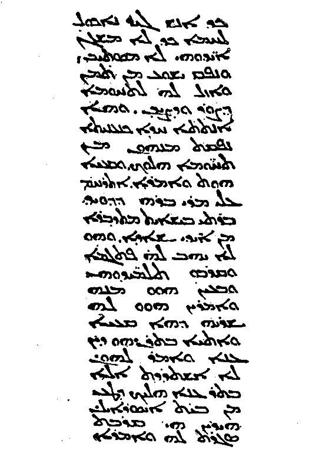

## LESSON 8

### The Subjunctive Future: The Imperfect Tense

  
  
<em>Folio from the Old Syriac Curetonian Gospels (5th century).</em>

---

#### Section 1: Review of Lesson 7

**Quick Summary**

In Lesson 7, we tackled "weak roots"—verbs whose roots contain a weak letter: Alaph, Yodh, Waw, or an initial Nun. We saw that while they can lose or transform their weak consonants in conjugation (e.g., *ʾ-m-r* $\rightarrow$ *ʾemar*; *ḥ-z-y* $\rightarrow$ *ḥzā*), they still behave syntactically like normal verbs.

**5-Question Warm-Up Drill**

*(Answers in Section 9)*

1. What does the Yodh in a III-Yodh verb turn into in the 3rd masc singular perfect (e.g., *ḥ-z-y*)?
2. Translate: *ʾEmar malkā*.
3. Identify the root of *ʾīdaʿ* (he knew).
4. What does the *-hy* at the end of *ʾaytaʾū(hy)* (ܐܝܬܐܘܗܝ, "bring him!") stand for?
5. How would you say "I saw" (1 c.sg. of *ḥ-z-y*)?

---

#### Section 2: The Semitic Prefix Conjugation — Overview

We have learned that the Participle handles the *Present* (ongoing action) and the *Perfect* (Suffix Conjugation) handles the *Past* (completed action). 

How does Syriac talk about the Future or expressing wishes/commands? It uses the **Imperfect Tense**, often called the "Prefix Conjugation."

**Cross-Linguistic Comparison: The Imperfect**

In all Semitic languages, the Imperfect adds prefixes (*n-, t-, ʾ-, y-*, etc.) to the root to indicate the person, while suffixes are used to indicate plural number.

*   **Hebrew Qal Imperfect**: יִכְתֹּב (*yiḵtōb* — he will write), אֶכְתֹּב (*ʾeḵtōb* — I will write).
*   **Arabic Form I Imperfect**: يَكْتُبُ (*yaktubu* — he writes/will write), أَكْتُبُ (*ʾaktubu* — I write).
*   **Syriac Peal Imperfect**: ܢܟܬܘܒ (*nektūb* / *nektob* — he will write), ܐܟܬܘܒ (*ʾektūb* / *ʾektob* — I will write).

*Crucial Note on Syriac vs. Hebrew/Arabic:* In Hebrew and Arabic, the 3rd person masculine prefix is **y-** (*ya-* or *yi-*). In standard Syriac, the 3rd person prefix shifted to **n-** (*ne-*).

---

#### Section 3: Morphology and Syntax of the Imperfect

**1. Forming the Peal Imperfect**

For a strong root like *k-t-b*, the base vocalization of the imperfect shifts to an *ū* (or East Syriac *o*) theme vowel written with *waw* between the second and third consonant: *-ktūb* (*-ktob*).
We then add the person-marking prefixes:

*   *n-* (He / They / We) $\rightarrow$ *n-ek-tūb* $\rightarrow$ **nektūb** (He will write).
*   *t-* (You / She) $\rightarrow$ **tektūb** (You will write / She will write).
*   *ʾ-* (I) $\rightarrow$ **ʾektūb** (I will write).

**2. Syntax: The Simple Future**

By itself, the Imperfect functions as a simple future tense.

*   *Nektūb Yūḥannan meltā*. (Yukhannan will write a word).
*   *Teḥzē tammān malkā*. (You will see a king there).

**3. Syntax: The Subjunctive / Purpose (`d-` + Imperfect)**

Syriac uses the Imperfect heavily for purpose clauses, wishes, and indirect commands. It accomplishes this by attaching the relative particle `d-` directly to the Imperfect verb. This corresponds to the Greek subjunctive with ἵνα (*hina*).

*   *ʾEtā **d-neḥzē*** = He came **in order that he might see**.
*   *ʾĀmer-nā d-tektūb* = I say **that you should write**.

---

#### Section 4: Imperfect Tense Paradigms (Peal, Paael, Aphel)

**1. The Peal Imperfect Conjugation (Root `q-ṭ-l`)**

In the Peal, the prefix has an *e* vowel in standard pronunciation, and the theme vowel is *ū* (West Syriac) / *o* (East Syriac), or *a* for guttural/stative verbs (like *nešmaʿ*, *nedḥal*).

| Person | Estrangela | Translit | Translation | Prefix | Suffix |
| :--- | :--- | :--- | :--- | :--- | :--- |
| **3 m.sg.** | ܢܩܛܘܠ | neqṭūl (neqṭol) | he will kill | n- | (none) |
| **3 f.sg.** | ܬܩܛܘܠ | teqṭūl (teqṭol) | she will kill | t- | (none) |
| **2 m.sg.** | ܬܩܛܘܠ | teqṭūl (teqṭol) | you (m.sg.) will kill| t- | (none) |
| **2 f.sg.** | ܬܩܛܠܝܢ | teqṭlīn | you (f.sg.) will kill| t- | -īn |
| **1 c.sg.** | ܐܩܛܘܠ | ʾeqṭūl (ʾeqṭol) | I will kill | ʾ- | (none) |
| **3 m.pl.** | ܢܩܛܠܘܢ | neqṭlūn | they (m.pl.) will kill| n- | -ūn |
| **3 f.pl.** | ܢܩܛ̈ܠܢ | neqṭlān | they (f.pl.) will kill| n- | -ān |
| **2 m.pl.** | ܬܩܛܠܘܢ | teqṭlūn | you (m.pl.) will kill| t- | -ūn |
| **2 f.pl.** | ܬܩܛܠܢ | teqṭlān | you (f.pl.) will kill| t- | -ān |
| **1 c.pl.** | ܢܩܛܘܠ | neqṭūl (neqṭol) | we will kill | n- | (none) |

*Warning: The forms for "He will kill" (*neqṭūl*) and "We will kill" (*neqṭūl*) are identical in spelling and pronunciation! Likewise, "She will kill" (*teqṭūl*) and "You (m.sg.) will kill" (*teqṭūl*) are identical. Context almost always makes the subject clear.*

**Weak Verbs in the Peal Imperfect**

The weak classes of Lesson 7 behave predictably once the prefix is added:

| Class | Perfect | Imperfect 3 m.sg. | Note |
| :--- | :--- | :--- | :--- |
| **I-Alaph** | ʾemar, ʾekal | ܢܐܡܪ nēmar, ܢܐܟܘܠ nēkūl | Alaph is silent; the prefix vowel lengthens to *ē* |
| **I-Yodh** | ʾīdaʿ, ʾīteb | ܢܕܥ neddaʿ, ܢܬܒ netteb | the Yodh assimilates, doubling the next consonant |
| **I-Nun** | npaq | ܢܦܘܩ neppūq | the Nun assimilates |
| **Hollow** | qām, sām | ܢܩܘܡ nqūm, ܢܣܝܡ nsīm | no prefix vowel; long *ū* or *ī* in the stem |
| **III-Yodh** | ḥzā | ܢܚܙܐ neḥzē | ends in *-ē*; plural ܢܚܙܘܢ neḥzōn |
| **ʾ-t-y, h-w-y** | ʾetā, hwā | ܢܐܬܐ nētē, ܢܗܘܐ nehwē | combine the rules above |

**2. The Paael Imperfect (Root `q-d-š`, to sanctify)**

In the Paael the prefix consonant has no full vowel (*nqaddeš*, 1 c.sg. *ʾqaddeš*), and the middle root letter is doubled.

| Person | Estrangela | Translit | Translation |
| :--- | :--- | :--- | :--- |
| **3 m.sg.** | ܢܩܕܫ | nqaddeš | he will sanctify |
| **1 c.sg.** | ܐܩܕܫ | ʾqaddeš | I will sanctify |
| **3 m.pl.** | ܢܩܕܫܘܢ| nqaddšūn | they will sanctify|
| **1 c.pl.** | ܢܩܕܫ | nqaddeš | we will sanctify |

**3. The Aphel Imperfect (Root `n-p-q`, Aphel = `ʾappeq` to bring out)**

In the Aphel, the original *ʾa-* prefix of the perfect drops out, and the imperfect prefix takes its place with an *a* vowel (*naqreb*, *nappeq*). The theme vowel is *e*.

| Person | Estrangela | Translit | Translation |
| :--- | :--- | :--- | :--- |
| **3 m.sg.** | ܢܦܩ | nappeq | he will bring out |
| **1 c.sg.** | ܐܦܩ | ʾappeq | I will bring out |
| **3 m.pl.** | ܢܦܩܘܢ| nappqūn | they will bring out|

---

#### Section 5: The Subjunctive Flow

Observe how the purpose clause flows in translation:

| Primary Action (Past/Present) | Subjunctive Clause (d- + Imperfect) | Translation |
| :--- | :--- | :--- |
| ʾEtā malkā (The king came) | d-neqṭūl leh (that he might kill him) | The king came in order to kill him. |
| Yūḥannan ʿābed nūhrā (Yukhannan makes light) | d-neḥzūn ʿammā (that the people might see) | Yukhannan makes light so that the people will see. |

---

#### Section 6: Vocabulary (Time, Judgment & Royal Court)

| Root/Noun | Transliteration | Meaning | Related Concept |
| :--- | :--- | :--- | :--- |
| ܙܒܢܐ / ܙܒܢ | zban / zabnā | time | Temporal boundary |
| ܥܕܡܐ | ʿdammā | until | Used with *d-* (until that) |
| ܕܝܢܐ / ܕܝܢ | dīn / dīnā | judgment, law | Eschatological judgment |
| ܥܠܡܐ / ܥܠܡ | ʿālam / ʿālmā | world, eternity | Often *l-ʿālam* (forever) |
| ܝܘܡܐ / ܝܘܡ | yawm (cstr. *yūm*) / yawmā | day | Heb. *yōm* |
| ܣܗܕ | sehed (Peal) | to testify/witness | Court setting |
| ܓܙܪ | gzar (Peal) | to decree/cut | Royal authority |
| ܝܬܒ | ʾīteb (Peal) | to sit/enthrone | enthronement |
| ܩܛܠ | qṭal (Peal) | to kill | execution context |
| ܕܚܠܬܐ / ܕܚܠ | dḥel (Peal) / deḥltā | to fear / fear, reverence| Root *d-ḥ-l* (to fear) |
| ܕܢ | dān (Peal, Hollow) | to judge | Active verb of *dīnā* |
| ܐܢ | ʾen | if | Introduces a condition; negative *ʾen lā* |

---

#### Section 7: The Story — Part 8

**The Threat**

*Narrative note: The king uses the Subjunctive/Imperfect to express his threats and purpose concerning Yukhannan's future.*

**Sentence 1**

ܩܡ ܝܘܚܢܢ ܩܕܡ ܡܠܟܐ ܕܕܝܢܐ
qām Yūḥannan qdām malkā d-dīnā.
qām (stood) Yūḥannan (John) qdām (before) malkā (the-king) d-dīnā (of-judgment).
→ Yukhannan stood before the king of judgment.

**Sentence 2**

ܘܝܬܒ ܡܠܟܐ ܘܐܡܪ ܠܗ
w-ʾīteb malkā w-ʾemar leh:
w-ʾīteb (and-sat) malkā (the-king) w-ʾemar (and-said) leh (to-him):
→ And the king sat and said to him:

**Sentence 3**

ܝܬܒ ܐܢܐ ܕܐܥܒܕ ܕܝܢܐ ܒܐܪܥܝ
yāteb-nā d-ʾeʿbed dīnā b-ʾarʿ(y)!
yāteb (sitting) -nā (am-I) d-ʾeʿbed (that-I-might-do) dīnā (judgment) b-ʾarʿ(y) (in-land-my)!
→ "I sit in order to render judgment in my land!"
*Note: ʾeʿbed is a Peal imperfect 1sg in a purpose clause (introduced by d-), not a perfect or imperative. The construction d- + Imperfect corresponds to Greek ἵνα + subjunctive.*

**Sentence 4**

ܐܢ ܠܐ ܬܫܒܘܩ ܐܪܥܝ ܢܩܛܠܘܢ ܠܟ ܒܝܘܡ ܕܝܢܐ
ʾen lā tešbūq ʾarʿ(y), neqṭlūn lāk b-yūm dīnā!
ʾen (if) lā (not) tešbūq (you-will-leave) ʾarʿ(y) (land-my), neqṭlūn (they-will-kill) lāk (to-you) b-yūm (in-the-day-of) dīnā (judgment)!
→ "If you do not leave my land, they will kill you in the day of judgment!"

**Sentence 5**

ܝܘܚܢܢ ܐܡܪ ܠܗ ܠܐ ܐܕܚܠ
Yūḥannan ʾemar leh: lā ʾedḥal.
Yūḥannan (John) ʾemar (said) leh (to-him): lā (not) ʾedḥal (I-will-fear).
→ Yukhannan said to him: "I will not fear."

**Sentence 6**

ܐܬܝܬ ܕܐܡܪ ܡܠܬܐ ܕܐܠܗܐ ܠܥܠܡܐ
ʾetēt d-ʾēmar meltā d-ʾAlāhā l-ʿālmā.
ʾetēt (I-came) d-ʾēmar (that-I-might-say) meltā (the-word) d-ʾAlāhā (of-God) l-ʿālmā (to-the-world).
→ "I came in order to speak the word of God to the world."

---

#### Section 8: Exercises

**Exercise 1: Imperfect Identification**

Identify the person, gender, and number of the following Imperfect verbs.

1. ܢܟܬܘܒ (nektūb)
2. ܬܫܒܩܘܢ (tešbqūn)
3. ܢܥܒܕܢ (neʿbdān)
4. ܐܚܙܐ (ʾeḥzē — root ḥ-z-y)

**Exercise 2: Conjugation Drill**

Conjugate the root *q-ṭ-l* (to kill) in the Peal Imperfect for:

1. He will kill
2. We will kill
3. I will kill
4. They (m) will kill

**Exercise 3: Translation Drill (Syriac → English)**

Translate the following future or subjunctive clauses. 

1. Npaq malkā d-neḥzē l-Yūḥannan. (Remember ḥ-z-y acts weak).
2. Lā neqṭūl malkā l-gabrā ṭābā.
3. Tešbqūn l-baytkūn l-ʿālam.
4. Ktabt meltā d-neddaʿ šrārā. (Root *y-d-ʿ*, 1 c.pl. impf. *neddaʿ*).

**Exercise 4: Production Drill (English → Syriac)**

Render the following sentences into Syriac transliteration using the Imperfect.

1. I will write the commandment (*pūqdānā*) in the day of judgment.
2. The king decreed (*gzar*, perfect) that he might kill the men (*gabrē*).
3. If you (m.sg) do not leave the truth (*šrārā*), you will see God.
4. They (m.pl) will come to the kingdom. (Hint: *nētūn* from ʾ-t-y).

**Exercise 5: Reading Comprehension**

Re-read Section 7 and answer:

1. What does the king threaten to do to Yukhannan?
2. What is the condition the king sets?
3. What is Yukhannan's stated purpose for coming to the world?

---

#### Section 9: Answer Key

**Section 1 Warm-Up**

1. It becomes a long Alaph (ā). Example: *ḥzā*.
2. The king said.
3. *y-d-ʿ* (to know). I-Yodh.
4. It is the 3 m.sg. object suffix, "him", in the form it takes after a vowel. It is written ܗܝ but is silent, like the *-(hy)* of *talmīdaw(hy)*.
5. *ḥzēt* (I saw).

**Exercise 1: Imperfect Identification**

1. 3.m.sg or 1.c.pl (He will write / We will write)
2. 2.m.pl (You all will leave)
3. 3.f.pl (They [feminine] will do)
4. 1.c.sg (I will see)

**Exercise 2: Conjugation Drill**

1. neqṭūl
2. neqṭūl
3. ʾeqṭūl
4. neqṭlūn

**Exercise 3: Translation Drill**

1. The king went out in order to see Yukhannan.
2. The king will not kill the good man.
3. You all will leave your house forever.
4. You wrote a word so that we might know the truth.

**Exercise 4: Production Drill**

1. ʾEktūb pūqdānā b-yūm dīnā.
2. Gzar malkā d-neqṭūl l-gabrē.
3. ʾEn lā tešbūq šrārā, teḥzē l-ʾAlāhā.
4. Nētūn l-malkūtā. 

**Exercise 5: Reading Comprehension**

1. To kill him in the day of judgment.
2. If Yukhannan does not leave his land ("my land").
3. To say/speak the word of God to the world.

---

#### Section 10: Grammatical Summary

**THE PEAL IMPERFECT (Root q-ṭ-l)**

| Person | Syriac | Translit |
| :--- | :--- | :--- |
| **3 m.sg.** | ܢܩܛܘܠ | neqṭūl (he will kill) |
| **3 f.sg.** | ܬܩܛܘܠ | teqṭūl (she will kill)|
| **2 m.sg.** | ܬܩܛܘܠ | teqṭūl (you [m.sg.] will kill) |
| **2 f.sg.** | ܬܩܛܠܝܢ | teqṭlīn (you [f.sg.] will kill) |
| **1 c.sg.** | ܐܩܛܘܠ | ʾeqṭūl (I will kill) |
| **3 m.pl.** | ܢܩܛܠܘܢ | neqṭlūn (they [m.] will kill)|
| **3 f.pl.** | ܢܩܛܠܢ | neqṭlān (they [f.] will kill)|
| **2 m.pl.** | ܬܩܛܠܘܢ | teqṭlūn (you [m.pl.] will kill)|
| **2 f.pl.** | ܬܩܛܠܢ | teqṭlān (you [f.pl.] will kill)|
| **1 c.pl.** | ܢܩܛܘܠ | neqṭūl (we will kill) |

**SYNTAX OF PURPOSE**

Verb 1 (Any Tense) + `d-` + Verb 2 (Imperfect) = Purpose Clause
*ʾEzal (He went) d-neʿbed (in order to do) qyāmā (a covenant).*

#### Section 11: Additional Vocabulary

The following 17 words supplement this lesson's vocabulary for nature, time, and human emotion.

| Estrangela | Transliteration | Gender/Type | Meaning |
| :--- | :--- | :--- | :--- |
| ܦܪܚܬܐ | pāraḥtā | f | bird |
| ܚܕܘܬܐ | ḥadūtā | f | joy |
| ܚܟܡܬܐ | ḥekmtā | f | wisdom |
| ܚܝܘܬܐ | ḥayūtā | f | animal, beast |
| ܦܐܪܐ | pīrā | m | fruit |
| ܟܠܒܐ | kalbā | m | dog |
| ܥܪܒܐ | ʿerbā | m | sheep |
| ܛܘܪܐ | ṭūrā | m | mountain |
| ܫܘܩܐ | šūqā | m | street, market |
| ܥܩܬܐ | ʿāqtā | f | distress, anguish |
| ܢܘܪܐ | nūrā | f | fire |
| ܡܚܪ | mḥār | adv | tomorrow |
| ܙܢܐ | znā | m | kind, manner, way |
| ܟܒܪ | kbar | adv | perhaps, already |
| ܬܘܟܠܢܐ | tūklānā | m | trust, confidence |
| ܕܚܠܐ | deḥlā | m | fear |
| ܝܕܥܐ | yadʿā | m | acquaintance, knowledge |

