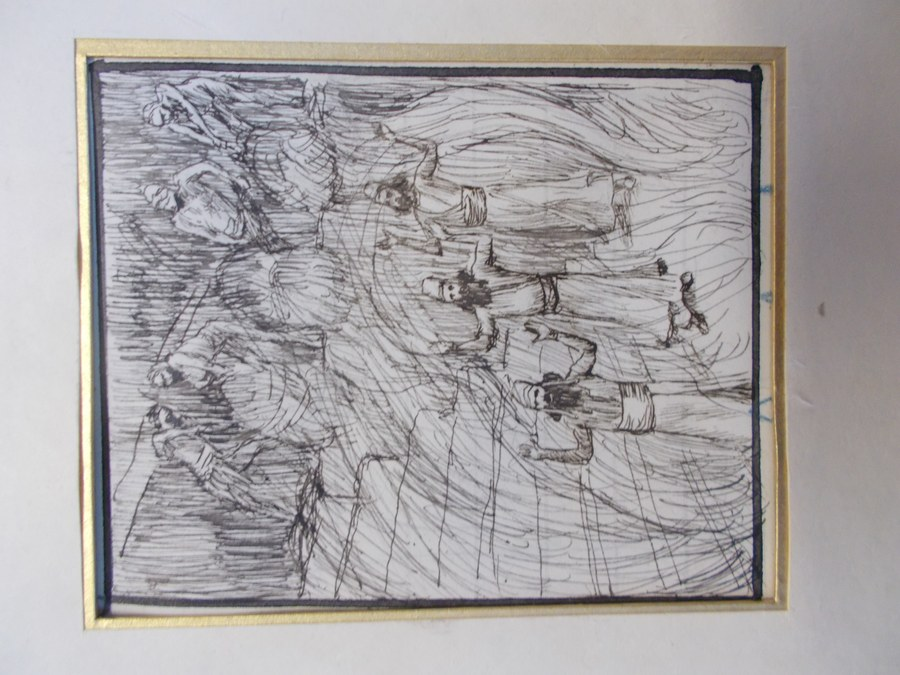

## LESSON 9

### Commands and Intentions

  
  
<em>The righteous men in the fiery furnace (J.J. Tissot).</em>

#### Section 1: Review of Lessons 1–8

Before diving into new material, take a moment to consolidate what you have learned so far. Lessons 0–8 have introduced you to the following foundational topics:

- **Lesson 0:** The Estrangela alphabet
- **Lesson 1:** Noun states, independent pronouns, verbless clauses, and the particles *d-* and *l-*
- **Lesson 2:** The Peal active participle with enclitic pronouns (the narrative present)
- **Lesson 3:** The Peal perfect (*qṭal*) — all persons and numbers; V-S-O word order
- **Lesson 4:** Pronominal suffixes on nouns and prepositions; *ʾīt l-* ("to have")
- **Lesson 5:** The Aphel stem — causation (*ʾaqreb*)
- **Lesson 6:** The Paael stem — intensive and factitive meaning (*barrek*, *qaddeš*, *ʾallep*)
- **Lesson 7:** Weak roots: I-Alaph, I-Yodh, and III-Yodh verbs
- **Lesson 8:** The Peal imperfect (*neqṭūl* / *neqṭol*): the future, and *d-* + imperfect for purpose

**5-Question Warm-Up Drill**

*(Answers in Section 9)*

1. What is the Peal perfect 3 m.sg. of *k-t-b* (write)?
2. What is the Peal imperfect 3 m.sg. of *š-m-ʿ* (hear)?
3. How do you say "the king commanded" (*p-q-d*, 3 m.sg. perfect)?
4. What does the Paael stem add to the root's meaning?
5. Give the Aphel perfect 3 m.sg. of *n-p-q* (go out).

#### Section 2: The Imperative

**2.1 What Is the Imperative?**

The imperative is the grammatical form used to issue **direct commands** or requests addressed to a second person ("you"). In Syriac, as in Hebrew and Arabic, the imperative exists only in the second person — singular and plural, masculine and feminine. There is no separate first-person or third-person imperative form; indirect commands or wishes ("let us go", "let him write") are expressed by the imperfect (often introduced by *d-*).

The **formation** of the Peal imperative follows a straightforward rule: take the **imperfect stem**, strip away the **t-** prefix of the 2nd person, and you have the imperative. The vowel pattern for action verbs is **CCūC** (pronounced *ū* in West Syriac and *o* in East Syriac, often written *ktob* or *ktūb*, "write!"). This parallels the Hebrew Qal imperative (כְּתֹב *ktōb*) and the Arabic imperative (اُكْتُبْ *uktub*).

**2.2 Peal Imperative — Formation**

- **Masculine Singular:** *CCūC* (or *CCoC*) — the simplest form, the bare root with its characteristic stem vowel written with *waw*. E.g., **ktūb** (*ktob*) ܟܬܘܒ "Write! (to one man)".
- **Feminine Singular:** *CCūC(y)* — add a final *yodh* that is written but silent. E.g., **ktūb(y)** ܟܬܘܒܝ "Write! (to one woman)".
- **Masculine Plural:** *CCūC(w)* — add the plural *waw*, also written but silent (a fuller, audible form in *-ūn* exists). E.g., **ktūb(w)** ܟܬܘܒܘ "Write! (to a group of men)".
- **Feminine Plural:** *CCūCēn* — add the feminine plural ending `-ēn` (spelled `-yn`). E.g., **ktūbēn** ܟܬܘܒܝܢ "Write! (to a group of women)".

In speech, then, the first three forms sound the same; the spelling shows whom you are addressing.

**Weak and irregular imperatives.** The weak verbs of Lesson 7 form their imperatives as you would expect from their imperfects, and three very common verbs are irregular. Learn these by heart:

| Verb | Imperative m.sg. | m.pl. | Note |
|:---|:---|:---|:---|
| *ʾezal* (go) | ܙܠ *zel* | ܙܠܘ *zel(w)* | irregular: the Alaph is dropped |
| *ʾetā* (come) | ܬܐ *tā* | ܬܘ *taw* | irregular |
| *ya(h)b* (give) | ܗܒ *hab* | ܗܒܘ *hab(w)* | irregular: the Yodh is dropped |
| *ʾemar* (say) | ܐܡܪ *ʾemar* | ܐܡܪܘ *ʾemar(w)* | I-Alaph, *a*-class |
| *ʾeḥad* (seize) | ܐܚܘܕ *ʾaḥūd* | ܐܚܘܕܘ *ʾaḥūd(w)* | I-Alaph, *ū*-class: the Alaph takes *a* |
| *npaq* (go out) | ܦܘܩ *pūq* | ܦܘܩܘ *pūq(w)* | I-Nun: the Nun is dropped |
| *qām* (rise) | ܩܘܡ *qūm* | ܩܘܡܘ *qūm(w)* | hollow |
| *ḥzā* (see) | ܚܙܝ *ḥzī* | ܚܙܘ *ḥzaw* | III-Yodh |

**2.3 Complete Paradigm Tables**

**Root *k-t-b* ܟܬܒ (write)**

| **Person/Gender/Number** | **Estrangela** | **Transliteration** | **Literal Meaning** |
|:---|:---|:---|:---|
| 2 m.sg. | ܟܬܘܒ | *ktūb* (*ktob*) | Write! (to one man) |
| 2 f.sg. | ܟܬܘܒܝ | *ktūb(y)* | Write! (to one woman) |
| 2 m.pl. | ܟܬܘܒܘ | *ktūb(w)* | Write! (to a group of men) |
| 2 f.pl. | ܟܬܘܒܝܢ | *ktūbēn* | Write! (to a group of women) |

**Root *š-m-ʿ* ܫܡܥ (hear — *a*-vowel class)**

| **Person/Gender/Number** | **Estrangela** | **Transliteration** | **Literal Meaning** |
|:---|:---|:---|:---|
| 2 m.sg. | ܫܡܥ | *šmaʿ* | Hear! (to one man) |
| 2 f.sg. | ܫܡܥܝ | *šmaʿ(y)* | Hear! (to one woman) |
| 2 m.pl. | ܫܡܥܘ | *šmaʿ(w)* | Hear! (to a group of men) |
| 2 f.pl. | ܫܡܥܝܢ | *šmaʿēn* | Hear! (to a group of women) |

**2.4 Derived Stems: Paael and Aphel Imperatives**

- **Paael Imperative:** Its m.sg. imperative is built from the Paael stem without a prefix: **CaCCeC** — identical in consonants and vowels to the 3 m.sg. perfect, with the characteristic doubled middle radical. E.g., **barrek** ܒܪܟ "Bless!"; **ʾallep** ܐܠܦ "Teach!". A III-Yodh Paael ends in *-ā* in the imperative: *ḥawwī* (he showed) $\rightarrow$ **ḥawwā** ܚܘܐ "Show!"; *ṣallī* (he prayed) $\rightarrow$ **ṣallā** ܨܠܐ "Pray!".
- **Aphel Imperative:** Its m.sg. imperative begins with **ʾa-** and has the pattern **ʾaCCeC** (identical to the 3 m.sg. perfect). E.g., **ʾappeq** ܐܦܩ "Bring out!"; **ʾaqreb** ܐܩܪܒ "Bring near!". In the plural: ܐܦܩܘ *ʾappeq(w)*; for a III-Yodh Aphel, ܐܪܡܘ *ʾarmaw* "Throw!" (m.pl.).

**2.5 Negative Commands**

> **Key Rule: Negating Commands**
>
> In Syriac, negative commands (prohibitions) are NOT formed with the imperative.
> Instead, use: **lā + IMPERFECT (2nd person)**.
> This is parallel to Biblical Hebrew (אַל + jussive / לֹא + imperfect) and Arabic (لَا + jussive).
> Example: *lā tektūb* (ܠܐ ܬܟܬܘܒ) = "Do not write!" (lit. "you shall not write")
> Example: *lā tešmaʿ* (ܠܐ ܬܫܡܥ) = "Do not listen!"

**2.6 Cross-Linguistic Comparison**

| **Language** | **Form (write!)** | **Form (hear!)** | **Negative** | **Notes** |
|:---|:---|:---|:---|:---|
| Syriac | *ktūb* (*ktob*) ܟܬܘܒ | *šmaʿ* ܫܡܥ | *lā* + imperfect | 2nd person only; 4 forms |
| Hebrew | כְּתֹב *ktōb* | שְׁמַע *šmaʿ* | אַל + jussive | Similar 4-form paradigm |
| Arabic | اُكْتُبْ *uktub* | اِسْمَعْ *ismaʿ* | لَا + jussive | Form I imperative derived from imperfect |
| Greek | γράφε / γράψον | ἄκουε / ἄκουσον | μή + impv./subj. | Pres./Aor. distinction; no gender |
| Latin | *scribe* | *audi* | *noli* + infinitive | Singular/plural; no gender marking |

**2.7 Example Commands with Interlinear Gloss**

| **Estrangela** | **Transliteration** | **Word Gloss** | **English** |
|:---|:---|:---|:---|
| ܟܬܘܒ ܫܡܗ ܕܡܠܟܐ | *ktūb šmeh d-malkā* | write! name-his of-the-king | Write the name of the king! |
| ܫܡܥ ܩܠܝ | *šmaʿ qāl(y)* | hear! voice-my | Hear my voice! |
| ܗܘܘ ܝܕܥܝܢ | *hwaw yādʿīn* | be-pl.! knowing (m.pl.) | Know (be knowing)! [m.pl.] |
| ܠܐ ܬܕܚܠ | *lā tedḥal* | not you-fear | Do not be afraid! |
| ܙܠܘ ܘܐܡܪܘ | *zel(w) w-ʾemar(w)* | go-pl.! and-say-pl.! | Go and tell! [m.pl.] |
| ܚܘܐ ܠܝ ܐܬܐ | *ḥawwā lī ʾātā* | show! to-me sign | Show me a sign! |

#### Section 3: The Infinitive (Verbal Noun / Maṣdar)

**3.1 The Nature of the Syriac Infinitive**

Syriac, like Arabic and Hebrew, possesses a **verbal noun** — a form derived from the verb root that expresses the action in abstract form. In Arabic this is called the **maṣdar** (مَصْدَر, "source"); in Hebrew it corresponds to the **infinitive construct**. In Syriac it is called the **infinitive** and always begins with the prefix **m-**. In narrative, it appears most commonly as a **complementary infinitive** after a verb of beginning, ability, desire, or command, introduced by the prefixed preposition **l-** ("to").

**3.2 Infinitive Formation by Stem**

- **Peal Infinitive: *meCCaC*** pattern. Insert *me-* prefix and *a*-vowel in the stem. E.g., *k-t-b* → **mektab** ܡܟܬܒ "to write"; *š-m-ʿ* → **mešmaʿ** ܡܫܡܥ "to hear". (For I-Alaph verbs like *ʾ-z-l* and *ʾ-s-r*, *me-* + *ʾ-* coalesces to *mē-*: **mēzal** ܡܐܙܠ "to go", **mēsar** ܡܐܣܪ "to bind".)
- **Paael Infinitive: *mCaCCāCū*** — *m-* prefix, doubled middle radical, *-ā-* before the last radical, final *-ū*. E.g., *barrek* (bless, Paael) → **mbarrākū** ܡܒܪܟܘ "to bless".
- **Aphel Infinitive: *maCCāCū*** — *ma-* prefix with *-ā-* vowel before final radical + *-ū*. E.g., *ʾappeq* (bring out, Aphel) → **mappāqū** ܡܦܩܘ "to bring out".

**3.3 Infinitive Forms — Five Key Verbs**

Not every root is used in every stem. A dash means that the root has no verb in that stem (or none that you need).

| **Root** | **Meaning** | **Peal Inf.** | **Paael Inf.** | **Aphel Inf.** |
|:---|:---|:---|:---|:---|
| *k-t-b* | write | *mektab* ܡܟܬܒ | — | — |
| *š-m-ʿ* | hear | *mešmaʿ* ܡܫܡܥ | — | *mašmāʿū* ܡܫܡܥܘ (cause to hear) |
| *q-ṭ-l* | kill | *meqṭal* ܡܩܛܠ | *mqaṭṭālū* ܡܩܛܠܘ (massacre) | — |
| *p-q-d* | command | *mepqad* ܡܦܩܕ | *mpaqqādū* ܡܦܩܕܘ (give orders) | *mapqādū* ܡܦܩܕܘ (entrust) |
| *y-d-ʿ* | know | *meddaʿ* ܡܕܥ | — | *mawdāʿū* ܡܘܕܥܘ (make known) |

#### Section 4: The *l-* + Infinitive Construction

**4.1 The Construction**

The infinitive is almost always found with the preposition *l-*.

> **The l- + Infinitive Construction**
>
> PATTERN: MAIN VERB + *l-* + INFINITIVE
> This construction expresses purpose or complement: "he began to write", "she is able to hear".
> The preposition *l-* is prefixed directly to the infinitive with no space.
> Compare: Hebrew *lamed* + infinitive construct לִכְתֹּב (*liḵtōb*).

**4.2 Eight Example Sentences with *l-* + Infinitive**

| **Estrangela** | **Transliteration** | **Word Gloss** | **English** |
|:---|:---|:---|:---|
| ܫܪܝ ܠܡܟܬܒ | *šarrī l-mektab* | began to-write | He began to write. |
| ܡܨܐ ܠܡܫܡܥ | *mṣē l-mešmaʿ* | is-able to-hear | He is able to hear. |
| ܒܥܐ ܠܡܐܙܠ | *bāʿē l-mēzal* | wants to-go | He wants to go. |
| ܨܒܐ ܠܡܩܛܠ | *ṣābē l-meqṭal* | wishes to-kill | He wishes to kill. |
| ܦܩܕ ܠܡܐܣܪ | *pqad l-mēsar* | commanded to-bind | He commanded (them) to bind. |
| ܫܕܪ ܠܡܥܒܕ | *šaddar l-meʿbad* | sent to-do/make | He sent (them) to act. |
| ܠܐ ܡܨܐ ܠܡܐܙܠ | *lā mṣē l-mēzal* | not is-able to-go | He is not able to go. |
| ܫܪܝܬ ܠܡܩܪܐ ܡܠܬܐ | *šarrīt l-meqrā meltā* | you-began to-read the-word | You began to read the word. |

#### Section 5: Verbs of Beginning, Ability, and Desire

**5.1 Semi-Modal Verbs**

These verbs function like **modal auxiliaries** in English and govern an infinitive complement introduced by **l-**. They are extremely common in Syriac narrative.

- ***š-r-y* ܫܪܝ — begin (Paael):** Perfect 3 m.sg. *šarrī* ܫܪܝ (Participle: *mšarrē* ܡܫܪܐ). Example: ܫܪܝ ܠܡܟܬܒ *šarrī l-mektab* — "He began to write." (In Peal *šrā* ܫܪܐ, the root means "to loosen, dwell"; in Paael *šarrī*, it means "to begin".)
- ***m-ṣ-y* ܡܨܐ — be able / can (Peal):** Perfect 3 m.sg. *mṣā* ܡܨܐ (Participle: *mṣē* ܡܨܐ). Example: ܡܨܐ ܠܡܩܛܠ *mṣē l-meqṭal* — "He is able to kill." Often negated: *lā mṣē* ܠܐ ܡܨܐ (1 c.pl. contracted *lā mṣēnan* ܠܐ ܡܨܝܢܢ, "we are not able").
- ***b-ʿ-y* ܒܥܐ — want / seek / ask (Peal):** Perfect 3 m.sg. *bʿā* ܒܥܐ (Participle: *bāʿē* ܒܥܐ). Example: ܒܥܐ ܠܡܐܙܠ *bāʿē l-mēzal* — "He wants to go."
- ***ṣ-b-y* ܨܒܐ — wish / will / be pleased (Peal):** Perfect 3 m.sg. *ṣbā* ܨܒܐ (Participle: *ṣābē* ܨܒܐ). Example: ܨܒܐ ܠܡܩܛܠ *ṣābē l-meqṭal* — "He wishes to kill." Related noun: *ṣebyānā* (will/wish).
- ***p-q-d* ܦܩܕ — command / order (Peal):** Perfect 3 m.sg. *pqad* ܦܩܕ. Example: ܦܩܕ ܠܡܐܣܪ *pqad l-mēsar* — "He commanded to bind."
- ***š-d-r* ܫܕܪ — send (Paael):** Perfect 3 m.sg. *šaddar* ܫܕܪ. Example: ܫܕܪ ܐܢܫ̈ܐ ܠܡܩܛܠ *šaddar ʾnāšē l-meqṭal* — "He sent men to kill."

#### Section 6: Military and Emotional Vocabulary — 30 Words

This vocabulary set is essential for the narrative of Lesson 9. Learn both the verbal root and its noun/adjective derivatives.

| **Root / Lemma** | **Estrangela** | **Transliteration** | **English** |
|:---|:---|:---|:---|
| *m-ḥ-y* | ܡܚܐ | *mḥā* / *nemḥē* | strike, smite, hit |
| *d-ḥ-l* | ܕܚܠ | *dḥel* / *nedḥal* | fear, be afraid |
| *ḥ-d-y* | ܚܕܝ | *ḥdī* / *neḥdē* | rejoice, be glad |
| *ʾ-s-r* | ܐܣܪ | *ʾesar* / *nēsūr* | bind, tie, imprison |
| *š-r-y* | ܫܪܐ | *šrā* / *nešrē* | loosen, release; Paael *šarrī* begin |
| *r-m-y* | ܪܡܐ | *rmā* / *nermē* | throw, cast |
| *ʾ-ḥ-d* | ܐܚܕ | *ʾeḥad* / *nēḥūd* | seize, grab, take hold |
| *g-r-r* | ܓܪ | *gar* / *neggūr* | drag, pull |
| *ʿ-r-q* | ܥܪܩ | *ʿraq* / *neʿrūq* | flee, escape |
| *r-d-p* | ܪܕܦ | *rdap* / *nerdūp* | pursue, chase, persecute |
| *q-ṭ-l* | ܩܛܠ | *qṭal* / *neqṭūl* (*neqṭol*) | kill, slay |
| *p-ṣ-ʿ* | ܦܨܥ | *pṣaʿ* / *nepṣaʿ* | wound, bruise |
| *z-ʿ-q* | ܙܥܩ | *zʿaq* / *nezʿaq* | cry out, shout |
| *p-q-d* | ܦܩܕ | *pqad* / *nepqūd* (*nepqod*) | command, order |
| *k-n-š* | ܟܢܫ | *knaš* / *neknūš* | gather, assemble |
| *ʾesṭraṭyōṭā* | ܐܣܛܪܛܝܘܛܐ | *ʾesṭraṭyōṭā* | soldier (Greek loanword: *στρατιώτης*) |
| *ḥaylā* | ܚܝܠܐ | *ḥaylā* | army; strength, power (dual meaning) |
| *saypā* | ܣܝܦܐ | *saypā* | sword |
| *nūrā* | ܢܘܪܐ | *nūrā* | fire (f.) |
| *ʾattūnā* | ܐܬܘܢܐ | *ʾattūnā* | furnace, oven |
| *šīšaltā* | ܫܫܠܬܐ | *šīšaltā* | chain (also spelled ܫܠܫܠܬܐ *šalšaltā*) |
| *gubbā* | ܓܘܒܐ | *gubbā* | pit, cistern; den (as in lions' den) |
| *bēt ʾasīrē* | ܒܝܬ ܐܣܝܪܐ | *bēt ʾasīrē* | prison (lit. "house of the bound ones") |
| *kenšā* | ܟܢܫܐ | *kenšā* | crowd, gathering, assembly |
| *qālā* | ܩܠܐ | *qālā* | voice, sound |
| *rūgzā* | ܪܘܓܙܐ | *rūgzā* | anger, wrath |
| *deḥltā* | ܕܚܠܬܐ | *deḥltā* | fear, reverence (noun from *d-ḥ-l*) |
| *ʾammīnūtā* | ܐܡܝܢܘܬܐ | *ʾammīnūtā* | steadfastness, constancy, endurance |
| *pūqdānā* | ܦܘܩܕܢܐ | *pūqdānā* | command, commandment (noun from *p-q-d*) |
| *ṣebyānā* | ܨܒܝܢܐ | *ṣebyānā* | will, wish, desire (key theological term) |

#### Section 7: The Story — Part 9

**The King Commands: Seize Yukhannan**

The narrative reaches a climax. Having heard Yukhannan's defiant answer, the king summons his soldiers and issues a series of direct commands. The passage is rich in imperatives and *l-* + infinitive constructions, giving you immediate practice in the new grammar.

**Sentence 1**

ܡܠܟܐ ܕܝܢ ܟܕ ܫܡܥ ܡ̈ܠܐ ܗܠܝܢ

*malkā dēn kad šmaʿ mellē hālēn*

malkā (the-king) dēn (now/but) kad (when) šmaʿ (he-heard) mellē (words) hālēn (these)

*→ Now when the king heard these words,*

**Sentence 2**

ܐܬܡܠܝ ܒܪܘܓܙܐ ܘܙܥܩ ܒܩܠܐ ܪܒܐ

*ʾetmlī b-rūgzā w-zʿaq b-qālā rabbā*

ʾetmlī (he-was-filled) b-rūgzā (with-anger) w-zʿaq (and-cried-out) b-qālā (with-voice) rabbā (great)

*→ he was filled with anger and cried out with a great voice.*

**Sentence 3**

ܦܩܕ ܠܐܣܛܪ̈ܛܝܘܛܘܗܝ

*pqad l-ʾesṭraṭyōṭaw(hy)*

pqad (he-commanded) l-ʾesṭraṭyōṭaw(hy) (his-soldiers)

*→ He commanded his soldiers:*

**Sentence 4**

ܙܠܘ ܘܐܚܘܕܘ ܠܝܘܚܢܢ

*zel(w) w-ʾaḥūd(w) l-Yūḥannan*

zel(w) (go! [m.pl.]) w-ʾaḥūd(w) (and-seize! [m.pl.]) l-Yūḥannan (Yukhannan)

*→ "Go and seize Yukhannan!"*

**Sentence 5**

ܘܐܝܬܐܘܗܝ ܘܐܪܡܘ ܠܗ ܒܐܬܘܢܐ

*w-ʾaytaʾū(hy) w-ʾarmaw leh b-ʾattūnā*

w-ʾaytaʾū(hy) (and-bring-him! [Aphel m.pl. + suffix]) w-ʾarmaw (and-throw! [Aphel m.pl.]) leh (him) b-ʾattūnā (into-the-furnace)

*→ "And bring him and throw him into the furnace!"*

**Sentence 6**

ܠܐ ܬܕܚܠܘܢ ܡܢ ܡ̈ܠܘܗܝ

*lā tedḥlūn men mellaw(hy)*

lā (do-not) tedḥlūn (you-fear [m.pl.]) men (from) mellaw(hy) (his-words)

*→ "Do not fear his words!"*

**Sentence 7**

ܐܣܛܪ̈ܛܝܘܛܐ ܫܪܝܘ ܠܡܐܙܠ

*ʾesṭraṭyōṭē šarrī(w) l-mēzal*

ʾesṭraṭyōṭē (the-soldiers) šarrī(w) (began) l-mēzal (to-go)

*→ The soldiers began to go.*

**Sentence 8**

ܒܥܐ ܚܕ ܡܢܗܘܢ ܠܡܗܦܟ

*bʿā ḥad menhūn l-mehpak*

bʿā (wanted) ḥad (one) menhūn (of-them) l-mehpak (to-turn-back)

*→ One of them wanted to turn back.*

**Sentence 9**

ܐܡܪ ܠܐ ܡܨܝܢܢ ܠܡܩܛܠ ܙܕܝܩܐ

*ʾemar: lā mṣēnan l-meqṭal zaddīqā*

ʾemar (he-said) lā (not) mṣēnan (we-are-able) l-meqṭal (to-kill) zaddīqā (a-righteous-man)

*→ He said: "We are not able to kill a righteous man."*

**Sentence 10**

ܐܚܪ̈ܢܐ ܐܣܪܘ ܐܝ̈ܕܘܗܝ ܒܫܫܠܬܐ

*ʾaḥrānē ʾesar(w) ʾīdaw(hy) b-šīšaltā*

ʾaḥrānē (others) ʾesar(w) (bound) ʾīdaw(hy) (his-hands) b-šīšaltā (with-a-chain)

*→ Others bound his hands with a chain.*

**Sentence 11**

ܘܓܪܘܗܝ ܠܘܬ ܐܬܘܢܐ

*w-garrū(hy) lwāt ʾattūnā*

w-garrū(hy) (and-they-dragged-him) lwāt (toward) ʾattūnā (the-furnace)

*→ And they dragged him toward the furnace.*

**Sentence 12**

ܝܘܚܢܢ ܕܝܢ ܠܐ ܕܚܠ ܐܠܐ ܨܠܝ

*Yūḥannan dēn lā dḥel ʾellā ṣallī*

Yūḥannan (Yukhannan) dēn (but) lā (not) dḥel (feared) ʾellā (rather) ṣallī (prayed)

*→ But Yukhannan did not fear; instead he prayed.*

#### Section 8: Exercises

**Exercise 1: Imperative Paradigm**

Write out all four imperative forms (m.sg., f.sg., m.pl., f.pl.) for each of the following roots in the Peal stem. Include Estrangela script and transliteration.

1. ***ʾ-z-l*** (go) — Peal imperfect 2 m.sg.: *tēzal* → imperative: ? (Careful: this verb is irregular.)
2. ***ʿ-b-d*** (do, make) — Peal imperfect 2 m.sg.: *teʿbed* → imperative: ?
3. ***q-r-y*** (read, call) — Peal imperfect 2 m.sg.: *teqrē* → imperative: ?

**Exercise 2: Infinitive Formation**

Form the infinitive of each verb. Use the pattern: Peal = *meCCaC*; Paael = *mCaCCāCū*; Aphel = *maCCāCū*.

1. *npaq* (go out, Peal) and *ʾappeq* (bring out, Aphel)
2. *qabbel* (receive, Paael)
3. *šaddar* (send, Paael)
4. *ḥzā* (see, Peal)
5. *ʿal* (enter, Peal) and *ʾaʿʿel* (bring in, Aphel)
6. *ʾīteb* (sit, Peal) and *ʾawteb* (seat, Aphel)
7. *rḥem* (love, have mercy, Peal) and *raḥḥem* (have mercy, Paael)
8. *sgad* (worship, Peal)

**Exercise 3: Translation — Syriac to English**

Translate each sentence into English. Identify any imperatives and *l-* + infinitive constructions.

1. ܙܠ ܠܐܘܪܫܠܡ
2. ܫܡܥܝ ܩܠܐ ܕܐܠܗܐ
3. ܠܐ ܬܙܥܩܘܢ
4. ܫܪܝ ܠܡܩܪܐ ܟܬܒܐ
5. ܒܥܐ ܡܠܟܐ ܠܡܐܣܪ ܠܝܘܚܢܢ
6. ܡܨܐ ܐܠܗܐ ܠܡܡܚܐ ܠܐܣܛܪ̈ܛܝܘܛܐ
7. ܦܩܕ ܠܗܘܢ ܠܡܪܡܝܘ ܒܐܬܘܢܐ
8. ܨܒܐ ܝܘܚܢܢ ܠܡܨܠܝܘ

**Exercise 4: Production — English to Syriac**

Express each sentence in Syriac. Use Estrangela script and transliteration.

1. Hear me, O king! (m.sg.)
2. Do not kill the righteous man! (m.pl.)
3. He began to pray.
4. The soldier is not able to flee.
5. The king commanded to throw him into the furnace.
6. She wants to read the book.

**Exercise 5: Reading Comprehension**

Re-read the story in Section 7 and answer the following questions in English.

1. Why was the king filled with anger?
2. What two commands did the king give his soldiers?
3. What did one soldier say? Why was he reluctant?
4. How was Yukhannan restrained before being brought to the furnace?
5. How did Yukhannan respond to his situation?

#### Section 9: Answer Key

**Section 1 Warm-Up**

1. *ktab* — he wrote (ܟܬܒ)
2. *nešmaʿ* — he will hear (ܢܫܡܥ)
3. *pqad malkā* — the king commanded (ܦܩܕ ܡܠܟܐ)
4. Intensity, repetition, or factitive/denominative meaning
5. *ʾappeq* — he brought out / caused to go out (ܐܦܩ)

**Exercise 1: Imperative Paradigm**

- ***ʾ-z-l* (go):** m.sg. *zel* ܙܠ | f.sg. *zel(y)* ܙܠܝ | m.pl. *zel(w)* ܙܠܘ | f.pl. *zelēn* ܙܠܝܢ (irregular: the Alaph of the root is dropped)
- ***ʿ-b-d* (do):** m.sg. *ʿbed* ܥܒܕ | f.sg. *ʿbed(y)* ܥܒܕܝ | m.pl. *ʿbed(w)* ܥܒܕܘ | f.pl. *ʿbedēn* ܥܒܕܝܢ
- ***q-r-y* (read/call):** m.sg. *qrī* ܩܪܝ | f.sg. *qrāy* ܩܪܝ | m.pl. *qraw* ܩܪܘ | f.pl. *qrāyēn* ܩܪܝܢ

**Exercise 2: Infinitive Formation**

1. ***npaq* / *ʾappeq*:** Peal **meppaq** ܡܦܩ; Aphel **mappāqū** ܡܦܩܘ
2. ***qabbel*:** Paael **mqabbālū** ܡܩܒܠܘ
3. ***šaddar*:** Paael **mšaddārū** ܡܫܕܪܘ
4. ***ḥzā*:** Peal **meḥzā** ܡܚܙܐ
5. ***ʿal* / *ʾaʿʿel*:** Peal **meʿʿal** ܡܥܠ; Aphel **maʿʿālū** ܡܥܠܘ
6. ***ʾīteb* / *ʾawteb*:** Peal **mettab** ܡܬܒ; Aphel **mawtābū** ܡܘܬܒܘ
7. ***rḥem* / *raḥḥem*:** Peal **merḥam** ܡܪܚܡ; Paael **mraḥḥāmū** ܡܪܚܡܘ
8. ***sgad*:** Peal **mesgad** ܡܣܓܕ

**Exercise 3: Translation**

1. Go to Jerusalem!
2. Hear the voice of God! (to a woman)
3. Do not cry out! (m.pl.)
4. He began to read the book.
5. The king wanted to bind Yukhannan.
6. God is able to strike the soldiers.
7. He commanded them to throw (him) into the furnace.
8. Yukhannan wished to pray.

**Exercise 4: Production**

1. ܫܡܥܝܢܝ ܡܠܟܐ *šmaʿayn(y) malkā* (imperative + 1 c.sg. object suffix, a preview of Lesson 11; ܫܡܥ ܠܝ *šmaʿ lī* is also correct)
2. ܠܐ ܬܩܛܠܘܢ ܠܙܕܝܩܐ *lā teqṭlūn l-zaddīqā*
3. ܫܪܝ ܠܡܨܠܝܘ *šarrī l-mṣallāyū*
4. ܐܣܛܪܛܝܘܛܐ ܠܐ ܡܨܐ ܠܡܥܪܩ *ʾesṭraṭyōṭā lā mṣē l-meʿraq*
5. ܦܩܕ ܡܠܟܐ ܠܡܪܡܝܘ ܠܗ ܒܐܬܘܢܐ *pqad malkā l-marmāyū leh b-ʾattūnā* (Aphel infinitive of *ʾarmī*)
6. ܒܥܝܐ ܠܡܩܪܐ ܟܬܒܐ *bāʿyā l-meqrā ktābā*

**Exercise 5: Comprehension**

1. He heard the words (reports) about Yukhannan and was filled with anger.
2. (1) Go and seize Yukhannan; (2) bring and throw him into the furnace.
3. One soldier said they were not able to kill a righteous man — showing moral hesitation.
4. They bound his hands with a chain and dragged him toward the furnace.
5. Yukhannan did not fear; he prayed instead.

#### Section 10: Grammatical Summary Box

**The Imperative at a Glance**

| **Form** | **Ending** | **Example (*k-t-b*)** | **Estrangela** |
|:---|:---|:---|:---|
| Masculine Singular | *CCūC* (*CCoC*, bare stem) | *ktūb* (*ktob*) | ܟܬܘܒ |
| Feminine Singular | *CCūC* + silent *-(y)* | *ktūb(y)* | ܟܬܘܒܝ |
| Masculine Plural | *CCūC* + silent *-(w)* | *ktūb(w)* | ܟܬܘܒܘ |
| Feminine Plural | *CCūC* + *-ēn* | *ktūbēn* | ܟܬܘܒܝܢ |

**Infinitive Patterns**

| **Stem** | **Pattern** | **Example** | **Notes** |
|:---|:---|:---|:---|
| Peal | *meCCaC* | *mektab* ܡܟܬܒ | Most common; parallel to Hebrew inf. construct with *l-* |
| Paael | *mCaCCāCū* | *mbarrākū* ܡܒܪܟܘ | Doubled middle radical + *-ū* ending |
| Aphel | *maCCāCū* | *mappāqū* ܡܦܩܘ | *ma-* prefix with *-ū* ending |

**The *l-* + Infinitive Construction**

> **Quick Reference**
>
> MAIN VERB + *l-* + INFINITIVE = "to [do X]"
> *šarrī l-mektab* = He began to write
> *mṣē l-mešmaʿ* = He is able to hear
> *bāʿē l-mēzal* = He wants to go
> *pqad l-mēsar* = He commanded to bind
> NEGATIVE: *lā* + IMPERFECT (not imperative!) for prohibitions
> IRREGULAR IMPERATIVES: *zel* (go!), *tā* (come!), *hab* (give!)
