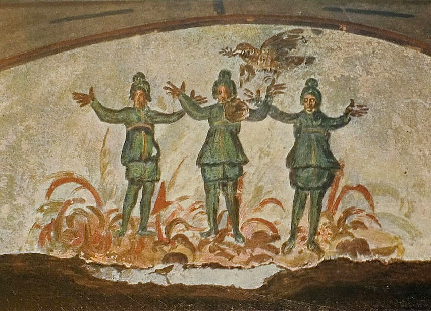

## LESSON 10

### The Passive Voice

  
  
<em>Early Christian depiction of the three youths in the fiery furnace, Catacombs of Rome.</em>

#### Section 1: Review of Lessons 1–9

Lesson 9 introduced the **imperative** (direct commands), the **infinitive** (verbal noun / maṣdar), and the **l- + infinitive construction** for expressing purpose, ability, desire, and obligation. Before proceeding, confirm you can recall the following:

- **Imperative formation:** Peal m.sg. = *CCūC* (*CCoC*); f.sg. = *CCūC(y)*; m.pl. = *CCūC(w)*; f.pl. = *CCūCēn*
- **Negative commands:** *lā* + imperfect (never imperative)
- **Infinitive:** Peal = *meCCaC*; Paael = *mCaCCāCū*; Aphel = *maCCāCū*
- **Semi-modals:** *šarrī*, *mṣē*, *bāʿē*, *ṣābē*, *pqad*, *šaddar* — all govern *l-* + infinitive

**Warm-Up Drill: Five Quick Questions**

Answer in Syriac (Estrangela + transliteration).

| # | Question | Expected answer | Syriac |
|---:|:---|:---|:---|
| 1 | Give the Peal imperative m.sg. of *ʾ-z-l* (go). | *ʾezal* — go! | ܐܙܠ |
| 2 | How do you say "Do not kill!" (m.pl.)? | *lā teqṭlūn* | ܠܐ ܬܩܛܠܘܢ |
| 3 | What is the Peal infinitive of *q-ṭ-l* (kill)? | *meqṭal* | ܡܩܛܠ |
| 4 | Translate: *šarrī l-mešmaʿ*. | He began to hear. | ܫܪܝ ܠܡܫܡܥ |
| 5 | What does *pūqdānā* mean? | commandment, command (noun from *p-q-d*) | ܦܘܩܕܢܐ |

#### Section 2: The Passive/Reflexive Stems — Overview

**2.1 The Principle of Passive Formation in Syriac**

In Syriac, the passive voice is not expressed by auxiliary verbs (as in English: "is killed", "was written") but by a separate, **inflected stem** built from the active stem by means of a characteristic prefix: **ʾet-** (or **ʾett-**). These are called the **Et-stems**. Each active stem has a corresponding Et-stem that functions as its passive or reflexive counterpart.

Students of Hebrew will recognise an analogy with the **Niphal** (נִפְעַל, passive of Qal) and **Hitpael** (הִתְפַּעֵל, reflexive of Piel). Arabists will recognise the parallel with **Forms V, VII, and VIII**: the *tāʾ*-prefixed (تَفَعَّلَ *tafaʿʿala*) and *tāʾ*-infixed (اِفْتَعَلَ *iftaʿala*) or *n*-prefixed (اِنْفَعَلَ *infaʿala*) passives/reflexives, which in Syriac have largely replaced the older internal vowel passives (like Arabic *fuʿila* or Hebrew *Puʿal* and *Hophal*).

**2.2 The Three Et-Stems**

| **Et-Stem Name** | **Active Counterpart** | **Prefix** | **Meaning / Function** |
|:---|:---|:---|:---|
| Ethpeel ܐܬܦܥܠ | Peal | *ʾet-* | Passive or reflexive of Peal: "to be killed", "to be written" |
| Etpaael ܐܬܦܥܠ | Paael | *ʾet-* + R2 doubled | Passive or reflexive of Paael: "to be blessed", "to be sanctified" |
| Ettaphal ܐܬܬܦܥܠ | Aphel | *ʾetta-* | Passive of Aphel (causative): "to be offered", "to be added" |

> **Cross-Linguistic Summary: Passive Formation**
>
> Syriac Ethpeel: *ʾet-* + Peal root → functions like Hebrew Niphal / Arabic Form VII (*infaʿala*) & Form VIII (*iftaʿala*)
> Syriac Etpaael: *ʾet-* + Paael (doubled R2) → cognate with Hebrew Hitpael / Arabic Form V (تَفَعَّلَ) and functionally replaces Hebrew Pual
> Syriac Ettaphal: *ʾetta-* + Aphel → functionally replaces Hebrew Hophal (passive of causative)
> Greek: middle/passive endings (*-ομαι*, *-θην*)
> Latin: passive endings (*-or*, *-ris*, *-tur*) + perfect passive participle

#### Section 3: The Ethpeel Stem

**3.1 Formation of the Ethpeel**

The Ethpeel is formed by prefixing **ʾet-** to the Peal root. The perfect stem is **ʾetCCeC**. The participial form, which is very common, is **metCCeC**.

**Example:** Root *q-ṭ-l* (kill) → Ethpeel perfect: **ʾetqṭel** ܐܬܩܛܠ "he was killed"; Participle: **metqṭel** ܡܬܩܛܠ "being killed".

**3.2 Phonological Rules — Assimilation and Metathesis**

When the root begins with certain consonants, the **t** of the **ʾet-** prefix undergoes regular phonological changes:

- **Before sibilants (*z*, *s*, *š*, *ṣ*): Metathesis and Voicing/Emphasis Assimilation** — the *t* and the sibilant swap positions, and *t* becomes voiced *d* after *z* and emphatic *ṭ* after *ṣ*. E.g., *š-m-ʿ* → *ʾet-šmaʿ* becomes **ʾeštmaʿ** ܐܫܬܡܥ "it was heard"; *z-ʿ-q* → **ʾezdʿaq** ܐܙܕܥܩ; *ṣ-l-b* → **ʾeṣṭleb** ܐܨܛܠܒ "he was crucified".
- **Before dental/emphatic consonants (*d*, *ṭ*, *t*): Assimilation** — the *t* assimilates completely to the following dental consonant (doubling it). E.g., *d-k-y* → **ʾeddkī** ܐܬܕܟܝ / ܐܕܟܝ; *ṭ-r-d* → **ʾeṭṭred** ܐܬܛܪܕ "he was expelled".
- **Before all other consonants: No change** — e.g., *q-ṭ-l* → **ʾetqṭel** ܐܬܩܛܠ; *k-t-b* → **ʾetkteb** ܐܬܟܬܒ.

**3.3 Full Paradigm: Ethpeel of *q-ṭ-l* (be killed)**

**Perfect (all 10 forms):**

| **Person / Number / Gender** | **Estrangela** | **Transliteration** | **Translation** |
|:---|:---|:---|:---|
| 3 m.sg. | ܐܬܩܛܠ | *ʾetqṭel* | he was killed |
| 3 f.sg. | ܐܬܩܛܠܬ | *ʾetqṭlat* | she was killed |
| 2 m.sg. | ܐܬܩܛܠܬ | *ʾetqṭelt* | you (m.sg.) were killed |
| 2 f.sg. | ܐܬܩܛܠܬܝ | *ʾetqṭelt(y)* | you (f.sg.) were killed |
| 1 c.sg. | ܐܬܩܛܠܬ | *ʾetqṭlet* | I was killed |
| 3 m.pl. | ܐܬܩܛܠܘ | *ʾetqṭelū* | they (m.) were killed |
| 3 f.pl. | ܐܬܩܛܠ / ܐܬܩܛܠܝ | *ʾetqṭel* | they (f.) were killed |
| 2 m.pl. | ܐܬܩܛܠܬܘܢ | *ʾetqṭeltūn* | you (m.pl.) were killed |
| 2 f.pl. | ܐܬܩܛܠܬܝܢ | *ʾetqṭeltēn* | you (f.pl.) were killed |
| 1 c.pl. | ܐܬܩܛܠܢ | *ʾetqṭeln* | we were killed |

**Participial Forms (Ethpeel Participle of *q-ṭ-l*):**

| **Form** | **Estrangela** | **Transliteration** | **Translation** |
|:---|:---|:---|:---|
| Participle m.sg. | ܡܬܩܛܠ | *metqṭel* | being killed (m.sg.) |
| Participle f.sg. | ܡܬܩܛܠܐ | *metqṭlā* | being killed (f.sg.) |
| Participle m.pl. | ܡܬܩܛܠܝܢ | *metqṭlīn* | being killed (m.pl.) |
| Participle f.pl. | ܡܬܩܛܠܢ | *metqṭlān* | being killed (f.pl.) |

#### Section 4: The Ettaphal and Etpaael Stems

**4.1 The Ettaphal — Passive of the Aphel**

The **Ettaphal** is the passive counterpart of the Aphel (causative) stem. Its formation prefixes **ʾetta-** (spelled ܐܬܬ- with two *taws*) before the root: **ʾettaCCaC**. Since the Aphel adds causative meaning ("to cause to X"), the Ettaphal means **"to be caused to X"**. It is the rarest of the six stems in Syriac; for many roots (especially hollow verbs like *q-w-m* and *r-w-m*), the Ethpeel (**ʾetqīm** ܐܬܩܝܡ "he was raised/established", **ʾetrīm** ܐܬܪܝܡ "he was exalted") regularly serves as the passive of the Aphel as well.

- **Example 1:** Root *q-r-b* / Aphel *ʾaqreb* (bring near, offer) → Ettaphal: **ʾettaqrab** ܐܬܬܩܪܒ "it was offered / brought near".
- **Example 2:** Root *y-s-p* / Aphel *ʾawsep* (add) → Ettaphal: **ʾettawsap** ܐܬܬܘܣܦ "it was added".
- **Example 3:** Root *ʿ-y-r* / Aphel *ʾaʿīr* (awaken) → Ettaphal: **ʾettʿīr** ܐܬܬܥܝܪ "he was awakened".

**Selected Paradigm — Ettaphal Perfect of *q-r-b* (be offered / brought near):**

| **Person / N / G** | **Estrangela** | **Transliteration** | **Translation** |
|:---|:---|:---|:---|
| 3 m.sg. | ܐܬܬܩܪܒ | *ʾettaqrab* | he/it was offered / brought near |
| 3 f.sg. | ܐܬܬܩܪܒܬ | *ʾettaqrbat* | she/it was offered / brought near |
| 2 m.sg. | ܐܬܬܩܪܒܬ | *ʾettaqrabt* | you (m.sg.) were brought near |
| 1 c.sg. | ܐܬܬܩܪܒܬ | *ʾettaqrbet* | I was brought near |
| 3 m.pl. | ܐܬܬܩܪܒܘ | *ʾettaqrabū* | they (m.) were brought near |
| 1 c.pl. | ܐܬܬܩܪܒܢ | *ʾettaqrabn* | we were brought near |

**4.2 The Etpaael — Passive/Reflexive of the Paael**

The **Etpaael** is the passive or reflexive of the Paael (intensive/factitive) stem. Its prefix is **ʾet-** attached to the Paael stem (with doubled R2 and *a* vowel after R2: **ʾetCaCCaC**; participle **metCaCCaC**). Since the Paael carries intensive or factitive meaning ("to bless", "to teach", "to send", "to sanctify"), the Etpaael means **"to be blessed", "to be taught", "to be sent", "to be sanctified"** (or reflexively, "to sanctify oneself").

- **Example 1:** Root *b-r-k* / Paael *barrek* (bless) → Etpaael: **ʾetbarrak** ܐܬܒܪܟ "he was blessed".
- **Example 2:** Root *ʾ-l-p* (*y-l-p*) / Paael *ʾallep* (teach) → Etpaael: **ʾetallap** ܐܬܐܠܦ "he was taught / instructed".
- **Example 3:** Root *q-d-š* / Paael *qaddeš* (sanctify) → Etpaael: **ʾetqaddaš** ܐܬܩܕܫ "he was sanctified" (participle **metqaddaš** ܡܬܩܕܫ).
- **Example 4:** Root *š-d-r* / Paael *šaddar* (send) → Etpaael: **ʾeštaddar** ܐܫܬܕܪ "he was sent" (with metathesis of *t* and *š*).

**Full Paradigm — Etpaael Perfect of *b-r-k* (be blessed):**

| **Person / N / G** | **Estrangela** | **Transliteration** | **Translation** |
|:---|:---|:---|:---|
| 3 m.sg. | ܐܬܒܪܟ | *ʾetbarrak* | he was blessed |
| 3 f.sg. | ܐܬܒܪܟܬ | *ʾetbarrkat* | she was blessed |
| 2 m.sg. | ܐܬܒܪܟܬ | *ʾetbarrakt* | you (m.sg.) were blessed |
| 1 c.sg. | ܐܬܒܪܟܬ | *ʾetbarrket* | I was blessed |
| 3 m.pl. | ܐܬܒܪܟܘ | *ʾetbarrakū* | they (m.) were blessed |
| 1 c.pl. | ܐܬܒܪܟܢ | *ʾetbarrakn* | we were blessed |

#### Section 5: The Passive Participle (Peal)

**5.1 Form and Usage**

Distinct from the Ethpeel, the **Peal passive participle** is a simple adjectival form expressing a **completed passive state**: "written" (*ktīb*), "killed" (*qṭīl*), "bound" (*ʾasīr*). Its pattern is **CCīC**. It agrees in gender and number with its noun, like any adjective. It is often used in **verbless clauses** with a predicative function: *gabrā qṭīl* ܓܒܪܐ ܩܛܝܠ = "the man is killed" (or emphatic *gabrā qṭīlā* ܓܒܪܐ ܩܛܝܠܐ = "the slain man").

Students of Arabic will recognise the **passive participle (*ism al-mafʿūl*)**: مَقْتُول *maqṭūl* "killed", مَكْتُوب *maktūb* "written". The Hebrew equivalent is **qāṭūl**: קָטוּל *qāṭūl*, כָּתוּב *kātūb*.

**5.2 Passive Participles — Ten Key Verbs**

| **Root** | **Estrangela (m.sg.)** | **Translit. (m.sg.)** | **Estrangela (f.sg. emph.)** | **Translit. (f.sg. emph.)** | **English Meaning** |
|:---|:---|:---|:---|:---|:---|
| *k-t-b* | ܟܬܝܒ | *ktīb* | ܟܬܝܒܬܐ | *ktībtā* | written |
| *q-ṭ-l* | ܩܛܝܠ | *qṭīl* | ܩܛܝܠܬܐ | *qṭīltā* | killed, slain |
| *ʾ-s-r* | ܐܣܝܪ | *ʾasīr* | ܐܣܝܪܬܐ | *ʾasīrtā* | bound, imprisoned |
| *š-r-y* | ܫܪܐ | *šrē* | ܫܪܝܬܐ | *šrītā* | loosed, released (abs. f.sg. ܫܪܝܐ *šaryā*) |
| *š-d-r* | ܫܕܝܪ | *šdīr* | ܫܕܝܪܬܐ | *šdīrtā* | sent |
| *p-q-d* | ܦܩܝܕ | *pqīd* | ܦܩܝܕܬܐ | *pqīdtā* | commanded, appointed |
| *ʿ-m-d* | ܥܡܝܕ | *ʿmīd* | ܥܡܝܕܬܐ | *ʿmīdtā* | baptized (lit. "dipped") |
| *ṣ-l-b* | ܨܠܝܒ | *ṣlīb* | ܨܠܝܒܬܐ | *ṣlībtā* | crucified |
| *q-b-r* | ܩܒܝܪ | *qbīr* | ܩܒܝܪܬܐ | *qbīrtā* | buried |
| *b-r-k* | ܒܪܝܟ | *brīk* | ܒܪܝܟܬܐ | *brīktā* | blessed |

**5.3 Passive Participle in Verbless Clauses**

| **Estrangela** | **Transliteration** | **Word Gloss** | **English** |
|:---|:---|:---|:---|
| ܓܒܪܐ ܩܛܝܠ | *gabrā qṭīl* | the-man killed (m.sg.) | The man is killed. |
| ܝܘܚܢܢ ܐܣܝܪ | *Yūḥannan ʾasīr* | Yukhannan bound | Yukhannan is bound. |
| ܟܬܒܐ ܟܬܝܒ ܒܩܘܫܬܐ | *ktābā ktīb b-qūštā* | the-book written in-truth | The book is written in truth. |
| ܡܫܝܚܐ ܒܪܝܟ ܠܥܠܡ | *Mšīḥā brīk l-ʿālam* | the-Messiah blessed forever | The Messiah is blessed forever. |

#### Section 6: Vocabulary — 30 Words (Passive Focus)

These words are central to Lesson 10 and to Syriac Christian literature generally. Each entry includes the basic (Peal or derived) form, its Et-stem counterpart, and the English meaning.

| **Root** | **Estrangela** | **Transliteration** | **English** |
|:---|:---|:---|:---|
| *ʿ-m-d* | ܥܡܕ / ܐܬܥܡܕ | *ʿmad* / *ʾetʿmed* | be baptized, dip / to be baptized |
| *g-l-y* | ܓܠܐ / ܐܬܓܠܝ | *glā* / *ʾetglī* | reveal / to be revealed, appear |
| *ḥ-y-y* | ܐܚܝ / ܐܬܚܝܝ | *ʾaḥī* / *ʾetḥayyī* | save, give life (Aphel) / to be preserved alive (Etpaael) |
| *q-ṭ-l* | ܩܛܠ / ܐܬܩܛܠ | *qṭal* / *ʾetqṭel* | kill / to be killed |
| *ʾ-s-r* | ܐܣܪ / ܐܬܐܣܪ | *ʾesar* / *ʾetʾsar* | bind / to be bound |
| *š-r-y* | ܫܪܐ / ܐܬܫܪܝ | *šrā* / *ʾetšrī* | loosen / to be loosed, released |
| *š-d-r* | ܫܕܪ / ܐܫܬܕܪ | *šaddar* / *ʾeštaddar* | send (Paael) / to be sent (Etpaael) |
| *ʾ-s-y* | ܐܣܝ / ܐܬܐܣܝ | *ʾassī* / *ʾetʾassī* | heal (Paael) / to be healed (Etpaael) |
| *q-w-m* | ܐܩܝܡ / ܐܬܩܝܡ | *ʾaqīm* / *ʾetqīm* | raise up (Aphel) / to be raised, established (Ethpeel) |
| *k-n-š* | ܟܢܫ / ܐܬܟܢܫ | *knaš* / *ʾetkneš* | gather / to be gathered |
| *d-k-y* | ܕܟܝ / ܐܬܕܟܝ | *dakkī* / *ʾetdakkī* | purify (Paael) / to be purified (Etpaael) |
| *š-b-q* | ܫܒܩ / ܐܫܬܒܩ | *šbaq* / *ʾeštbaq* | forgive, leave / to be forgiven |
| *b-r-k* | ܒܪܟ / ܐܬܒܪܟ | *barrek* / *ʾetbarrak* | bless (Paael) / to be blessed (Etpaael) |
| *ʾ-l-p* (*y-l-p*) | ܐܠܦ / ܐܬܐܠܦ | *ʾallep* / *ʾetallap* | teach (Paael) / to be taught (Etpaael) |
| *m-š-ḥ* | ܡܫܚ / ܐܬܡܫܚ | *mšaḥ* / *ʾetmšaḥ* | anoint / to be anointed |
| *ṣ-l-b* | ܨܠܒ / ܐܨܛܠܒ | *ṣlab* / *ʾeṣṭleb* | crucify / to be crucified |
| *q-b-r* | ܩܒܪ / ܐܬܩܒܪ | *qbar* / *ʾetqbar* | bury / to be buried |
| *d-w-n* | ܕܢ / ܐܬܕܝܢ | *dān* / *ʾetdīn* | judge (Peal) / to be judged (Ethpeel) |
| *ḥ-y-b* | ܚܝܒ / ܐܬܚܝܒ | *ḥayyeb* / *ʾetḥayyab* | condemn, make guilty / to be condemned |
| *p-r-q* | ܦܪܩ / ܐܬܦܪܩ | *praq* / *ʾetpreq* | redeem, save / to be redeemed |
| *k-l-l* | ܟܠܠ / ܐܬܟܠܠ | *kallel* / *ʾetkallal* | crown (Paael) / to be crowned (Etpaael) |
| *r-w-m* | ܐܪܝܡ / ܐܬܪܝܡ | *ʾarīm* / *ʾetrīm* | exalt (Aphel) / to be exalted (Ethpeel) |
| *m-k-k* | ܡܟܟ / ܐܬܡܟܟ | *makkek* / *ʾetmakkak* | humble (Paael) / to be humbled (Etpaael) |
| *ṭ-r-d* | ܛܪܕ / ܐܬܛܪܕ | *ṭrad* / *ʾeṭṭred* | cast out, expel / to be cast out |
| *y-d-y* | ܐܘܕܝ / ܐܬܬܘܕܝ | *ʾawdī* / *ʾettawdī* | confess, give thanks (Aphel) / to be confessed (Ettaphal) |
| *t-w-b* | ܬܒ / ܬܐܒ | *tāb* / *tāyeb* | return, repent (Peal perf. / ptcp.) |
| *y-l-d* | ܝܠܕ / ܐܬܝܠܕ | *īled* / *ʾetyled* | give birth / to be born (Ethpeel) |
| *n-h-r* | ܐܢܗܪ / ܐܬܢܗܪ | *ʾanhar* / *ʾetnahhar* | illuminate (Aphel/Paael) / to be illumined (Etpaael) |
| *m-l-y* | ܡܠܐ / ܐܬܡܠܝ | *mlā* / *ʾetmlī* | fill / to be filled |
| *p-r-š* | ܦܪܫ / ܐܬܦܪܫ | *praš* / *ʾetpreš* | separate, distinguish / to be separated |
| *ʾ-ḥ-d* | ܐܚܕ / ܐܬܐܚܕ | *ʾeḥad* / *ʾetʾḥed* | seize, hold, shut / to be seized, shut |
| *ḥ-l-m* | ܚܠܡ / ܐܬܚܠܡ | *ḥlam* / *ʾetḥlam* | heal, be sound / to be healed, recover |

**Additional words**

| Syriac (Estrangela) | Transliteration | Part of Speech | Meaning |
|:---|:---|:---|:---|
| ܡܕܥܐ | *maddʿā* | m. noun | knowledge, mind (root *y-d-ʿ*) |
| ܐܪܡܠܘܬܐ | *ʾarmlūtā* | f. noun | widowhood |
| ܥܣܒܐ | *ʿesbā* | m. noun | grass, herb |
| ܐܫܦܠ | *ʾašpel* | verb (Aphel) | to humble, bring low (root *š-p-l*) |
| ܚܛܝܬܐ | *ḥṭītā* | f. noun | sin (root *ḥ-ṭ-y*) |

#### Section 7: The Story — Part 10

**Yukhannan Is Thrown into the Fire — and Saved**

The narrative continues from Lesson 9. Yukhannan has been bound and dragged to the furnace. Now the passive voice dominates the story: things happen *to* Yukhannan — he is thrown, he is saved, the miracle is revealed to the city. The story showcases Ethpeel, Etpaael, and passive participle forms throughout.

**Sentence 1**

ܘܐܬܪܡܝ ܝܘܚܢܢ ܒܐܬܘܢܐ

*w-ʾetrmī Yūḥannan b-ʾattūnā*

w-ʾetrmī (and-was-thrown) Yūḥannan (Yukhannan) b-ʾattūnā (into-the-furnace)

*→ And Yukhannan was thrown into the furnace.*

**Sentence 2**

ܘܢܘܪܐ ܠܐ ܩܪܒܬ ܠܗ

*w-nūrā lā qerbat leh*

w-nūrā (and-the-fire) lā (not) qerbat (approached) leh (to-him)

*→ But the fire did not approach him,*

**Sentence 3**

ܐܝܟ ܕܐܬܥܒܕ ܥܡ ܚܢܢܝܐ ܘܚܒܪܘܗܝ

*ʾayk d-ʾetʿbed ʿam Ḥananyā w-ḥabrāw-hy*

ʾayk (just-as) d-ʾetʿbed (that-was-done) ʿam (with) Ḥananyā (Hananiah) w-ḥabrāw-hy (and-his-companions)

*→ just as it was done with Hananiah and his companions.*

**Sentence 4**

ܐܬܚܙܝ ܓܝܪ ܓܒܪܐ ܕܢܘܪ ܒܓܘ ܐܬܘܢܐ

*ʾetḥzī gēr gabrā d-nūr b-gaw ʾattūnā*

ʾetḥzī (was-seen) gēr (for) gabrā (a-man) d-nūr (of-fire) b-gaw (in-the-midst-of) ʾattūnā (the-furnace)

*→ For a man of fire was seen in the midst of the furnace,*

**Sentence 5**

ܘܝܘܚܢܢ ܐܬܢܗܪ ܡܢ ܢܘܗܪܗ

*w-Yūḥannan ʾetnahhar men nūhreh*

w-Yūḥannan (and-Yukhannan) ʾetnahhar (was-illumined) men (from) nūhreh (his-light)

*→ and Yukhannan was illumined by his light.*

**Sentence 6**

ܘܟܕ ܢܦܩ ܐܬܚܙܝ ܦܪܨܘܦܗ ܐܝܟ ܫܡܫܐ

*w-kad npaq ʾetḥzī parṣōpeh ʾayk šemšā*

w-kad (and-when) npaq (he-came-out) ʾetḥzī (was-seen) parṣōpeh (his-face) ʾayk (like) šemšā (the-sun)

*→ And when he came out, his face was seen like the sun.*

**Sentence 7**

ܟܠܗ ܟܢܫܐ ܐܬܟܢܫ ܕܢܚܙܐ

*kulleh kenšā ʾetkneš d-neḥzē*

kulleh (all-of-it) kenšā (the-crowd) ʾetkneš (was-gathered) d-neḥzē (that-it-might-see)

*→ All the crowd was gathered to see.*

**Sentence 8**

ܘܐܬܐ ܪܒܬܐ ܐܬܝܕܥܬ ܒܟܠܗ ܡܕܝܢܬܐ

*w-ʾātā rabbtā ʾetīdʿat b-kullāh mdīttā*

w-ʾātā (and-a-sign) rabbtā (great) ʾetīdʿat (was-made-known) b-kullāh (in-all-of-it) mdīttā (the-city)

*→ And a great sign was made known in all the city.*

**Sentence 9**

ܣܓܝܐܐ ܕܚܠܘ ܘܐܬܦܢܝܘ

*saggīʾē dḥelw w-ʾetpnīw*

saggīʾē (many) dḥelw (feared) w-ʾetpnīw (and-turned-back/repented)

*→ Many feared and repented.*

**Sentence 10**

ܘܐܡܪܝܢ ܒܪܝܟ ܗܘ ܐܠܗܐ ܕܝܘܚܢܢ

*w-ʾāmrīn: brīk hū ʾAlāhā d-Yūḥannan*

w-ʾāmrīn (and-they-say) brīk (blessed) hū (is) ʾAlāhā (the-God) d-Yūḥannan (of-Yukhannan)

*→ And they said: "Blessed is the God of Yukhannan!"*

**Sentence 11**

ܘܝܘܚܢܢ ܐܬܦܪܩ ܡܢ ܐܝܕܝ ܒܥܠܕܒܒܘܗܝ

*w-Yūḥannan ʾetpreq men ʾīday bʿeldbābāw-hy*

w-Yūḥannan (and-Yukhannan) ʾetpreq (was-saved/redeemed) men (from) ʾīday (the-hands-of) bʿeldbābāw-hy (his-enemies)

*→ And Yukhannan was saved from the hands of his enemies,*

**Sentence 12**

ܘܫܘܒܚܐ ܐܬܝܗܒ ܠܐܠܗܐ

*w-šūbḥā ʾetīheb l-ʾAlāhā*

w-šūbḥā (and-glory) ʾetīheb (was-given) l-ʾAlāhā (to-God)

*→ and glory was given to God.*

**Biblical Allusion:** The reference to **Ḥananyā** and his companions (Hananiah/Shadrach — cf. Dan 3) is intentional. This is a common hagiographic motif in Syriac martyr literature: the saint re-enacts biblical miracles.

#### Section 8: Exercises

**Exercise 1: Stem Identification**

Identify the stem of each verb form (Peal, Paael, Aphel, Ethpeel, Etpaael, or Ettaphal) and give its basic meaning.

1. *ʾetqṭel* ܐܬܩܛܠ
2. *ʾetbarrak* ܐܬܒܪܟ
3. *ʾeštaddar* ܐܫܬܕܪ
4. *metqṭel* ܡܬܩܛܠ
5. *ʾetpreq* ܐܬܦܪܩ
6. *ʾetʿmed* ܐܬܥܡܕ
7. *ʾettaqrab* ܐܬܬܩܪܒ
8. *brīk* ܒܪܝܟ
9. *ʾetnahhar* ܐܬܢܗܪ
10. *ʾetmšaḥ* ܐܬܡܫܚ
11. *ʾetallap* ܐܬܐܠܦ
12. *ʾetpreš* ܐܬܦܪܫ

**Exercise 2: Active to Passive Transformation**

Rewrite each active sentence in the passive voice using the appropriate Et-stem. Adjust agreement as needed.

1. *malkā qṭal l-gabrā* — the king killed the man.
2. *kāhnā barrek l-ʿammā* — the priest blessed the people.
3. *šaddar malkā ʾesṭraṭyōṭē* — the king sent the soldiers.
4. *ʾāsyā ʾaḥī l-ḥalīšā* — the physician saved the weak man.
5. *ʾallep rabbā talmīdē* — the teacher taught the disciples.
6. *ʾaqīm l-mītā* — he raised the dead man.

**Exercise 3: Translation — Syriac to English**

Translate each sentence into smooth English.

1. ܐܬܪܡܝ ܒܢܘܪܐ
2. ܐܬܦܪܩ ܡܢ ܒܥܠܕܒܒܐ
3. ܐܬܓܠܝ ܢܘܗܪܐ ܒܚܫܘܟܐ
4. ܟܢܫܐ ܐܬܟܢܫ ܒܡܕܝܢܬܐ
5. ܡܫܝܚܐ ܐܨܛܠܒ ܘܐܬܩܒܪ
6. ܐܬܝܠܕ ܒܪܐ ܕܐܠܗܐ
7. ܗܘ ܩܛܝܠ ܡܛܠ ܚܛܗܝܢ
8. ܐܫܬܡܥ ܩܠܗ ܒܟܠ ܐܬܪ

**Exercise 4: Production — English to Syriac**

Write each sentence in Syriac (Estrangela + transliteration).

1. He was baptized in the river.
2. The soldiers were sent to the city.
3. The dead man was raised.
4. She was healed by the saint.
5. The word of God was heard in all the land.
6. He was crowned by the king.

**Exercise 5: Reading Comprehension**

Re-read the story in Section 7 and answer the following questions in English.

1. What happened when Yukhannan was thrown into the furnace?
2. What was the biblical parallel mentioned in the story?
3. What was seen in the midst of the furnace?
4. How did the people of the city respond to the miracle?
5. What phrase do the people use to glorify God? Translate it word for word.

#### Section 9: Answer Key

**Exercise 1: Stem Identification**

1. *ʾetqṭel* — Ethpeel (passive of Peal) — "he was killed"
2. *ʾetbarrak* — Etpaael (passive/reflexive of Paael) — "he was blessed"
3. *ʾeštaddar* — Etpaael (passive of Paael *šaddar*) — "he was sent"; note metathesis of *t* after *š*
4. *metqṭel* — Ethpeel participle — "being killed"
5. *ʾetpreq* — Ethpeel — "he was redeemed/saved"
6. *ʾetʿmed* — Ethpeel — "he was baptized"
7. *ʾettaqrab* — Ettaphal (passive of Aphel *ʾaqreb*) — "he/it was offered / brought near"
8. *brīk* — Peal passive participle — "blessed" (adjective)
9. *ʾetnahhar* — Etpaael (passive of Paael *nahhar* "illumine") — "he was illumined"
10. *ʾetmšaḥ* — Ethpeel — "he was anointed"
11. *ʾetallap* — Etpaael (passive of Paael *ʾallep*) — "he was taught / instructed"
12. *ʾetpreš* — Ethpeel — "he was separated"

**Exercise 2: Active to Passive**

1. *ʾetqṭel gabrā (men malkā)* — The man was killed (by the king).
2. *ʾetbarrak ʿammā (men kāhnā)* — The people were blessed (by the priest).
3. *ʾeštaddarū ʾesṭraṭyōṭē* — The soldiers were sent.
4. *ʾetḥayyī ḥalīšā* — The weak man was saved / preserved alive.
5. *ʾetallapū talmīdē* — The disciples were taught.
6. *ʾetqīm mītā* — The dead man was raised.

**Exercise 3: Translation**

1. He was thrown into the fire.
2. He was saved/redeemed from (his) enemies.
3. The light was revealed in the darkness.
4. The crowd was gathered in the city.
5. The Messiah was crucified and buried.
6. The Son of God was born.
7. He is killed / slain on account of our sins.
8. His voice was heard in every place.

**Exercise 4: Production (sample answers)**

1. ܐܬܥܡܕ ܒܢܗܪܐ *ʾetʿmed b-nahrā*
2. ܐܫܬܕܪܘ ܐܣܛܪܛܝܘܛܐ ܠܡܕܝܢܬܐ *ʾeštaddarū ʾesṭraṭyōṭē l-mdīttā*
3. ܐܬܩܝܡ ܡܝܬܐ *ʾetqīm mītā*
4. ܐܬܐܣܝܬ ܡܢ ܩܕܝܫܐ *ʾetʾassīyat men qaddīšā* (3 f.sg.)
5. ܐܫܬܡܥܬ ܡܠܬܐ ܕܐܠܗܐ ܒܟܠܗ ܐܪܥܐ *ʾeštamʿat meltā d-ʾAlāhā b-kullāh ʾarʿā*
6. ܐܬܟܠܠ ܡܢ ܡܠܟܐ *ʾetkallal men malkā*

**Exercise 5: Comprehension**

1. The fire did not approach him — he was unharmed.
2. Hananiah (Shadrach) and his companions in the fiery furnace (Daniel 3).
3. A man of fire (an angelic figure) was seen in the midst of the furnace.
4. Many feared and repented, and said "Blessed is the God of Yukhannan!"
5. *Brīk hū ʾAlāhā d-Yūḥannan* — Blessed (is) he, the God of Yukhannan. Word-for-word: *brīk* = blessed; *hū* = he (is); *ʾAlāhā* = the God; *d-* = of; *Yūḥannan* = Yukhannan.

#### Section 10: Grammatical Summary Box

**Complete Table of All Six Syriac Verbal Stems**

This is the master reference table for all six Syriac stems. Memorise the patterns, the characteristic prefixes, and the functions.

| **Stem** | **Perf. 3 m.sg.** | **Participle** | **Prefix** | **Meaning / Function** |
|:---|:---|:---|:---|:---|
| Peal ܦܥܠ | *qṭal* ܩܛܠ | *qāṭel* ܩܛܠ | (none) | Basic active: "he killed" |
| Paael ܦܥܠ | *qaddeš* ܩܕܫ | *mqaddeš* ܡܩܕܫ | doubling of R2 | Intensive / factitive: "he sanctified" |
| Aphel ܐܦܥܠ | *ʾaqreb* ܐܩܪܒ | *maqreb* ܡܩܪܒ | *ʾa-* | Causative: "he brought near / offered" |
| Ethpeel ܐܬܦܥܠ | *ʾetqṭel* ܐܬܩܛܠ | *metqṭel* ܡܬܩܛܠ | *ʾet-* | Passive/reflexive of Peal: "he was killed" |
| Etpaael ܐܬܦܥܠ | *ʾetqaddaš* ܐܬܩܕܫ | *metqaddaš* ܡܬܩܕܫ | *ʾet-* (R2 doubled) | Passive/reflexive of Paael: "he was sanctified" |
| Ettaphal ܐܬܬܦܥܠ | *ʾettaqrab* ܐܬܬܩܪܒ | *mettaqrab* ܡܬܬܩܪܒ | *ʾetta-* | Passive of Aphel: "he/it was offered" |

**Passive Participle Pattern**

> **Peal Passive Participle**
>
> Pattern: *CCīC*
> Agrees in gender and number with noun (like any adjective)
> m.sg. abs.: *ktīb* ܟܬܝܒ | f.sg. emph.: *ktībtā* ܟܬܝܒܬܐ | m.pl. abs.: *ktībīn* | f.pl. abs.: *ktībān*
> Used predicatively in verbless clauses: *gabrā qṭīl* = "the man is killed"
> Compare: Arabic *mafʿūl* (مَكْتُوب *maktūb* "written"); Hebrew *qāṭūl* (קָטוּל)

**Ethpeel Phonological Rules**

> **Assimilation & Metathesis in Ethpeel**
>
> Before sibilants (*z*, *s*, *š*, *ṣ*): METATHESIS — *t* moves after the sibilant (and voices to *d* after *z*, or becomes emphatic *ṭ* after *ṣ*)
> *ʾet-* + *š-m-ʿ* → *ʾeštmaʿ* (not \**ʾetšmaʿ*); *ʾet-* + *ṣ-l-b* → *ʾeṣṭleb*
> Before dentals (*d*, *ṭ*, *t*): ASSIMILATION — *t* assimilates to the following letter
> *ʾet-* + *d-k-y* → *ʾeddkī*; *ʾet-* + *ṭ-r-d* → *ʾeṭṭred*
> Before all other consonants: no change — *ʾet-* + *q-ṭ-l* → *ʾetqṭel*
