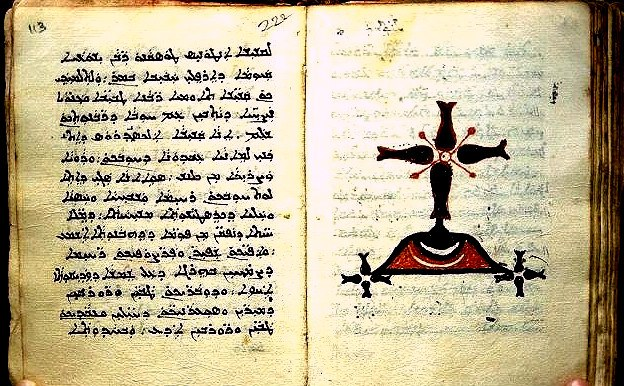

## LESSON 12

### Fringes of Syntax: Demonstratives, Numbers, and Conditionals

  
  
<em>Illuminated cross and concluding liturgical text in Syriac.</em>

---

#### Section 1: Review of Lesson 11

**Quick Summary**

In Lesson 11, we examined how Syriac attaches direct object pronouns directly to the verb, creating a highly compressed "fast direct object" (e.g., *qaṭl-eh*, "he killed him" vs. *qṭal l-eh*, "he killed to-him").

**5-Question Warm-Up Drill**

*(Answers in Section 9)*

1. How does Syriac buffer the 1st person singular object suffix on a Peal perfect verb?
2. Translate: *Parq-anī* (and contrast it with *Pruqaynī!*).
3. Break down the components of *qṭal ʾennōn*.
4. Why does *qṭal* become *qaṭl-* when adding a light (vowel-initial) suffix?
5. Translate the double-determined phrase: *ʾAssyeh ʾAlāhā l-malkā*.

---

#### Section 2: Demonstratives and Numbers — Overview

As we wrap up our core tour of Syriac syntax, we encounter the final few connective tissues that hold sentences together: Demonstrative pronouns (this, that, these, those) and Numbers.

**Cross-Linguistic Comparison: Demonstratives**

Semitic languages feature a close-range pointing word ("this") and a far-range pointing word ("that").

*   **Hebrew**: זֶה (*zeh* — this, m), הַהוּא (*hahūʾ* — that, m).
*   **Arabic**: هَذَا (*hādhā* — this, m), ذٰلِكَ (*dhālika* — that, m).
*   **Syriac**: ܗܢܐ (*hānā* — this, m), ܗܘ (*haw* — that, m). 

*Syriac Trick*: The far demonstrative ("that", *haw* ܗܘ) is spelled with the same consonants as the 3rd person independent pronoun (*hū* ܗܘ = he/it), distinguished in pointed texts by a supralinear vs. sublinear dot. Context dictates the meaning.

---

#### Section 3: Demonstratives & Syntax Rules

**1. Pointing Words (Demonstratives)**

Demonstratives in Syriac must agree with the noun they modify in gender and number.
Unlike English (which puts "this" *before* the noun: "this king"), Syriac prefers to place the demonstrative *after* the noun, or even isolated at the front of a sentence.

*   *Malkā hānā* = This king (The king, this one).
*   *Malkūtā hādē* = This kingdom.
*   *Gabrē hālēn* = These men.

**2. Conditional Clauses (`ʾen`)**

Syriac expresses "If X, then Y" using the particle *ʾen* (if). 
The "if" half of the sentence is the *protasis*, and the "then" half is the *apodosis*. Usually, Syriac doesn't even use a word for "then"; it simply starts the second clause, often with `w-` (and).

*   *ʾEn teḥzē, teddaʿ* (If you see, [then] you will know).

**3. Comparatives (`men`)**

Syriac lacks special adjective forms for "bigger," "faster," or "better" (like Greek's -τερος or English's -er). Instead, it uses the standard adjective and the preposition `men` (from/than).

*   *Nūhrā ṭābā hū men ḥešūḵā* (Light is good from darkness $\rightarrow$ Light is **better than** darkness).
*   *Rabbā hī men malkūtā* (She is great from the kingdom $\rightarrow$ She is **greater than** the kingdom).

---

#### Section 4: Demonstrative Pronoun Paradigm

| Distance | Gender / Number | Estrangela | Translit | Translation |
| :--- | :--- | :--- | :--- | :--- |
| **Close** | Masc Sg | ܗܢܐ | hānā | this (m) |
| **Close** | Fem Sg | ܗܕܐ | hādē | this (f) |
| **Close** | Common Pl | ܗܠܝܢ | hālēn | these (c) |
| **Far** | Masc Sg | ܗܘ | haw | that (m) |
| **Far** | Fem Sg | ܗܝ | hāy | that (f) |
| **Far** | Masc Pl | ܗܢܘܢ | hānōn | those (m) |
| **Far** | Fem Pl | ܗܢܝܢ | hānēn | those (f) |

---

#### Section 5: The Numbers 1-10

Semitic numbers from 3 to 10 famously exhibit "gender polarity"—masculine nouns take the numeral form ending in *-ā* (which looks morphologically feminine), while feminine nouns take the short numeral form without *-ā*. For 1 and 2, the numeral agrees directly in gender with the noun.

| Number | With Masc. Nouns | With Fem. Nouns | Meaning |
| :--- | :--- | :--- | :--- |
| **1** | ܚܕ (ḥad) | ܚܕܐ (ḥdā) | (One) |
| **2** | ܬܪܝܢ (trēn) | ܬܪܬܝܢ (tartēn) | (Two) |
| **3** | ܬܠܬܐ (tlātā) | ܬܠܬ (tlāt) | (Three) |
| **4** | ܐܪܒܥܐ (ʾarbaʿā) | ܐܪܒܥ (ʾarbaʿ) | (Four) |
| **5** | ܚܡܫܐ (ḥamšā) | ܚܡܫ (ḥammeš) | (Five) |
| **6** | ܫܬܐ (štā) | ܫܬ (šet) | (Six) |
| **7** | ܫܒܥܐ (šabʿā) | ܫܒܥ (šbaʿ) | (Seven) |
| **8** | ܬܡܢܝܐ (tmānyā) | ܬܡܢܐ (tmānē) | (Eight) |
| **9** | ܬܫܥܐ (tešʿā) | ܬܫܥ (tšaʿ) | (Nine) |
| **10** | ܥܣܪܐ (ʿesrā) | ܥܣܪ (ʿsar) | (Ten) |

---

#### Section 6: Vocabulary (Concepts & Concluding Words)

| Estrangela | Transliteration | Gender | Meaning | Notes |
| :--- | :--- | :--- | :--- | :--- |
| ܫܪܪܐ | šrārā | m. | truth, reality | Root š-r-r (to be firm). Cf. Heb *ʾĕmet* |
| ܫܠܡܐ | šlāmā | m. | peace, greeting | Root š-l-m. Heb *Shalom*, Arabic *Salam* |
| ܚܝܐ | ḥayyē | m.pl. | life | Used heavily by John in the NT |
| ܥܠܡܐ | ʿālmā | m. | world, eternity | Temporal and spatial boundary |
| ܗܟܢܐ | hākannā | adv. | thus, so | Also shortened to ܗܟܢ *hākan* |
| ܐܢ | ʾen | conj. | if | Introduces condition |
| ܚܫܘܟܐ | ḥešūḵā | m. | darkness | Antonym of *nūhrā* (light) |
| ܫܠܚ | šlaḥ (Peal) | verb | to strip off / send | Used for stripping off garments or sin |

---

#### Section 7: The Story — Part 12

**The Departure**

*Narrative note: The conclusion of the initial cycle of Mar Yukhannan's acts. The king uses a conditional statement ("If any man...") to establish a new decree. The section closes with a demonstrative and thematic "peace".*

**Sentence 1**

ܟܕ ܐܣܝܗ ܝܘܚܢܢ ܠܡܠܟܐ ܡܠܟܐ ܩܡ
kad ʾassy-eh Yūḥannan l-malkā, malkā qām.
kad (when) ʾassy-eh (he-healed-him) Yūḥannan (John) l-malkā (to/the-king), malkā (the-king) qām (stood-up).
→ When Yukhannan healed the king, the king stood up.

**Sentence 2**

ܘܐܡܪ ܠܥܡܐ ܕܝܠܗ ܗܟܢܐ
w-ʾemar l-ʿammā d-īl-eh hākannā:
w-ʾemar (and-said) l-ʿammā (to-the-people) d-īl-eh (which-were-his) hākannā (thus):
→ And he said to his people thus:

**Sentence 3**

ܐܢ ܐܝܢܐ ܒܪܢܫܐ ܠܐ ܢܫܠܚ ܚܛܝܬܐ ܕܝܠܗ ܢܩܛܠܘܢܝܗܝ
ʾen ʾaynā barnāšā lā nešlaḥ ḥṭītā d-īl-eh, neqṭlūn-yhy!
ʾen (If) ʾaynā (which/any) barnāšā (man) lā (not) nešlaḥ (will-cast-away) ḥṭītā (sin) d-īl-eh (which-[is]-his), neqṭlūn-yhy (they-will-kill-him)!
→ "If any man does not cast away his sin, they shall kill him!"

**Sentence 4**

ܝܘܚܢܢ ܐܡܪ ܠܡܠܟܐ ܠܐ ܗܟܢܐ
Yūḥannan ʾemar l-malkā: lā hākannā.
Yūḥannan (John) ʾemar (said) l-malkā (to-the-king): lā (not) hākannā (thus/so).
→ Yukhannan said to the king: "Not so."

**Sentence 5**

ܐܠܗܐ ܕܫܪܪܐ ܫܒܩ ܠܒܝܫܐ
ʾAlāhā d-šrārā šbaq l-bīšā.
ʾAlāhā (God) d-šrārā (of-truth) šbaq (forgave) l-bīšā (to-the-evil-one / evil).
→ "The God of truth forgave the evil."

**Sentence 6**

ܢܘܗܪܐ ܗܢܐ ܛܒܐ ܗܘ ܡܢ ܚܫܘܟܐ
nūhrā hānā ṭābā hū men ḥešūḵā.
nūhrā (the-light) hānā (this) ṭābā (good) hū (it-[is]) men (from) ḥešūḵā (darkness).
→ "This light is better than darkness."

**Sentence 7**

ܘܫܒܩ ܝܘܚܢܢ ܠܡܠܟܘܬܐ ܒܫܠܡܐ ܘܐܙܠ ܒܐܘܪܚܐ ܕܥܠܡܐ
w-šbaq Yūḥannan l-malkūtā b-šlāmā, w-ʾezal b-ʾūrḥā d-ʿālmā.
w-šbaq (and-left) Yūḥannan (John) l-malkūtā (the-kingdom) b-šlāmā (in-peace), w-ʾezal (and-went) b-ʾūrḥā (in-way/road) d-ʿālmā (of-eternity/the-world).
→ And Yukhannan left the kingdom in peace, and went in the way of eternity.

---

#### Section 8: Exercises

**Exercise 1: Demonstrative & Number Identification**

Identify the gender, number, and meaning of these modifiers.

1. ܗܕܐ (hādē)
2. ܬܠܬܐ (tlātā)
3. ܗܢܘܢ (hānōn)
4. ܚܕܐ (ḥdā)

**Exercise 2: Comparative Translation**

Translate these sentences using `men` as a comparative.

1. ʾAlāhā rabbā hū men malkā.
2. Ḥayyē ṭābīn hennōn men mawtā.
3. ʾArʿā hādē bīštā hī men šmayyā (heaven).

**Exercise 3: Translation Drill (Syriac → English)**

Translate the following conditional and demonstrative clauses.

1. ʾEn tešbūq l-ʾAlāhā, neqṭūl lāḵ malkā hānā.
2. Gabrā haw npal b-kurhānā.
3. W-ʾetaw talmīdē hālēn l-bayteh.
4. Lā hākannā ʾemar Yūḥannan b-šrārā.

**Exercise 4: Production Drill (English → Syriac)**

Render the following sentences into Syriac transliteration.

1. This word (f.sg) is better than that word.
2. If you (m.pl) hear the voice, you will live (ḥ-y-y, imperfect).
3. The three men went out from the kingdom. (Three = *tlātā*).
4. God saved this evil world (*ʿālmā hānā*).

**Exercise 5: Reading Comprehension**

Re-read Section 7 and answer:

1. What extreme punishment does the king decree for those who do not cast away their sin?
2. How does Yukhannan correct the king's theology?
3. With what emotion or state does Yukhannan depart the kingdom?

---

#### Section 9: Answer Key

**Section 1 Warm-Up**

1. It inserts a *Nun* (n) in the 1st person singular object suffix, e.g., *qaṭlanī*.
2. *Parqanī* means "He saved me" (3 m.sg. Peal perfect + 1 c.sg. suffix); *Pruqaynī!* means "Save me!" (2 m.sg. Peal imperative + 1 c.sg. suffix).
3. 3 m.sg. Peal perfect *qṭal* ("he killed") followed by the 3 m.pl. enclitic object pronoun *ʾennōn* ("them") = "He killed them."
4. The addition of the vowel-initial suffix shifts the syllable structure, causing the vowel *a* to move after the first radical (*qṭal* + *-eh* $\rightarrow$ *qaṭ-leh*).
5. "God healed him, the king" (Double determination using the suffix *and* the preposition *l-*).

**Exercise 1: Identification**

1. Feminine singular close (This, f)
2. Number three (used with masc nouns)
3. Masculine plural far (Those, m)
4. Number one (f)

**Exercise 2: Comparative Translation**

1. God is greater than the king.
2. Life is better than death.
3. This earth is worse than heaven.

**Exercise 3: Translation Drill**

1. If you abandon God, this king will kill you.
2. That man fell into illness.
3. And these disciples came to his house.
4. "Not so" said Yukhannan in truth.

**Exercise 4: Production Drill**

1. Meltā hādē ṭābtā hī men meltā hāy.
2. ʾEn tešmʿūn qālā, tēḥūn / teḥyūn.
3. Tlātā gabrīn npaqū men malkūtā.
4. ʾAlāhā praq l-ʿālmā hānā bīšā.

**Exercise 5: Reading Comprehension**

1. They will be killed (*neqṭlūn-yhy*).
2. By reminding him that the God of truth forgave the evil ("Not so," *lā hākannā*).
3. In peace (*b-šlāmā*).

---

#### Section 10: Grammatical Summary

**DEMONSTRATIVES**

| Close (This / These) | Far (That / Those) |
| :--- | :--- |
| hānā (m) / hādē (f) | haw (m) / hāy (f) |
| hālēn (pl) | hānōn (m.pl) / hānēn (f.pl) |

**CONDITIONALS & COMPARISONS**

| Construction | Example | Meaning |
| :--- | :--- | :--- |
| `ʾen` (If) + Imperf | ʾen teḥzē | If you see... |
| Adj + `men` (from) | ṭābā men malkā | Better than the king |
| Noun + Demonstrative | malkā hānā | This king |

#### Section 11: Additional Vocabulary

The following 8 high-frequency words and ordinal/cardinal reference forms supplement this lesson's core vocabulary.

| Syriac (Estrangela) | Transliteration | Part of Speech | Meaning | Notes |
| :--- | :--- | :--- | :--- | :--- |
| ܬܘܪܓܡܐ | tūrgāmā | m. noun | translation, interpretation, homily | from t-r-g-m |
| ܐܝܟܢܐ | ʾaykannā | adv | how, in what manner | interrogative/relative |
| ܡܟܐ | mekkā | adv | from here, hence | men + kā |
| ܠܐ | lā | neg_adv | not, no | negation/discourse |
| ܕܘܟܬܐ | dūktā | f. noun | place, position | emphatic of dūkkā |
| ܩܕܡܝܐ | qadmāyā | m. adj | first, former | ordinal numeral |
| ܬܪܝܢܐ | trayyānā | m. adj | second | ordinal numeral from trēn |
| ܬܠܝܬܝܐ | tlītāyā | m. adj | third | ordinal numeral from tlātā |

